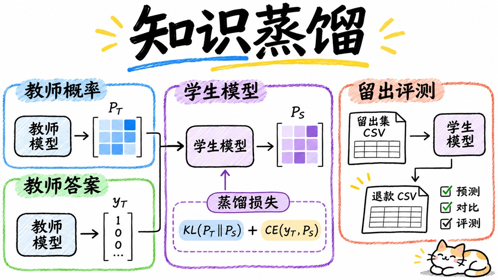
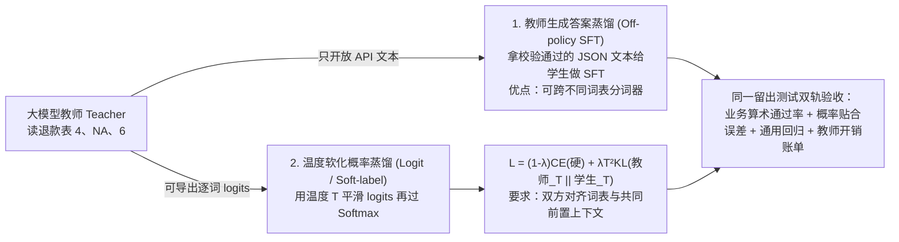

> **生成工具**：Codex\
> **生成模型**：gpt-6.2-sol

假设咱们已经打磨出一尊身经百战的「大神教师模型」（比如百亿千亿级大参数，推理极准但又慢又烧卡）来看守退款规则：CSV 里的 `0` 算有效金额、`NA` 算缺失。可线上每分钟几千次表格扫描请求，真要用这么大的教师模型去扛算力账单直接炸裂——于是我们打算找一个身材小巧、跑得飞快的「学生小模型」来顶班！

这时候怎么教学生就有讲究了：是仅仅把教师算出来的**硬邦邦最终答案（1 或 0、或者那串完整 JSON）**抄下来做常规微调？还是请教师直接亮出自己心底的**软概率偏好（比如「我觉得有九成把握算有效，但留一成谨慎怀疑」）**让小模型照猫画虎？这就是**知识蒸馏（Knowledge Distillation）**！只要讲清楚学生到底在学教师产出的哪一种信号，大小模型的架构、参数量甚至分词器都可以大不相同。[知识蒸馏论文](https://arxiv.org/abs/1503.02531)

> **先用大白话讲明白**：硬标签微调 vs 软标签蒸馏，就像**学霸辅导学渣备考选择题**：
> - **只给硬标签 / 教师文本（给答案抄写）**：学霸只甩给你一张写着 `选 B` 的答案纸（或者一整篇教师写的 JSON 范文），你只知道 A、C、D 全错、B 是对的，根本不知道 C 其实是很有迷惑性的近义陷阱而 D 纯属瞎胡闹。好处是只要答案干净文本就行，老师和学生哪怕各自用完全不同的词表（词库不同）也能顺利跨架构学习（**Response-based SFT 蒸馏**）。
> - **软标签概率蒸馏（教你各选项心里的真实底气）**：学霸不仅写 `选 B`，还通过**温度 `T` 放大镜**把原本高度集中的打分稍微拍扁平滑一点告诉你：「这题 B 我有 `73%` 把握，C 有点像占 `27%`」——学生顺着这份丰富的相对概率分布（所谓的「暗知识 Dark Knowledge」）去学，不仅答得对，连老师心底对边界情况的不确定度分寸也一并学到手！不过既然要逐词对齐概率分布，就要求老师和学生共享对齐的词表概率轴（**Logit Distillation**）。



## 1. 同一张退款表，教师能交给学生的三种信号

看表里 `4`、`NA`、`6` 三行金额，真正的逐行有效判定标签是 `[1, 0, 1]`（再送给固定聚合逻辑稳稳得出 `{"count":2,"mean":5}`）。同一位懂行教师可以递出截然不同的三种教学原料：

| 蒸馏信号路径 | 学生在每条训练样本上真正看到什么？ | 它的训练目标怎么发力？ | 对词表与接口有什么门槛？ |
| --- | --- | --- | --- |
| **硬标签（Hard Label）** | 只给 `[1, 0, 1]`（非黑即白 `0/1`） | 拼命把正确类的概率拉高向 `1.0` 靠近（反向压低错误类到 `0.0`） | 无特殊要求，有真实答案即可 |
| **软标签（Soft Label / Logits）** | 教师给出逐行有效软概率，如 `[0.9, 0.1, 0.9]` | 逼着学生预测的整套概率分布去贴紧教师这份软分布 | 必须拿到完整分类/词表概率且双方概率轴严格一一对齐 |
| **教师回复文本（Response Distillation）** | 教师自己推理吐出的完整合格 JSON（或含思考链文本） | 校验通过后当作标准答案，直接对学生做普通文本 SFT | 只要文本，**完美跨不同分词器与词表！**（最流行于闭源/超大模型往小模型蒸馏） |

> **容易踩的坑（黑盒接口局部概率与对齐坑）**：如果你只有在线 API、拿不到开源权重的全词表 logits，千万仔细！一是拿**教师文本蒸馏**时务必存下输入、教师模型号、采样参数并拿确定性验证程序过滤掉教师算错的垃圾文本；二是若想对比概率分布（Logits 蒸馏），记住教师跟学生**哪怕底层架构跨代，也必须在同一固定前缀下按完全一致的分词定位对齐才能相减**——有些闭源 API `top_logprobs` 只肯返给你前 5 个或前 20 个高分候选 Token 的概率，剩下的长尾概率全都丢了，工程上一定要写清这截缺失概率质量是做截断忽略还是统一重归一！

## 2. 从原始 Logit 分数到平滑概率，再到联合损失公式

**Logit** 就是大模型最后一层还没经过概率转换、直接分给各个类别（或词表项）的原始实数打分。加一个标量**温度 `T`（Temperature）** 除以全部类别后做 **Softmax（指数归一化）**，手算一遍感受温度的神奇作用：

假设教师给「有效 / 缺失」二分类吐出原始分 `[2, 0]`：
- 当 **`T = 1`**（原样不加热）：第一类概率 `e² ÷ (e² + e⁰) = 7.389 ÷ 8.389 ≈` **`0.8808`**（88% 把握，较自信）；
- 当把温度拧大到 **`T = 2`**（除以 2 再算 Softmax）：原始差从 `2` 缩成 `[1, 0]`，第一类概率立刻软化到 `e¹ ÷ (e¹ + e⁰) = 2.718 ÷ 3.718 ≈` **`0.7311`**！原本极不起眼的错误弱项一下子被抬到了近 `27%` 的可见权重——**温度越高，教师暗地里流露出来的相对强弱分布就摊得越平、信息越不至于被零头彻底吞没！**

蒸馏时，让教师和学生双双挂着同一温度 `T` 算出软概率，然后和传统硬标签损失拼成一个加权总目标：

```text
L = (1 - λ) × CE(硬标签, 学生 T=1) + λ × T² × KL(教师 T || 学生 T)
```

把公式里的四个零件一次读明白：
- **`CE`**：交叉熵（Cross-Entropy），拉着学生别忘记贴合真实对错标签；
- **`KL`**：库尔贝克–莱布勒散度（Kullback–Leibler Divergence），衡量学生那组带温度的分布和教师分布有多不相像（使用自然对数时，两者单位均为 **nat**）；
- **`λ`（Lambda）**：在 `0` 到 `1` 之间的平衡权重，决定听真答案多一点还是模仿教师神韵多一点；
- **神秘的 `T²` 系数是干嘛用的？** 因为我们在算 Softmax 之前提前把 Logit 除以了一个 `T`，链式求导回到 logits 时，梯度幅度会被顺带着缩小 `1 / T²` 倍！为了确保无论温度 `T` 拧到 2 还是 5，梯度更新力度都和前面的 `CE` 处于同一个量级而不致于哑火，公式特意显式乘回 **`T²`** 补偿掉！

（下方极简代码实验为了直观演示硬软标签本身差距，直接给学生喂设定好的 `0.9 / 0.1` 软目标相当于令 `T = 1`；当教师分布已经死死冻住不变时，对学生做软交叉熵求导与最小化 `KL(教师 || 学生)` 仅仅相差一个常数（教师自身的固定熵），两者算出的学生参数梯度分毫不差！）

## 3. 固定学生与步数实测：看软标签如何把偏差甩掉 485 倍！

仓库里的 [experiments/trn-post-training/run_toy.py](../../experiments/trn-post-training/run_toy.py) 写了一个零依赖纯 Python 的可控对照（`distill()` 函数，实测 JSON 见 [toy-results.json](../../experiments/trn-post-training/toy-results.json)）：
- 构建一个仅带 **2 个特征权重**的小型逻辑回归二分类器负责判定「退款某一行要不要计入有效金额」；
- 每行仅抽两个特征，全用 `±1` 编码：**`[是否非空, 是否非零]`**——于是正数 `4` 是 `[+1, +1]`，有效 **`0`** 是 **`[+1, -1]`**，缺失 **`NA`** 是 **`[-1, -1]`**！
- **绝对控制单一变量**：两条路线全部从全零权重 `[0.0, 0.0]` 起步，在完全相同的 4 张训练表、完全一致的学习率下跑满 **`100` 步**：
  - **硬标签学生**：只见 `1 / 0`（有效或无效）；
  - **软标签学生**：直接学教师给出的软目标 `0.9 / 0.1`（留一点柔和边界）。

预测概率超过 `0.5`（对应逻辑回归对数几率 > `0`）就计入有效，随后交由同一统计程序聚合成 `count` 与 `mean`。看看 100 步之后交出的答卷：

| 学生接受的监督方式 | 学出来的两个特征权重 `[非空, 非零]` | 留出 4 张表整表全对 | 相对教师软概率均方误差 (MSE) |
| --- | --- | ---: | ---: |
| **硬标签 (`1.0 / 0.0`)** | `[4.017371, 0.782875]` | `4/4` | **`0.007519`** |
| **软标签 (`0.9 / 0.1`)** | **`[2.150131, 0.047085]`** | `4/4` | **`0.00001549`**（狂降 **485 倍**！） |

> **想再深入一层？（看穿那组学出来的权重数字有多神奇！）**
> 这两个数字背后藏着蒸馏最漂亮的一课！
> 1. 硬标签因为要求学生向绝对概率 `1.0` 和 `0.0` 无穷冲刺，逼得逻辑回归两个权重一起狂飙——不但把真有用的「是否非空」推到 `4.017`，还把其实**完全无关紧要的「是否非零」干扰特征也推到了 `0.783`**；
> 2. 而软标签（`0.9 / 0.1`）有明确的有限停手边界（对数几率 `ln(9) ≈ 2.197`），100 步内不仅精准把有用的特征锚定在 `2.150`，顺手把无用的干扰特征压扁到接近 `0` 的 **`0.047`**，留出表上的概率误差从 `0.007519` 跌到极其贴合教师的 **`0.00001549`**！两个学生虽然都把 `[4, NA, 6]`、`[NA, 0]`、`[NA, NA]`、`[0, 8, NA]` 这 4 张留出表全算对了（共享了相似的零/缺失/非零行规律），但软标签学生显然对真实置信度学得远更干净扎实。（当然，这个 2 参数微型实验只为检验训练信号怎么拉动权重，并不拿来推论通用跨分布能力。）

本地秒跑验证：

```bash
python3 experiments/trn-post-training/run_toy.py --out /tmp/trn-toy.json
```

> **大白话小结**：要把这一套方法搬上真实的生成式大模型做选型对照，记住控制变量五件套：**同一组输入集、同一个学生起始权重、相等的总训练 Token 预算**。左边用纯人工答案微调，右边拿经过校验程序筛选过关的教师答案/软分布蒸馏；对比成绩单至少分栏列出：业务计算正确率、JSON 格式合格率、通用百科问答能力有没有退化、以及背后一共烧了多少次教师前向调用费用（如果做概率蒸馏，顺便把几百 GB 预保存词表概率矩阵的磁盘 IO 开销也算进总成本账本里！本示例规则教师本地算零费用）。

## 下一篇

不管是教微调还是搞蒸馏，如果原本训练集里全都是「正数 + `NA`」，压根一条带有 **`0`** 的记录都没有——那哪怕是神仙算法训出来的模型，也分不清「`value is not None`（非空才保留）」和「`bool(value)`（在 Python 里会把整数 `0` 误判成 `False` 直接剔掉！）」这两条完全不一样的规则！怎么有目的性地批量**制造高价值合成数据**补上盲区、并用**语义防重复锁**守住留出测试集不被污染？[**TRN-12《合成训练数据，从候选生成到留出评测》**](trn-12-synthetic-training-data.md) 带你亲自堵上这个盲点！

[返回 LLM 与 Agent 学习路线图](https://blog.lacknb.cn/articles/2026/11/19/1795058329577.html)
