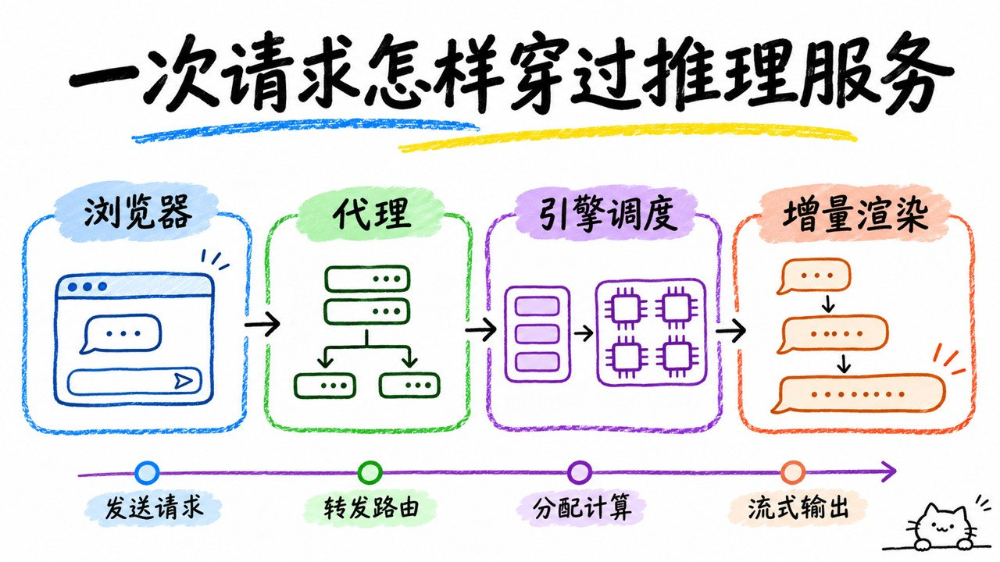
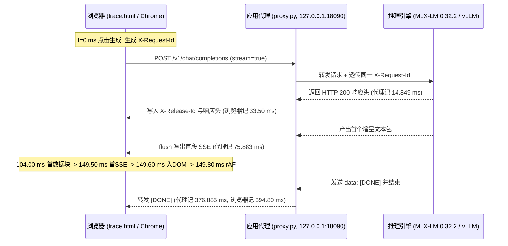

> **生成工具**：Codex\
> **生成模型**：gpt-6.2-sol

做过大模型网页产品的工程师几乎都踩过同一个迷魂阵：测试用户抱怨「点了生成之后页面干瞪眼好久才刷出字」，你打开浏览器开发者工具一看，`POST /v1/chat/completions` 明明十几毫秒就绿了 `200 OK`——那时间到底卡在了哪儿？是浏览器还没拼好流、是中间的 Python/Nginx 代理偷偷把流憋住了，还是底层 GPU 根本连第一个字都还没算出来？

今天我们让老朋友退款表 `4`、`NA`、`6` 走一遍从**用户浏览器按钮 -> 本机中转代理 -> 推理引擎 -> 再流式传回屏幕**的完整往返，顺带给你展示一套能直接装进自己项目排查耗时卡点的全链路追踪工具。

> **先用大白话讲明白**：追踪一次端到端流式请求，就像**顺着一张全局唯一的快递跟踪单号（`X-Request-Id`）查这件包裹经过三道驿站的分段计时账**：
> - **第一站：浏览器（发单并等上屏幕）**：用网页的 `fetch` 把 JSON 寄出去，收到回执信封头（`HTTP 200`）并不代表包裹里有字！它必须一边等网络分片（Chunks），一边拿 **`TextDecoderStream`** 防止半个中文汉字在字节边界被切碎乱码，凑够整条 `data:` 再追加进网页（DOM），接着等屏幕下一次刷新画上屏幕（`requestAnimationFrame`）。
> - **第二站：中间应用代理（鉴权与中转）**：业务网关接住浏览器请求、打上发布号和跟踪号转给模型引擎。它心里记着两块时间——引擎什么时候回响应头，以及自己到底啥时候把第一行数据往浏览器推过去。
> - **第三站：推理引擎（分词排号吐 Token）**：收到消息串 -> 拼模板分词 -> 等调度批排上队算出一个新字 -> 包装成 SSE 吐给代理。
> - **记死跨进程秒表铁律**：浏览器的 `performance.now()` 是从「点击生成瞬间」归零起步，代理的 `time.perf_counter()` 是从「代理收到请求瞬间」归零起步——**两只手表零点压根不在同一刻！同一只表里允许做减法算区间，跨进程只能靠同一张 `X-Request-Id` 把各自记录摆在一起对照排查，绝不能把两个进程的时间直接乱相减！**



## 1. 全链路拆解：六道关卡各收什么输入、往后交什么结果？

把请求剖开成六个接力棒来看，每一层视野里究竟有啥一清二楚：

| 流转关卡 | 这一关收到了什么？ | 加工之后交给下一关什么？ |
| --- | --- | --- |
| **1. 浏览器请求侧** | 用户点按操作 + `4、NA、6` 表单 | 用 `fetch` 发起的 JSON 请求体 + 自动生成的 `X-Request-Id` |
| **2. 应用接入代理** | HTTP 请求行、请求头、完整字节体 | 校验长度、限制并发槽位后，透传同个 `X-Request-Id` 发给引擎 |
| **3. 推理引擎网关** | `messages`、逻辑 `model` 名、采样参数 | 套入模板、切出提示 Token、分配引擎内部请求 ID 与预算 |
| **4. 调度器与 Worker** | 可排队的上下文与当前 KV 块表 | 每轮前向算出的新 Token ID 与完成/停止标志 |
| **5. 输出解码与回传代理** | 新产生的 Token ID、停止原因 | 反解码回 UTF-8 字符，打包成标准 SSE 事件按行流回 |
| **6. 浏览器渲染闭环** | 网络底层零碎抵达的字节数组 `Chunk` | 经状态化 UTF-8 解码并按空行切完整事件，追加进页面元素 |

**SSE（Server-Sent Events）** 传输走的是普通分块 HTTP 数据流：底层 TCP 数据包可能半路切在某一行 JSON 中间，甚至硬生生把一个 3 字节的中文汉字劈成前两字节和后一字节分两趟送来！所以千万不要对每次 `reader.read()` 拿到的原始字节硬转字符串，看示范网页 [experiments/serving/trace.html](../../experiments/serving/trace.html) 第 67 行的写法——专门串了一层 **`TextDecoderStream()`**（有状态的流式 UTF-8 解码器，把劈开的半个汉字乖乖攥在缓存里等下一块补齐再吐出来），再沿着 `\n\n` 空行拼出完整 `data:` 文本交给 JSON 解析，写入页面 `DOM`（Document Object Model）后立即挂一个 `requestAnimationFrame` 记录下一次屏幕绘制周期回调（注：帧回调表示浏览器主线程已把最新文字提交进这一帧排版流程，真正落到物理显示器像素还会再经合成等底层一步）。

## 2. 本机运行实战追踪器，读懂真实时间线！

直接利用仓库自带的标准库小代理 [experiments/serving/proxy.py](../../experiments/serving/proxy.py) 拉起 `18090` 端口对接你身后的上游推理服务（这里选直通 `--mode flush`，遇到一次读一个行事件就马上往浏览器冲刷出去）：

```bash
python3 experiments/serving/proxy.py --upstream http://127.0.0.1:18080 \
    --port 18090 --mode flush
```

打开 Chrome 访问 `http://127.0.0.1:18090`（若上游后端是 MLX-LM 这种用 `default_model` 当默认名的服务，地址栏带上 `?model=default_model`）点下「生成」。代理不仅会在响应头里带回追踪 ID 与当前发布版本 `X-Release-Id`，还会同步打印上游到达时间和往浏览器写出时间。此外别忘了大型调度器自身常另有内部追踪 ID（比如上一篇见到的 `chatcmpl-...`），生产日志里一定要存下一张「**外部网关 `X-Request-Id` <-> 引擎内部 Request ID**」的映射关系。

以下是真实跑在 **Apple M1 + Chrome + 后端 MLX-LM 0.32.2** 留下的全链路实测记录（见 [experiments/serving/browser.json](../../experiments/serving/browser.json) 的 `flush` 分支），两只独立的秒表共同锁定同一张追踪单号 **`browser-ae28e302-9a9b-43cd-8997-4e75776f3e49`**：

| 观察视角（各自从收到/触发归零的独立时钟） | 关键里程碑事件 | 各自实测时间戳 (`ms`) | 这一步排除了什么嫌疑？ |
| --- | --- | ---: | --- |
| **应用代理 (`proxy.py`)** | `upstream_headers_ms`（后端回响应头） | `14.849` | 上游建连与接单没卡住 |
| **应用代理 (`proxy.py`)** | `client_headers_ms`（转发响应头给浏览器） | `14.927` | 代理发头几乎零延迟 (`0.08 ms`) |
| **应用代理 (`proxy.py`)** | `first_write_ms`（推流写出首行增量） | `75.883` | 真正模型算第一轮花了大约六十多毫秒 |
| **应用代理 (`proxy.py`)** | `elapsed_ms`（收尾关闭） | `376.885` | 全代理往返完毕 |
| **Chrome (`trace.html`)** | `HTTP 响应头` 收到 | `33.50` | 对得上！只是信封到了，没一个字 |
| **Chrome (`trace.html`)** | `第一个数据块` (`reader.read()`) | `104.00` | 第一段字节跨越进程到浏览器缓冲区 |
| **Chrome (`trace.html`)** | `第一条 SSE` + `第一段文字入 DOM` + `下一帧回调` | `149.50` -> `149.60` -> `149.80` | 仅耗时 ~0.3 ms！浏览器渲染丝毫没拖后腿 |
| **Chrome (`trace.html`)** | `[DONE]` 结束事件抵达 | `394.80` | 整套流式顺利落幕 |

> **容易踩的坑（业务正确性依旧独立核对！）**：看看这次全程走得如此顺滑完美的流式请求，屏幕最后到底给用户印出了什么字？`browser.json` 忠实记下了输出：**`"Count: 3\nMean: 4.0"`**——因为这个基础提示没有严格式约束且小模型把空值算成了 3 行，算术完全不对！再次印证：**协议畅通、流式收工、业务正确，永远是三份各自独立、缺一不可的验货证明！**

## 3. 拿到时间线之后，出现白屏/没字卡顿一眼怎么排查？

学会了分段打点，遇到用户报错时按这套定位逻辑三秒定责任：
- **响应头早就绿了（`33.5 ms`），可后续很久没收到首条文字事件**：这极其正常——`200` 响应头经常只代表连接接通、代理透传了初始 `"role": "assistant"` 空头块，此时模型本体可能还在队列里排队、或者正在艰难地算长上下文的 Prefill！把 `upstream_headers_ms` 和 `first_write_ms` 一减就知道是不是卡在推理引擎里。
- **整个流走完却一直空屏没字**：拿上那张 `X-Request-Id` 沿着「浏览器 -> 代理 -> 引擎」顺序三处比对：**浏览器收到的最后一条状态是不是报错 JSON？有没有真的等到 `data: [DONE]`？代理 `outcome` 打印的是 `complete`、`connection_closed` 还是 `upstream_unavailable`？**
- **前端突然一大段字在一瞬之间猛弹出来（不是逐字打字机）**：十有八九是代理层开启了缓冲或者 gzip 压缩！留到 **SERV-05** 我们会故意开开 `proxy.py --mode buffer` 复现这个经典故障！[Fetch API 规范](https://developer.mozilla.org/docs/Web/API/Fetch_API)

## 下一篇

在刚才那条流程里，浏览器把文字交到引擎门前就停下了。可大门里面——从 `POST /v1/chat/completions` 踏进 **vLLM V1** 代码仓库的第一行入口开始，这串退款请求到底在哪些进程间穿梭、被谁渲染成哪些精确 Token ID、又是怎么轮到 `GPUModelRunner` 上去真算一步前向的？[**SERV-03《读 vLLM V1 源码，从路由跟到模型前向》**](serv-03-vllm-v1-source.md) 会锁定精准 Commit 版本，带你按图索骥读一遍真实核心源码链路！

[返回 LLM 与 Agent 学习路线图](https://blog.lacknb.cn/articles/2026/11/19/1795058329577.html)
