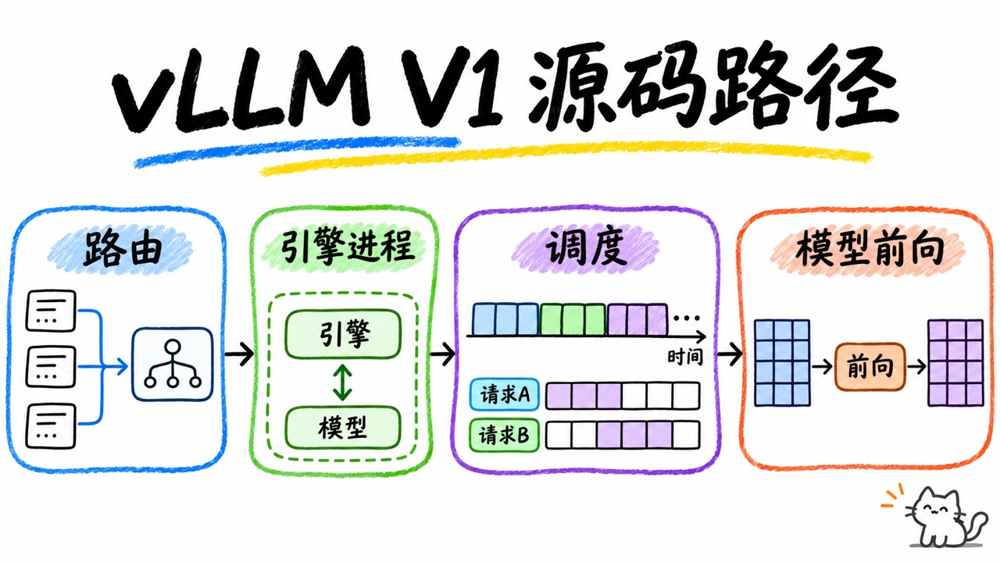
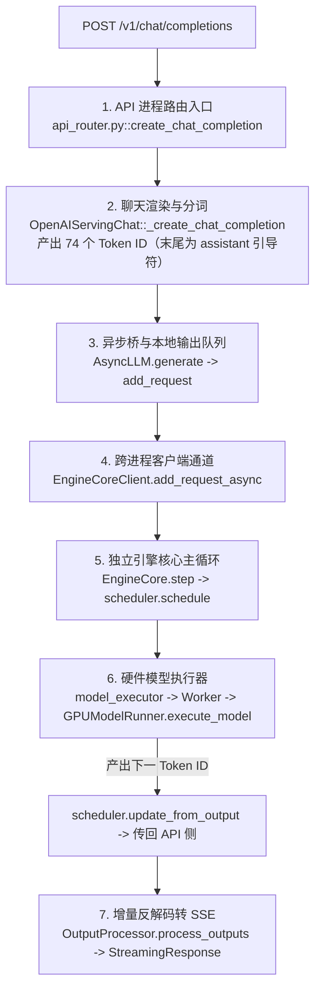

> **生成工具**：Codex\
> **生成模型**：gpt-6.2-sol

很多开发者天天用 `vllm serve` 启动模型，可一旦碰到诡异的性能抖动、聊天模板格式对不上、或者流式输出卡顿，打开几百个文件的 vLLM 仓库瞬间两眼一抹黑，根本不知道从哪个 `.py` 文件看起。

其实无论框架封装多厚，同一份 `4`、`NA`、`6` 退款请求的宿命只有一条：**进门时是人能看懂的 JSON 消息数组，进引擎计算核心前必须脱胎换骨成冰冷的整数 Token ID，算完吐出一个整数后再重新穿回文字衣裳通过网络送给用户**。今天我们死死锁定 vLLM **`v0.33.0rc3`**（精准 Git Commit `4ba787ec9959e566d3b587a796dff07673324da5`），顺着这趟旅程摸清 vLLM V1 最核心的六站源码路标（源码路径与函数名均严格核对于该指定版本）。[固定版本源码](https://github.com/vllm-project/vllm/tree/4ba787ec9959e566d3b587a796dff07673324da5) · [V1 架构总览](https://docs.vllm.ai/en/stable/design/arch_overview/)

> **先用大白话讲明白**：**vLLM V1 架构**为了避免繁重的 Python Web 解析与异步处理卡死宝贵的 GPU 算力周期，干脆把服务硬拆成了**「前厅门童进程（API Process）」+「独立后厨核心进程（Engine Core Process）」**两套车间协同打工：
> 1. **前厅接单翻译（API 侧：`OpenAIServingChat` + `AsyncLLM`）**：门童接下你的 HTTP JSON 点菜单，用 `render_chat_request` 按模型自带菜单模板翻译成一串密码编号（`74` 个整数 Token ID），写好追踪单号后异步塞进传菜滑槽（`EngineCoreClient`）放手去接下一桌客人的单子；
> 2. **后厨拼桌主厨（核心侧：`EngineCore.step` + `Scheduler`）**：独立进程里的调度器不停高速循环转圈，看看谁新进了、谁还在生成下一口字、哪几个 KV Cache 显存块空闲着，拍板开出一份本轮拼桌指令 **`SchedulerOutput`**；
> 3. **灶台大厨 + 前厅还字（Worker + `OutputProcessor`）**：各卡上的执行器（CUDA 下叫 `GPUModelRunner`）照着调度指令实算一遍模型前向，挑出新生成的 Token ID 丢回后厨，`EngineCore` 通知前台的 `OutputProcessor` 解码变成文字、塞入 SSE 流吐出去！

## 1. 前厅第一步：HTTP 路由接收、套聊天模板与分词落地

一次发向 `/v1/chat/completions` 的请求，进门第一脚踩在 FastAPI 路由注册函数 **`vllm/entrypoints/openai/chat_completion/api_router.py::create_chat_completion`** [路由入口](https://github.com/vllm-project/vllm/blob/4ba787ec9959e566d3b587a796dff07673324da5/vllm/entrypoints/openai/chat_completion/api_router.py)。它把 JSON 正文解析校验为强类型 `ChatCompletionRequest` 对象后，转身转交给 **`OpenAIServingChat.create_chat_completion`**（入口周围包着并发负载限制与客户端断开取消检测装饰器）：
- 要是业务方传了 `stream: false`，路由等待完整对象归来直接返回普通 JSON 响应；
- 要是带了 `stream: true`，且处理函数返回一个异步生成器，路由直接裹一层 FastAPI `StreamingResponse` 按 SSE 流往下推。

紧接着进入的核心在 **`OpenAIServingChat._create_chat_completion`** [聊天处理](https://github.com/vllm-project/vllm/blob/4ba787ec9959e566d3b587a796dff07673324da5/vllm/entrypoints/openai/chat_completion/serving.py)：它会先调 `render_chat_request` 把带有 `system`/`user` 角色的字典列表套进模型自备模板，彻底敲定分词边界和采样超参，再分配好内部追踪请求 ID 交给下一棒 `engine_client.generate`。

> **想再深入一层？（拿咱们的退款请求看看真实分词到底切出了什么！）**
> 把 `probe.py` 里发的那条真实退款对话拿来按固定版 Qwen2.5-0.5B-Instruct 分词器一跑（完整追踪归档于 [prompt-trace.json](../../experiments/serving/prompt-trace.json)）：
> - `system` + `user` 加上助手提示头一起精准切出了 **`74` 个整数 Token ID**；
> - 它最末端的那 **5 个整数** 分别是 **`[151645, 198, 151644, 77091, 198]`**——挨个查词表对照，它们严丝合缝对应着：用户消息的 **`<|im_end|>` (`151645`)**、换行 **`\n` (`198`)**、新消息头 **`<|im_start|>` (`151644`)**、角色 **`assistant` (`77091`)**、紧跟着的引导换行 **`\n` (`198`)**！这就印证了模型根本没见过什么 JSON 字符串，在推理起跑线前它眼里只看得到那 74 个冷冰冰的整数。

## 2. 后厨第二步：跨进程异步传单、核心调度循环与硬件计算

为了不让 Web 请求解析、JSON 序列化跟耗 CPU 的 Tokenizer/Detokenizer 拖拽核心 GPU 步进循环，vLLM V1 的后半段顺着这 6 个锚点在进程间精准交接：

| 所在进程与模块 | 你应该点开阅读的核心函数路标 | 这一步手里接过/递出去什么关键对象？ |
| --- | --- | --- |
| **API 进程异步层** | `AsyncLLM.generate -> add_request -> _add_request` | 组装好 `EngineCoreRequest`，同时在本进程建一个用来收结果的异步本地队列。 |
| **跨进程桥接层** | `EngineCoreClient.add_request_async` | 序列化请求通过进程间高速通道（ZMQ 等）扔去独立 EngineCore 进程。 |
| **核心主调度循环** | `EngineCore.step` -> `scheduler.schedule()` | **核心大脑**：清点待处理队列与显存空闲 KV 块，决断这一步拼哪几条一起算，输出 `SchedulerOutput`。 |
| **模型执行总控** | `model_executor.execute_model` | 把这批待算序列列表、各自算多少个新 Token 及对应物理 KV 块表号派给底层设备 Worker。 |
| **设备实际运算** | CUDA 下看 `Worker.execute_model` -> `GPUModelRunner.execute_model` | 构造 Attention 元数据，在显卡/加速卡上跑完一步前向，做完 Logits 采样挑出下个新 Token ID！ |
| **核心回流与前台拼字** | `scheduler.update_from_output` -> API 侧 `OutputProcessor.process_outputs` | 更新序列生成状态（判断是否遇到停止符或越界继续留下步），并将刚出的整数分发到对应用户队列增量解码成文字。 |

[异步引擎源码](https://github.com/vllm-project/vllm/blob/4ba787ec9959e566d3b587a796dff07673324da5/vllm/v1/engine/async_llm.py) · [EngineCore 源码](https://github.com/vllm-project/vllm/blob/4ba787ec9959e566d3b587a796dff07673324da5/vllm/v1/engine/core.py) · [Scheduler 源码](https://github.com/vllm-project/vllm/blob/4ba787ec9959e566d3b587a796dff07673324da5/vllm/v1/core/sched/scheduler.py) · [OutputProcessor 源码](https://github.com/vllm-project/vllm/blob/4ba787ec9959e566d3b587a796dff07673324da5/vllm/v1/engine/output_processor.py)

注意两点真实落地时的区别：
1. **KV Cache 与 Scheduler 的本质角色**：KV Cache（键值注意力缓存）存着算过的老历史向量，`SchedulerOutput` 正是每轮通知大厨「本轮给 A 算哪几个新位置、用哪个物理块、给 B 算哪几个新位置」的精密施工图；
2. **CUDA 主力路径 vs 多平台 Worker**：上面提及的 `GPUModelRunner` 是标准的 Linux NVIDIA CUDA 主路径；当你换成 CPU 镜像或 Apple Silicon 的 `vllm-metal` 插件时，API 侧接单依然相同，但底下挂载执行的会切换成对应后端自己的 Worker 实现。

## 3. 把源码静态路标跟真实启动/回包对上号

> **容易踩的坑（别混用真实观察证据和跨环境推测！）**：
> 在我们的本地验证记录里（所有数据忠实归档不跨环境混凑）：
> - 在 Linux ARM64 CPU 容器的 vLLM `0.21.0` 启动日志 [vllm-startup.json](../../experiments/serving/vllm-startup.json) 中，确实亲眼观察到了分离拉起的 **API 进程、EngineCore 进程、Worker 进程、载入权重（`33.84s`）及预热编译阶段**（与今天读到的 V1 多进程分离架构完全印证），只是该离线 CPU 验证未继续打完整 HTTP 生成包；
> - 固定版分词器则直接拿到了真实的 `74` 个输入 Token 追踪档案 `prompt-trace.json`；
> - 对面同款 OpenAI 兼容 HTTP 回包形状另拿本地完成实测的 **SGLang** 记实档案 [sglang-probe.json](../../experiments/serving/sglang-probe.json) 作对照参照（实测吐出 21 个生成 Token 并正常停止）。

> **大白话小结**：等你在自己的 NVIDIA CUDA 机器上调试某条特定请求变慢或者输出诡异时，抓紧那唯一一个**请求 ID（或 `EngineCore` 的批次 ID）**，同时打开引擎内部日志与设备追踪器（我们会在 **SERV-14** 演练 Nsight Systems）——这下你不仅能在客户端算到总耗时，更清楚知道「API 门童到调度器跨进程排队用了多少毫秒」「真正算力大厨跑前向用了多少毫秒」「`OutputProcessor` 反分词吐出 SSE 又用了多少毫秒」！

## 下一篇

在上面 `Scheduler.schedule()` 做决定的时候，它手里最核心的资源筹码就是 **KV Cache 物理块**。为什么大家都在夸 **PagedAttention** 显存利用率猛涨、夸 **连续批处理（Continuous Batching）** 吞吐暴增、又夸 **Prefix Cache** 让千篇一律的系统指令再也不必重复算？[**SERV-04《PagedAttention、连续批处理与前缀缓存》**](serv-04-paged-attention-batching.md) 会用块大小 `4` 带你亲手算一次哈希拼盘块表，并用真实 SGLang 数据看清吞吐、首字延迟和可见事件间隔这三件事是如何互相拉扯的！

[返回 LLM 与 Agent 学习路线图](https://blog.lacknb.cn/articles/2026/11/19/1795058329577.html)
