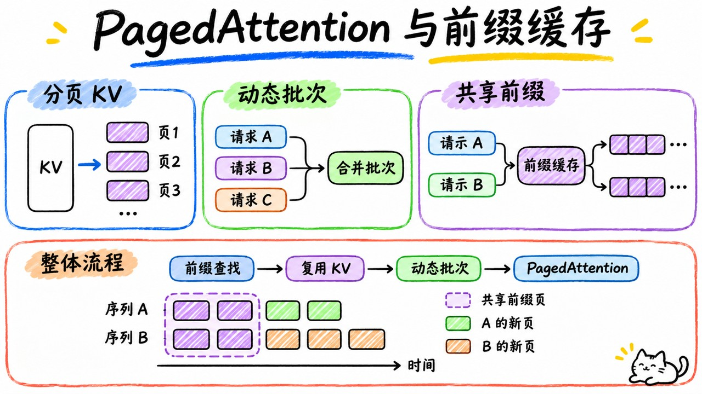
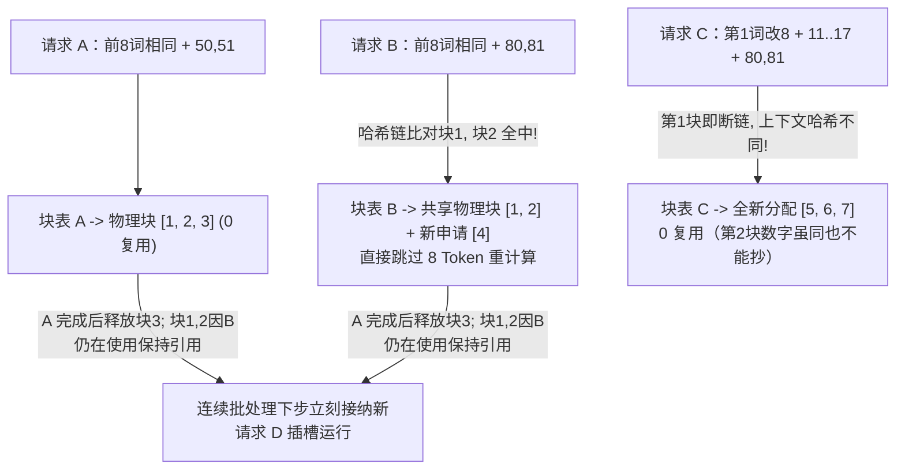

> **生成工具**：Codex\
> **生成模型**：gpt-6.2-sol

在退款报表助手的线上真实请求里，每一百个客户发来的提示词往往长着同一张脸：**开头那几千字的系统指令、输出字段要求、合规边界规定几乎一模一样，唯一变的只是最底下那两行 CSV 金额**。

要是没有好的内存与调度管理，引擎不仅得给每张大表格提前在显存里圈一大块整块连续空地白白占着茅坑（哪怕最后只答了 10 个字），还得看着大家把一模一样的几千字系统规则从头重复算上一百遍！今天彻底把最常挂在嘴边的三大引擎核武器拆开理顺——记住，它们仨解决的是**三个各自独立又紧密咬合的问题**：
1. **PagedAttention（分页注意力）**：怎么省地方存放不断长高的 KV Cache？
2. **Prefix Cache（前缀缓存 / RadixAttention）**：怎么认出不同请求头上那截长相一模一样的文字并直接抄作业免重算？
3. **Continuous Batching（连续批处理）**：怎么让长短不一的请求快进快出不相互拖死？

> **先用大白话讲明白**：把这三项技术看成一家生意火爆的快餐厅怎么安排餐桌和拼盘：
> - **PagedAttention（把大包厢拆成 4 格一盘的固定小菜盘 + 菜单索引表）**：以前来一位客，不管他点不点得完，直接强行预留一张容纳 2,048 道菜的大长桌（巨量内部显存碎片）；现在厨师长把显存全统一切成标准 **4 格装小圆盘（物理 Block）**，写一张 **块表（Block Table）** 记着某客人坐第 `1, 2, 3` 盘——哪怕这几个小盘在显存物理地址上根本不挨着，模型也能顺着门牌一格一格吃过去；吃一格申一格，走人立刻清空盘子还回池子！
> - **Prefix Cache（一模一样的前菜拼盘直接端旧盘，绝不回炉重炒）**：客人 A 和客人 B 都点了完全相同的「开胃规范拼盘（第 1 盘 `[10,11,12,13]` + 第 2 盘 `[14,15,16,17]`）」，只有第 3 盘甜点不一样。B 进门时引擎拿前面块和本块的整串指纹算哈希对上一模一样，直接把 B 块表的前两行指向物理盘 `1` 和 `2`（复用 8 个 Token 免重算！）。但注意**哈希像防伪锁链一样环环相扣**——客人 C 只把第 1 盘头一个字改成了 `8`，哪怕后面第 2 盘菜一字不差，因为他的「前世因果」全变了，第 2 盘也**一个都不允许抄！**
> - **Continuous Batching（插空动态拼桌，不干等最慢的那位买单）**：以前静态拼批，同桌 4 人必须等最啰嗦那位吃完 500 字大家才能一起撤桌重开下一批；现在改成**每个推理微步结束后立刻清点一次**：A 这轮刚吐出 `<|im_end|>` 走人，立刻把 A 独享的那最后半盘 3 号收掉，下一微步无缝把刚排队的客人 D 插进空闲算力槽接着跑！



## 1. 手算块表：为什么改动第 1 个字，后面整块全废掉？

KV Cache（键值缓存）保存着每个已处理 Token 在 Transformer 各层的 Key 与 Value 投影向量。**PagedAttention** 把它按固定 Token 数量切为等长**物理块（Block）**，逻辑上连着写的序列通过**块表（Block Table）**映射到显存里东一块、西一块的物理块编号上——不仅彻底干掉了传统连续内存分配导致的巨额预留浪费，还支持请求一边往外吐字一边按需零散申请新物理块，算完或客户突然取消后立刻归还。[PagedAttention 论文](https://arxiv.org/abs/2309.06180) · [vLLM Prefix Cache 设计](https://docs.vllm.ai/en/stable/design/prefix_caching/)

拿仓库教学模拟脚本 [experiments/serving/simulate.py](../../experiments/serving/simulate.py) 的 `paged_example()` 亲自算一遍——假设每个物理块仅装 **4** 个 Token，现有三条 10 Token 请求先后进门：

| 请求代号 | 逻辑 Token 序列（共 10 个） | 映射出来的物理块表 | 成功省掉重算的 Token 数 | 发生了什么？ |
| --- | --- | --- | ---: | --- |
| **`A`** | `10,11,12,13`, `14,15,16,17`, `50,51` | `[1, 2, 3]` | `0` | 冷开局，填满完整块 1、块 2 注册进缓存表，未满的尾块 `[50,51]` 放私盘 3（不进公共完整块缓存）。 |
| **`B`** | `10,11,12,13`, `14,15,16,17`, `80,81` | **`[1, 2, 4]`** | **`8`** | 前 8 个完全重合且都成完整块！B 直接引用物理块 1 和 2，自己只需新申请并计算尾块 `[80,81]` 放块 4。 |
| **`C`** | **`8`**,`11,12,13`, `14,15,16,17`, `80,81` | **`[5, 6, 7]`** | **`0`** | 仅仅第一个位置从 `10` 变 `8`！第二块虽也是 `14,15,16,17`，但前文变了导致它的自回归因果 KV 状态全变，必须从头重算申请新块 `5,6,7`！ |

> **想再深入一层？（前缀缓存键到底怎么防错乱？）** 看看 `simulate.py` 第 27 行的代码你就完全豁然开朗了：`key = hashlib.sha256(parent + bytes(tokens)).digest()`！块表给每个**完整块**算校验指纹时，会把**上一块算好的父哈希 `parent`** 拼进这一块的输入里。于是哪怕第 2 块文本一字不差，由于第 1 块改了一个数导致 `parent` 变了，第 2 块的指纹也连环变脸！在真实的 vLLM 里，计算缓存标识不仅看前缀与整块 Token，还必须额外拼入**适配器 ID（防甲业务的 LoRA 混用乙业务的缓存）、多模态特征哈希与缓存命名空间**——面向多个客户共用的多租户平台，一定记得按租户权限配好缓存共享隔离界线，绝不能让 A 公司悄悄通过撞哈希或侧信道蹭 B 公司的系统提示缓存！

## 2. 释放物理块 + 连续批处理：吞吐与并发排队的硬币两面

当请求 `A` 生成完毕（或断流取消）退场时：引擎先去检查 `A` 名下 `[1, 2, 3]` 各自还有几人在用。`1` 和 `2` 正被尚未结束的 `B` 死死攥着引用计数（RefCount），绝不乱删；只有 `A` 独家占用的尾块 `3` 引用计数归零，立马还回空闲内存池！此时正在门口排队的请求 `D` 不用傻等同批所有人都写完，在下一个调度 Micro-step 就直接领着空出来的资源加入正在跑的这一批队伍（**Continuous Batching**）。

但别盲目把并发上限开到无穷大！**并发开得越多，虽然 GPU 矩阵乘法同时喂饱了几十个序列、总体 `Tokens/s` 一飞冲天，每一步合并前向的时间和抢占 KV Cache 池子的竞争压力也随之上升——落在单个用户身上的吐字速度（事件间隔）反而变慢，甚至在突发内存吃紧时被调度器强行「踢出暂存重启（Preemption）」。** 因此一定要同时盯着延迟节奏与总吞吐两条线。

## 3. 用一模一样的请求流，看 SGLang 实测前缀缓存与并发的真实数据

用仓库脚本先做纯数学模拟演算验证块表，再用通用 HTTP 探针对着正在本机跑的真实服务依次打三波流量：
1. `cache_unique`（串行、故意在共享系统规范开头插一个变化标号破坏前缀匹配）；
2. `cache_shared`（串行、完全一致的 74 Token 长前缀）；
3. `concurrent`（4 线程并发踩在已预热的相同前缀上）。

```bash
python3 experiments/serving/simulate.py --out /tmp/serving-simulation.json
python3 experiments/serving/probe.py --server http://127.0.0.1:18080 \
    --model refund --out /tmp/serv-04.json
```

下面直接摊开在 **Apple M1 + SGLang `v0.5.23`（Metal 后端）** 上每组 8 条实测跑出来的真数字（全部原始记录存档于 [sglang-probe.json](../../experiments/serving/sglang-probe.json) 和 [simulated-results.json](../../experiments/serving/simulated-results.json)）。注意这里的 `设备缓存 Token 增量` 实实在在读的是引擎暴露出来的 Prometheus 指标 `sglang:cached_tokens_total` 组前后差值（另外注意哪怕号称 `异前缀`，因为 chat 模板开头的 `<|im_start|>system` 等那几粒公共引子还在，引擎同样能精准命中那小段前缀！）：

| 压测负载组 (各 8 条请求) | 服务端缓存 Token 增量 (`cached_tokens_total`) | 客户端首字 P50 (`ms`) | 首字 P95 (`ms`) | 可见事件间隔中位数 (`ms`) | 总输出吞吐 (`Token/s`) |
| --- | ---: | ---: | ---: | ---: | ---: |
| **串行 · 异前缀 (`unique`)** | `+490` | `161.8` | `170.2` | `20.1` | `28.5` |
| **串行 · 同前缀 (`shared`)** | **`+2,050`**（猛增 4 倍！） | **`54.2`**（狂降 **66.5%**！） | `236.0` | `24.7` | `32.0` |
| **并发 4 · 同前缀 (`concurrent`)** | `+2,304` | `112.1` | `127.4` | **`34.7`**（单人间隔变慢） | **`83.1`**（总吞吐接近 **3 倍**！） |

> **容易踩的坑**：
> 1. **小样本里第一条「冷启动请求」拉歪 P95 读数！** 看第二行「串行同前缀」：明明首字中位数已经从 `161.8 ms` 掉到极其丝滑的 `54.2 ms`，可它的 `P95`（8 条里就是最大值）竟然反常写着 **`236.0 ms`**——因为 8 条里第 1 条恰好要从零先把共享系统前缀写热，加上首条冷态波动直接垫高了 P95 最大值；
> 2. **前缀缓存省的只是 Prefill（第一次读取长提示），完全帮不了 Decode（往外逐个吐字）！** 并发加到 4 之后总产出狂飙到 `83.1 Token/s`，代价就是单个用户的吐字间隔中位数也从 `20.1 ms` 放慢到了 `34.7 ms`；如果继续猛加并发，直到打穿显存安全线或被抢占，尾延迟会瞬间失控。容量选型务必使用按真实到达速率（Open-loop）发压的负载分布！

## 下一篇

缓存命中也配好了、调度也跑得飞快，可前线开发还是跑来骂娘：「用户吐槽怎么一卡好几百毫秒然后一瞬间嘣地全砸在屏幕上？还有，用户在网页点下『取消停止生成』按钮之后，后台显存与 GPU 怎么还在呼呼烧算力半分钟才肯歇？」[**SERV-05《端到端流式调试和取消》**](serv-05-streaming-cancellation.md) 会教你故意造出两种对照代理现场抓包破案，并把断点一路追到引擎取消计数器清零！

[返回 LLM 与 Agent 学习路线图](https://blog.lacknb.cn/articles/2026/11/19/1795058329577.html)
