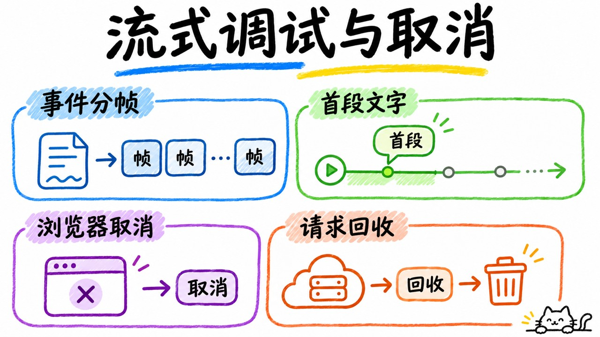
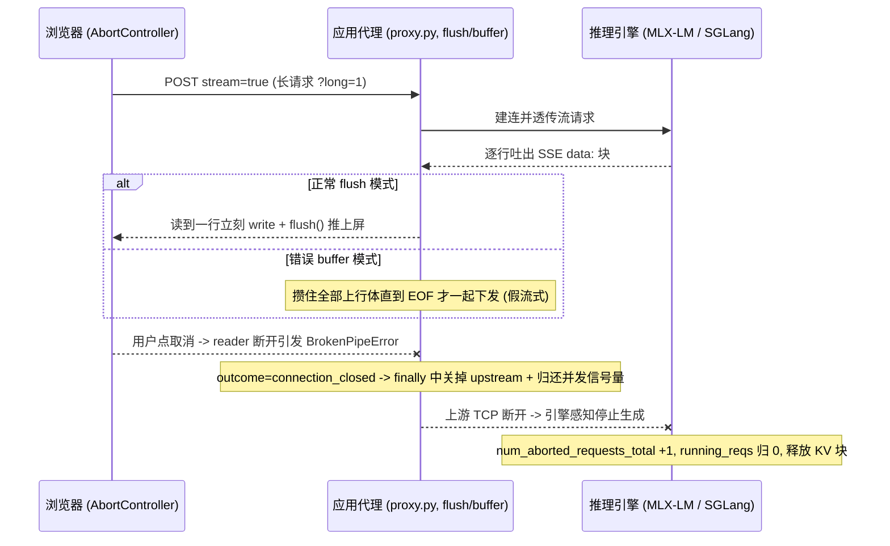

> **生成工具**：Codex\
> **生成模型**：gpt-6.2-sol

做 AI 应用上线后，最让前端与后端相互扯皮的两件怪事莫过于：
1. **「伪流式卡死」**：后端同事发誓自己明明传了 `"stream": true`，可网页上愣是白等了三百多毫秒甚至好几秒一动不动，然后一毫秒内把整篇报告轰地一口气拍在屏幕上！
2. **「假取消空烧钱」**：用户看模型开始瞎编，果断在页面点下「停止生成」按钮，网页端是立刻安静了；可后台监控一看，显卡利用率和并发槽位居然还在一路飙着把它后面几百个字全算完，一个慢请求差点拖垮整台单机！

今天用同一个本机可控代理彻底治好这两块心病——亲手制造一次「伪流式缓冲现场」对照抓包，再把用户点停的断开信号顺着网线一路追进推理引擎确认物理释放！

> **先用大白话讲明白**：流式输出卡顿与取消失效，全出在**「传菜中间商有没有当场传话 & 有没有及时喊停」**：
> - **逐行冲刷 (`flush`) vs 憋住打包 (`buffer`)**：上游模型厨房其实每隔二十毫秒就顺顺当当递出一句增量 `data:`；可如果路上的 Nginx、网关、代理或者响应压缩器手欠「等这一大袋全部接齐封盒再发车（`buffer`）」，浏览器的表看起来就会变成 `0 -> 343.3 ms（空白等待）-> 344.2 ms（全部上屏）-> 344.4 ms（直接结束）`！明明花了流式的钱，吃到的却是一整包阻塞体验！
> - **取消要追到底（`Abort -> Proxy close -> Engine abort & reclaim`）**：浏览器点击停止（`AbortController.abort()`）只是**挂掉了自己家听筒**；要是中间应用代理不趁机断开指向引擎的那根 TCP 连接、或者推理引擎本身没实现断开监听，后厨依然会在无人在意的地方继续炒菜白占宝贵 KV 块！



## 1. 先学会拆开流式时间线上的五个精确里程碑

想抓流式延迟，光记一个模糊的总时间根本抓不住真凶，一定要用单调时钟记清下面五个独立边界（对照 [probe.py](../../experiments/serving/probe.py) 与 [trace.html](../../experiments/serving/trace.html)）：
1. **发单起步 (`0 ms`)**：客户端正真发出一笔流式 HTTP 请求；
2. **HTTP 响应头抵达 (`headers_ms`)**：此时已经拿到 HTTP 200 和追踪 ID，但往往一行正文也没有；
3. **首个网络字节块 (`first_line_ms`) vs 首条完整 SSE (`first_event_ms`)**：这两个不是同一刻！因为第一个到来的块里可能只含了一半行、甚至第一条完整 SSE 往往只是个不含文字的 `{delta: {"role": "assistant", "content": ""}}` 占位事件或结尾用量事件；
4. **首段非空可见文字落地 (`ttft_ms` / 加入 DOM)**：这是客户端对用户可见感知到的「真 **TTFT**（首 Token 延迟）」（提醒：如果模型或代理把多个 Token 合并在一个网络包才推送，这上面就悄悄叠加了缓冲与解码时间）；
5. **流正式收尾**：等到明确的 `data: [DONE]` 才算完美功德圆满，或者是中途报错、主动取消、网络提前断掉 **EOF（End of File）**。

## 2. 对照实验：拿同一代理造出「真流式」vs「伪流式缓冲」现场

直接启动仓库标准库小代理 [proxy.py](../../experiments/serving/proxy.py) 两个端口对照：一个开 `--mode flush`（读上游一行立刻往下刷一行），另一个故意开 `--mode buffer`（把上游整个响应流憋到 `response.read()` 全读完才一口气发头送出）：

```bash
python3 experiments/serving/proxy.py --upstream http://127.0.0.1:18080 \
    --port 18090 --mode flush
python3 experiments/serving/proxy.py --upstream http://127.0.0.1:18080 \
    --port 18091 --mode buffer
```

注意在真实生产环境，除了你自己写的反向代理缓存（比如 Nginx 默认开启的 `proxy_buffering`），连 HTTP 响应 **gzip 压缩中间件**（凑齐块大小才刷新压缩字典）、HTTP 客户端库内部读缓存以及浏览器 JS 事件循环全都会暗中憋包！所以排查时**一定要在代理端同时记 `upstream_headers_ms`（从上游拿到）和 `client_headers_ms / first_write_ms`（真正发给下游）**，把怀疑精准锁死在哪一层再动手调参数（顺便再检查一下自己浏览器解析遵循没遵循按行增量解码 UTF-8 + 逢空行发完整 SSE 规范 [HTML SSE 规范](https://html.spec.whatwg.org/multipage/server-sent-events.html)）。

同一台 Apple M1 跑 Chrome + MLX-LM（见完整追踪记录 [browser.json](../../experiments/serving/browser.json)），两套模式打出来的浏览器秒表一秒揭露真相：

| 代理转发模式 | 浏览器收响应头 (`ms`) | 浏览器收首块 (`ms`) | 首条完整 SSE (`ms`) | 第一段文字入 DOM (`ms`) | `[DONE]` 彻底结束 (`ms`) | 肉眼体感 |
| --- | ---: | ---: | ---: | ---: | ---: | --- |
| **`flush`（逐行直通）** | `33.50` | `104.00` | `149.50` | `149.60` | `394.80` | 首字 `150ms` 出来，后续 `245ms` 平滑打字机滚动吐字 |
| **`buffer`（读完再发）** | **`343.30`** | `344.10` | `344.20` | `344.20` | **`344.40`** | 白白干等 `343ms`，然后全篇文字和结束事件在 **`0.2 ms` 内同时瞬发砸屏！** |

> **想再深入一层？（翻代理侧日志文件验证真凶！）**
> 查看 `browser.json` 里代理自己的日志彻底破案：`buffer` 模式时，其实上游模型引擎仅仅花了 **`3.788 ms`** 就发回来了响应头，代理却硬生生憋着全流一直死等到 **`326.123 ms`** 整段彻底吐完了，才肯往下游写第一字节回复给浏览器！（注意两次单次执行的总壁钟耗时本身会带运行时随机抖动，这里对比的核心是「首字与结尾几乎零间距压成一坨」的伪流式形状。）

## 3. 追击「取消」信号：从浏览器点停一路查到引擎销毁槽位

接着在测试页打开 `?long=1&model=default_model` 发起一个持续输出 1 到 500 的长流，刚看见开头 `"Sure,"` 几个字符在 `151.40 ms` 果断按下取消键：
- **浏览器端**：`AbortController.abort()` [AbortController 文档](https://developer.mozilla.org/docs/Web/API/AbortController) 立刻掐断本地 `fetch` 管道，日志清晰打下 `客户端取消 signal is aborted without reason`；
- **中间代理端 (`proxy.py`)**：紧接着往浏览器 `wfile.write()` 时触发 `BrokenPipeError`，代理记下 `outcome: "connection_closed"`，**并在 `finally:` 块里双双关掉指向上游引擎的连接 `upstream.close()` + 释放并发限流信号量 `slots.release()`**；
- **独立推理引擎端**：我们还在独占隔离的 SGLang 服务上单独打了一发长流取消探针（见 [sglang-protocol.json](../../experiments/serving/sglang-protocol.json)）：客户端刚读到第一个 ```` ``` ```` 块立刻强关 Socket，等 1 秒后读取引擎 `/metrics` 指标，**清晰观察到 `sglang:num_aborted_requests_total` 精准由 `1.0` 跳升至 `2.0`，同时正在运行序列数 `sglang:num_running_reqs` 干脆利落回落并稳住为 `0.0`**！（严谨提醒：`browser.json` 取消验证到 MLX-LM 代理断开，`sglang-protocol.json` 单独验证到 SGLang 引擎内核计数回收，两份各自真实独立，切勿强行混剪成同一场实验时间线。）

> **容易踩的坑（线上防泄露 & 防假死检查单）**：
> 1. **忘了在 `finally:` 里归还并发限制闸门或连接**：要是代理层对异常断开处理潦草漏还了一个并发槽位，来几个手机锁屏断网的慢用户就能瞬间把你服务器并发额度榨干死锁！
> 2. **慢客户端憋爆网关内存队列（Backpressure）**：找个故意卡着网络每隔 500ms 才勉强 read 几字节的「慢客户端」压一下代理，观察待发送内存缓冲区水位会不会暴涨 OOM——记得配上单连接最大发送缓存限制、写超时以及按中间负载均衡区分「用户正常取消」与「网关 504 读超时」。
> 3. **回归流水线要覆盖四类终局**：正常跑完、前端主动取消、服务端报错吐异常、以及半路直接拔网线断流。

## 下一篇

搞定前后端的传输管道，现在把目光收回调度大厅最深处：为什么新进来的一个超长报表能把别人正在丝滑吐字的好端端响应彻底冻住几十秒？以及为什么明明 GPU 显存很空、单个请求吐字速度却卡死在内存带宽天花板上？[**SERV-06《分块预填充和投机解码分别快在哪》**](serv-06-prefill-speculative.md) 会亲自算清这两种改变现代推理延迟下限的调度算法！

[返回 LLM 与 Agent 学习路线图](https://blog.lacknb.cn/articles/2026/11/19/1795058329577.html)
