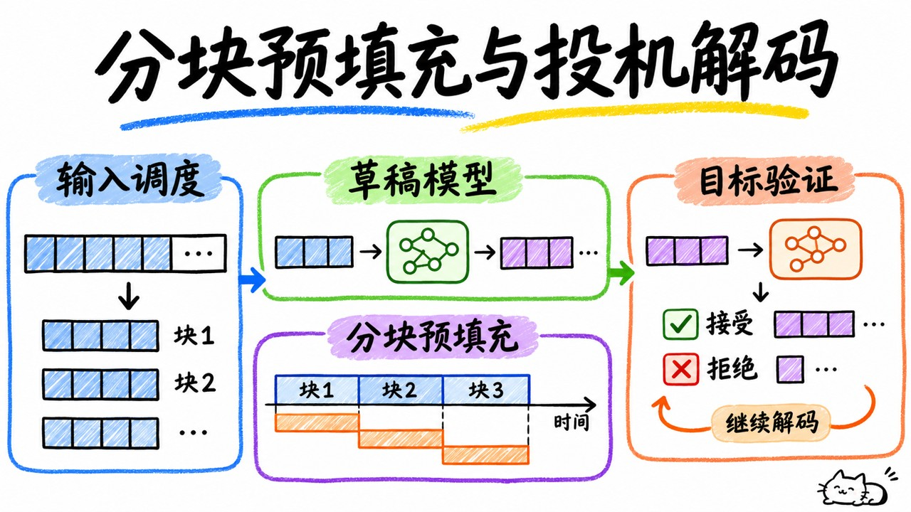
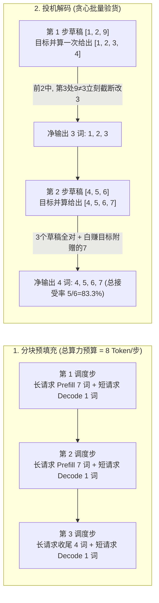

> **生成工具**：Codex\
> **生成模型**：gpt-6.2-sol

线上跑推理服务时，最让人头疼的延迟灾难恰恰长在两个看似矛盾的极端：
1. **「突发长文本冻死正在输出的人」**：一个简短退款问答刚开心地每 20 毫秒吐出一个字，突然旁边新冲进来一位甩了一整份几千字财务字典长文的新顾客！要是调度器一口闷地先算完这几千字的 **Prefill（预填充）** 才肯回头管大家，前面那位原本马上要写完句号的小请求就得生生卡在屏幕上僵住整整好几百毫秒！
2. **「长文本也没几个，可吐字本身咋提速？」**：[F-05](https://blog.lacknb.cn/articles/2026/11/20/1795161425780.html) 里算过一笔铁账——**Decode（逐字生成阶段）每吐区区 1 个字，都得老老实实把整本几个 GB 的模型权重从显卡 HBM 高带宽内存搬进计算核心算一遍！**（算力几乎闲着发霉，瓶颈全堵在「搬砖读权重」的内存带宽上！）那既然搬一次权重几乎一样久，为啥不让它**一口气同时验证三四个候选词**呢？

今天分别用一组可口算的调度演算和草稿序列，彻底摸清解决前者卡顿的 **分块预填充（Chunked Prefill）** 和打破后者单步吐字天花板的 **投机解码（Speculative Decoding）**。

> **先用大白话讲明白**：这两项技术分别治两种截然不同的「慢病」：
> - **分块预填充（Chunked Prefill）=「不管你点了多复杂的 18 页满汉全席，厨房每轮最多只切 8 个菜的名额——必须留 1 格给正在吃的客人上新，剩下的分三轮慢慢上！」**：通过把每一轮的全局总 Token 算力预算封顶（比如 `max_num_batched_tokens`），强行把庞然大物的大长文本劈成一小块一小块穿插着算。这样一来，旁边正在丝滑流式输出的短请求几乎感受不到突然大停顿（**ITL 极度平稳**），只是那位交长论文的客人拿到首字的时间（TTFT）会被稍微拉长几轮。
> - **投机解码（Speculative Decoding）=「学徒在旁边飞快顺手连写 3 个草稿字，大模型师傅只需看一眼（1 次显存权重读取）就能一口气全改出来，对几个算几个还附赠 1 个！」**：由于验证 4 个并排字的耗时跟自己憋出 1 个字在显卡上几乎差不多（权重只需要从 HBM 读一次！），只要前面小模型草稿猜对一两个词，一次计算直接白白多赚出两三个稳稳保真一模一样的输出！



## 1. 分块预填充（Chunked Prefill）：给正在吐字的老请求死守一个槽位

**Prefill** 负责一口气消化全部历史与问题建立 KV Cache；**Decode** 则是随后一步吐出一个新词的自回归阶段。假如不加拆块隔离、大长提示一把抢走全部算子时隙，正在 Decode 阶段畅快吐字的线上流就不得不停摆等待。

看一套极简手算（来自 [simulate.py](../../experiments/serving/simulate.py)）：假设调度器定死「每一调度步最多共同计算 **`8` 个 Token**」（即 `max_num_batched_tokens = 8`）。此刻大厅里已经有一个正在每步顺畅生成 **1** 个字的短退款报告请求；就在这一瞬间，又新来了一个包含 **18** 个输入 Token 的长报表请求。调度预算会毫不犹豫先扣出 **`1` 个槽位** 死死保住老请求的连续 Decode，只把剩下 **`7` 格配额**分给新请求：
- **第 1 步**：老请求吐 `1` 个字 + 新请求吞下前 **`7`** 个词；
- **第 2 步**：老请求又吐 `1` 个字 + 新请求继续吞下 **`7`** 个词；
- **第 3 步**：老请求接着吐 `1` 个字 + 新请求吞下剩余 **`4`** 个词完成预填充！

> **想再深入一层？（怎么平衡这块天平？）** 分块预算调得越小（例如每步只放 256 甚至 64 Token），正在流式阅读体验就会极其如丝般顺滑，短请求最大卡顿时间大幅压缩；但长文本客户就需要经历更多调度步才能出第一个字（`TTFT` 略微上浮），且小块过碎可能打折 GPU 大矩阵计算效率。此外真实生产调度不仅算 Token 数预算，还必须协同计算动态并发序列数、物理 KV 块上限、多卡并行以及显存不够时的抢占重算策略。[vLLM 调度调优](https://docs.vllm.ai/en/stable/configuration/optimization/)

## 2. 投机解码（Speculative Decoding）：小草稿换大厨一次并行验货

当系统并发不大、大部分时间全浪费在反复搬运巨型权重却一步只求 1 个字时，**投机解码**就靠着「**验证连续多个猜测 Token 与只算 1 个新 Token 几乎花费相同的权重带宽**」来实现惊人提速：
- 猜字源头（Proposer）：可以是参数小几十倍的同族小**草稿模型（Draft Model）**，也可以是零模型开销直接从输入上下文（如 CSV 表头字段、代码重复段）里捞连续词组的 **n-gram 匹配**，或者是挂在大模型尾部的 **多头并行预测头（MTP / Medusa / Eagle）**。
- **关键保证**：只要严格遵守对比验货（以及随机采样时的拒绝采样修正分布算法 [投机解码原论文](https://arxiv.org/abs/2211.17192)），**投机解码最终输出的概率分布和纯正原版大模型一字不差，完全无损画质！**

拿贪心解码亲手走两步数字演示（每步假设草稿先一口气蒙 `3` 个后续整数 Token ID，真实引擎里随后转为字符）：

| 推理步 | 小助手草稿提案 (`3` 词) | 目标大厨一次并行预测出 | 命中接受数 | 本步最终安全提交吐出的词 | 发生了啥判断？ |
| --- | --- | --- | ---: | --- | --- |
| **第 1 步** | `1, 2, 9` | `1, 2, 3, 4` | `2` | **`1, 2, 3`**（`3` 词！） | `1` 和 `2` 蒙对了；第 3 位大厨觉得是 `3` 不是 `9`——**果断撕掉错误草稿 `9` 以及后面的 `4`（因为基于错误前提的），就地用大厨正版词 `3` 接上！** |
| **第 2 步** | `4, 5, 6` | `4, 5, 6, 7` | `3` | **`4, 5, 6, 7`**（`4` 词！） | 3 个草稿全部精准猜中！外加大厨本来就有能力基于 `6` 顺便预测出下一个正版 **`7`**——白赚 **4** 个确定 Token！ |

算总账：两步总共提案 `6` 个草稿，顺利验收了 `5` 个（**草稿接受率 `5 / 6 ≈ 83.3%`**），仅仅跑了两次大厨前向，却足足吐出了 **7 个** 保真字！提醒一句：真实随机温度采样时必须跑带分布纠正的严格拒绝重采样算法（不能简单按上面贪心逐值比对），而且最后到底快了还是变慢了，还要扣除运行小草稿模型自身花掉的时间和额外批次开销——只有在高接收率、低草稿开销的典型低并发长输出场景最猛！[vLLM 投机解码接受率指标](https://docs.vllm.ai/en/latest/features/speculative_decoding/acceptance_metrics/)

## 3. 演练计算，并用真实引擎重放看清「基线观察 vs 实测对比」边界

在本地随时运行一遍教学模拟核验上面的 `[7, 7, 4]` 分块数组和 `5/6` 接受率：

```bash
python3 experiments/serving/simulate.py --out /tmp/serving-simulation.json
```

如果你想在真实引擎（比如 vLLM 或 SGLang）上做严谨的优化对照实验，记得死守两条铁律：**先固定关掉投机只拧 `max_num_batched_tokens`** 做长短混合压测，看清 **TTFT（长请求首字）** 和 **ITL（老请求可见停顿）** 的此消彼长；然后再锁死刚选好的分块预算，只切换开启/关闭 `--speculative-config`，拿一模一样的提示词、温度（0 或固定分布）验收真实文本输出一致性和端到端速度。

> **容易踩的坑（别拿客户端 SSE 包当引擎单 Token 延迟，更别拿单基线瞎吹收益！）**：
> 1. **诚实汇报本地基线实测结果**：在 Apple M1 Metal + SGLang 上用仓库 [tuning.py](../../experiments/serving/tuning.py) 实际重放了 4 对并发混合流——等短退款请求先吐出第 1 个字后，立刻猛砸进一条长达 **718** 个输入 Token 的长请求（环境设定超大预填充分块预算 `2,048` 相当于整段一把吃进）。实测记录见 [sglang-large-chunk-v2.json](../../experiments/serving/sglang-large-chunk-v2.json)：4 次里长请求首字中位数约为 **`157.0 ms` (`156.97 ms`)**，而在它猛算预填充的那一瞬，**正在吐字的短请求遭遇的最长事件停顿中位数高达 `134.0 ms` (`133.97 ms`)**（正常间隔仅 ~20ms，瞬间卡掉 6 倍时间！）。不过该环境当时并未拿下 `chunk=64` 和真启用 `speculative` 的完整同条件硬件对照数据，**因此这组数字严谨界定为「混跑阻塞基线观察」，绝不拿着它脑补夸大「开启后肯定降了几倍延迟」！**
> 2. **客户端测量陷阱**：有些服务后端会攒两三个词打包进一个 SSE `data:` 帧才往外推，所以客户端量到的可见事件间隔只能叫事件间隔，想确认引擎真开启了投机草稿接受长度，务必翻服务端官方计数器（如 `spec_decode_num_accepted_tokens` 等），切忌光看表面文本就瞎猜功能生效了！

## 下一篇

看到这里，前面 `SERV-01` 到 `SERV-06` 主要围绕 vLLM V1 源码和通用引擎原理解读；而在刚刚的真实实测记录里，我们多次用到另一个高速开源引擎 **SGLang** 来跑通了真服务、前缀命中和结构化约束。它内部的 **Scheduler** 和最著名的 **RadixAttention（基数树注意力共享）** 代码长什么样？为什么我们在跑 SGLang Metal 加 `JSON Schema` 严格约束时第一回直接炸了 `HTTP 500`，加上一个神奇参数就立马变成 `HTTP 200`（却居然算错了均值）？[**SERV-07《SGLang 的 Scheduler 与 RadixAttention》**](serv-07-sglang-source.md) 带你钻进固定版源码里直接看个明明白白！

[返回 LLM 与 Agent 学习路线图](https://blog.lacknb.cn/articles/2026/11/19/1795058329577.html)
