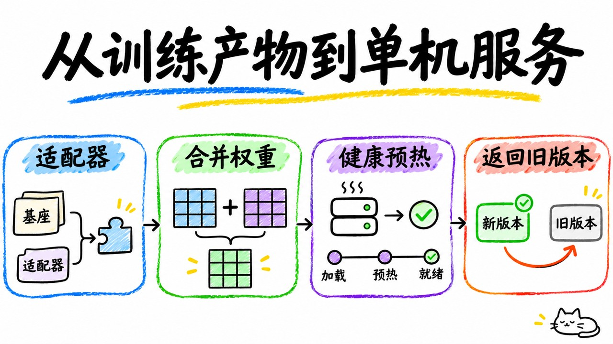
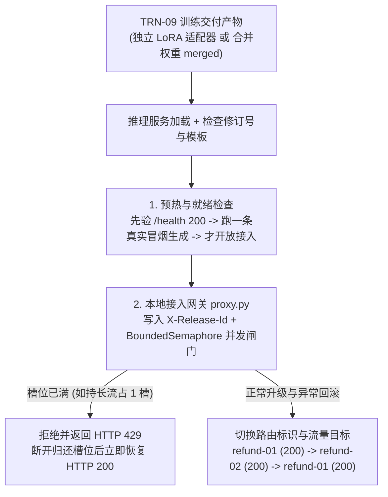

> **生成工具**：Codex\
> **生成模型**：gpt-6.2-sol

在 [TRN-09](../04-model-training/trn-09-unsloth-finetune-export.md) 收官时，我们手里已经握着两种形态的成果产物：一套只有约 `1 MB` 的 **独立 LoRA 适配器文件夹**，另一套则是将近 `1 GB` 的 **完整合并权重文件夹**。

今天终于要把训练产物真正端到端跑成一个稳定对外的**单机推理服务**！上线之前不但要亲自检查两种加载路径吐出的字是不是一致（记住：**「文件加载成功不报红」绝对不等于「生成内容一模一样、且算对了退款账」**），更要把单机生产防爆四件套——**启动期就绪隔离、并发限流闸门（超载抛 429）、异常归还槽位、无痛切换与秒级回滚**——全数接上亲测一遍！

> **先用大白话讲明白**：把微调后的权重搬上生产单机跑，就像**把研发配好的新秘方放进门面开张营业**：
> - **两条交接通道（外挂适配器 vs 合并整机）**：一种是保留原版大厨，只现场递给他一张 1 MB 小便利贴（`--adapter-path lora/`）边算边加，占硬盘极少但引擎必须懂怎么合并算子；另一种是重做一把合好秘方的整套大铁锅（`merged/`），哪怕不认 LoRA 的老引擎也能直接开火。
> - **营业前「先预热、再亮绿灯（Readiness Gate）」**：进程刚起 `python server` 时权重才刚开始读，门卫（代理/健康检查）必须挡住外面真实客人（避免 500 报错）；等 `/health` 绿了、而且内部自己**拿第一份试菜 CSV 真正跑通一次热身**后，才对外挂上「正常营业（Ready）」的牌子！
> - **并发闸门 + 一键换回老摊位**：一个慢请求死霸着锅灶时，后面新冲进来的客人门口直接礼貌吃张 **`HTTP 429` 稍后再试排队牌**（同时确保客人中途拔线取消时`finally` 一定立刻把闸门槽位还回去！）；新摊 `refund-02` 万一有问题，网关一秒把路牌翻回老摊 `refund-01`，旧长流在老摊继续体面跑完不受打断！



## 1. 先填好一份经得起核查的上线部署清单

开工前先把所有必须钉死的契约与边界对齐入表：

| 部署规格项 | 本篇实战落地取值与讲究 |
| --- | --- |
| **基座与分词器** | `Qwen/Qwen2.5-0.5B-Instruct`，同一固定 Git `revision` |
| **对话聊天模板** | 严守基座仓库自带 `tokenizer_config.json`，不随意拼接私改字符 |
| **独立适配器加载路径** | `lora/adapter_config.json` + `adapters.safetensors`，运行时配合完整基座挂入 |
| **合并整机加载路径** | `merged/` 目录自含配置文件、分词器与完整合并权重 |
| **推理预算与最小测试** | `temperature=0`、最多 `48` 个新 Token；至少跑通涵盖混合/零/空/小数的四类回归表 |
| **流量追踪标头** | 由接入代理在响应写入 `X-Release-Id`，一键反查当时是哪份产物答的题 |

记住各自取舍：**独立适配器**极其适合需要底座共享或频繁增量迭代小补丁的引擎（前提是推理器必须精准匹配同一 `revision`、目标层列表和格式规范）；**合并模型**虽然文件大，却通吃一切标准推理软件、省去运行时旁路算子兼容烦恼。另外一旦涉及额外 PTQ 量化或特定算子加速（如 FlashAttention/CUDA Graph），永远重新过一遍逐条对照生成，**不能把「顺利启动不报错」等同于「行为一模一样」！**

## 2. 本机实测：双路径拉起服务，验证一致输出与流控切换

在 Apple Silicon 上使用与 TRN-09 同一套 `mlx-lm==0.32.2` 拉起两台本机服务，分别测试外挂独立适配器与完整合并权重（提示：MLX-LM 用 `--model` 或 `default_model` 作为客户端请求名，调用方不用操心具体物理路径）：

```bash
python -m mlx_lm server --model "$MLX_BASE" --adapter-path "$TRN_OUTPUT/lora" \
    --host 127.0.0.1 --port 18144
python -m mlx_lm server --model "$TRN_OUTPUT/merged" \
    --host 127.0.0.1 --port 18145
python3 experiments/serving/probe.py --server http://127.0.0.1:18144 --model default_model \
    --quick --out /tmp/adapter.json
```

直接检验两路跑回的完整记录（[独立适配器响应](../../experiments/serving/adapter-probe.json) vs [合并模型响应](../../experiments/serving/merged-probe.json)）：
- 两边完美齐平：**`74` 个输入 Token、`10` 个输出 Token**；
- 无论普通单包生成还是 SSE 流式响应，两边逐字符均输出一模一样的 **`{"count":2,"mean":4}`** 且均以 `"finish": "stop"` 正常收尾！
- （**业务视角复查**：这条短冒烟测试验证了**部署侧读取两种训练产物的输出 100% 复现等价**；而它答出 `mean: 4` 也同时提醒——由于这批示例源自 TRN-09 的 12 步实验权重，业务验收门禁依然要毫不留情地拦截算错的均值，实际生产全量验收必须跑满全套退款测试集！）

接着用 [deployment_check.py](../../experiments/serving/deployment_check.py) 对接两个挂着代理（分别标为 `refund-01` 与 `refund-02`）的本地入口演练生产网关四关大考，结果存档在 [deployment-check.json](../../experiments/serving/deployment-check.json)：
1. **双路就绪探活**：`/health` 均稳定返回 **`200`**；
2. **发布切换与瞬间回滚**：依次请求旧 -> 新 -> 旧，响应头干净印出 **`refund-01` -> `refund-02` -> `refund-01`** 全部成功；
3. **并发超限返回 `429`**：代理限制并发信号量设为 `1`，此时故意发起一条长流式生成霸住槽位，紧接着第 2 个并发请求立刻被门外闸门干脆利落拦下并弹回 **`HTTP 429` (`concurrency limit`)**；
4. **断开立刻释放并自动自愈**：一秒关停长流归还槽位之后，重新发出常规请求立刻顺利拿到 **`HTTP 200`**！

> **想再深入一层？（想从这台单机 Mac 上线到 Linux NVIDIA 容器集群时，哪些地方会立刻变样？）**
> 真正在线上 Docker / Kubernetes 里部署大服务，必须明确列出环境清单防飘：镜像精确 `digest` 哈希、宿主机 CPU/GPU 架构型号、内存与容器 **`/dev/shm` 共享内存上限**（多卡 NCCL 通信太小会直接挂掉）、大权重卷按**只读挂载**防止误删或脏写、固定网络及入口脚本！
> 在仓库档案里，我们在 Linux ARM64 CPU 容器实证走了标准挂载并读完权重进入编译预热（[vllm-startup.json](../../experiments/serving/vllm-startup.json)）；切记 `mlx-lm` 强绑 macOS Apple Metal 统一内存驱动，**绝不能把 Mac 本机吞吐或显存体验直接外推当成 Linux NVIDIA 容器容量！** 上 NVIDIA CUDA 时请老实按对应 CUDA 镜像实测。[vLLM Docker 运行方式](https://docs.vllm.ai/en/stable/deployment/docker/) · [MLX-LM 项目](https://github.com/ml-explore/mlx-lm)

## 3. 单机上线必须接好的三条工程防线

> **容易踩的坑（别在切换、断开、流式上留漏洞！）**：
> 1. **区分 Liveness（活着）与 Readiness（能干活）**：`Liveness (/health)` 200 只证明 Python 进程没死；`Readiness` 必须等模型权重、KV 池分配和首条内部预热请求全跑通才放行真流量进门！
> 2. **并发槽位泄露 = 单机慢性窒息死锁**：凡代理层做了请求限流信号量，无论上游超时、网络中断、还是客户端突然取消（`BrokenPipeError`），务必放进 `try ... finally: slots.release()` 保证 100% 归还槽位；
> 3. **新老切换务必「原子切换 + 旧连接排空」**：真上线时先把 `refund-02` 完整拉起并热身好，再原子替换路由指向，同时保留正在 `refund-01` 上吐字跑到一半的老流继续跑完排空（Drain），一旦监测指标异常，马上切回还在热备的旧地址并以响应 `X-Release-Id` 确认回滚落定。[探针脚本](../../experiments/serving/probe.py) · [本机接入代理](../../experiments/serving/proxy.py)

## 下一篇

看到这里，我们既跑过 SGLang 也跑了 MLX-LM 甚至是原生纯手写服务。其实如果你需要在个人电脑或边缘轻量环境（Mac、CPU 或单张小显卡）快速脱离庞大的 Python/vLLM 调度群跑起极高性价比的本地模型，业界还有两位赫赫有名的轻量级老大哥——**`llama.cpp`（基于 GGUF）** 与 **`MLX-LM`**！把它俩放到同一台 M1 上，拿完全一模一样的 16-bit Qwen 权重转换过去跑同一套测试，为什么一个加载快到 3 秒可首字冷启动竟飙到 2 秒、而另一个加载慢到 16 秒首字却只有区区 143 毫秒——**甚至连回答的正确率都不一样（一个 `2/8` 另一个 `4/8`）？** [**SERV-13《从同一 Qwen 基座比较 llama.cpp 与 MLX-LM》**](serv-13-llamacpp-mlx.md) 带你实打实拆个明白！

[返回 LLM 与 Agent 学习路线图](https://blog.lacknb.cn/articles/2026/11/19/1795058329577.html)
