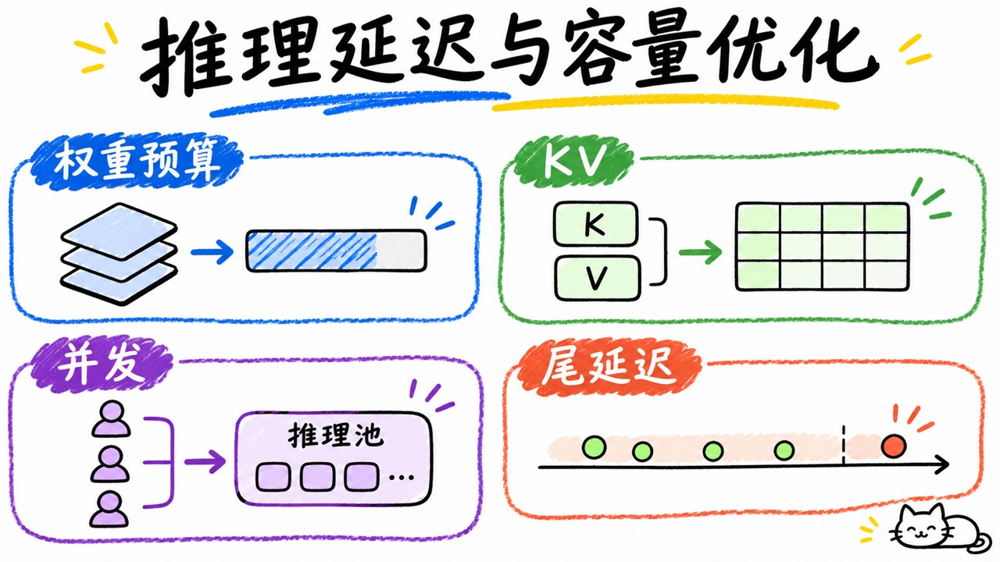
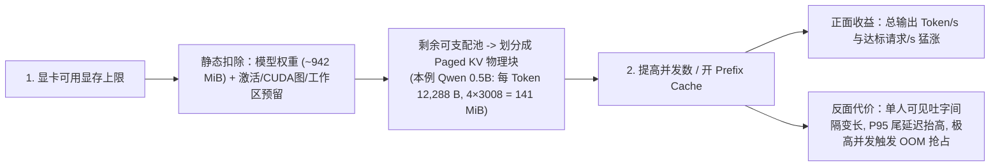

> **生成工具**：Codex\
> **生成模型**：gpt-6.2-sol

很多刚上手搭推理服务的新手只问一句话：「我这张卡显存有 24 GB，这模型文件 14 GB 塞得进去吧？」

确实塞得进去权重，**可一旦请求蜂拥而至、大家聊天越来越长，服务往往跑到半路轰然 OOM（Out of Memory，显存爆满崩溃）**；要么没崩溃，系统吞吐指标（`Tokens/s`）看着飙到飞起，用户端却因为并发挤兑排队把 `P95` 延迟拖到惨不忍睹！要想真正驾驭好一台推理机，第一步永远是**拿纸笔把内存大头算明白**，再用**结合了正确率和延迟红线的真实指标**去压测取舍。

> **先用大白话讲明白**：调优推理服务器就像**当一家热门私房菜馆的掌柜算账**：
> - **死空间 vs 随客人猛涨的活空间**：冰箱总容量就这么大，固定冻在里面的核心老汤底座好比**模型权重**（不动不涨）；每进来一位客人点长篇故事（输入加输出长度），厨房备菜台就得跟着实时腾出一条不断拉长的 **KV Cache 暂存通道**（而且分页盘每 16 格一取，多出一个词也得向上多占整盘！）。
> - **别拿「厨房每秒炒出多少盘菜（Total Tokens/s）」糊弄客人，要算「按时按点吃进嘴且菜没炒错的客流量（SLO Goodput，达标吞吐）」**：厨师把 4 桌客人的菜并到一大锅里翻炒，出菜总量看起来翻了几乎 3 倍（`55.4 tok/s` vs `20.0 tok/s`），但如果端上桌超时超过 `1.5 秒`、或者因为模板/算术出错根本端错菜，那这一桌白炒了不算进真正能创收的达标吞吐！



## 1. 手算一笔硬账：Qwen 模型里哪几块在吃显存？

直接翻开本专题一直在用的 [Qwen2.5-0.5B-Instruct 官方 config.json](https://huggingface.co/Qwen/Qwen2.5-0.5B-Instruct/blob/7ae557604adf67be50417f59c2c2f167def9a775/config.json)：一共 **`24`** 层、由于开启了 GQA 分组注意力每层仅 **`2`** 个 KV 头、每个头宽度 **`64`** 维。模型逻辑参数量约 `4.94 亿`（`494,032,768`）：
- **权重静载荷**：采用 **16-bit（2 字节/元素）** 存储时，`494,032,768 × 2 = 988,065,536 B ≈` **`942 MiB`**（注意 **MiB** 是二进制兆字节，`1 MiB = 1,048,576 B`）。
- **KV Cache 活账本**（按张量轴 `[layer, K/V, token_position, head, head_dim]` 一层一层乘起来！）：

```text
每个 Token 的 KV 占用字节 = 2 (K与V两份) × 24 层 × 2 个KV头 × 64 维 × 2 字节(16-bit) = 12,288 字节 (12 KiB)
如果每条请求保留 3,000 个位置，分页块大小取 16 -> 向上取整实际分配 ⌈3000/16⌉×16 = 3,008 个位置
4 条互相独立的请求同时在线所占 KV = 4 × 3,008 × 12,288 B = 147,849,216 B = 141 MiB
```

（用仓库 [simulate.py](../../experiments/serving/simulate.py) 可以直接复算检验上述精准整数结果，见 [simulated-results.json](../../experiments/serving/simulated-results.json)。）

> **容易踩的坑（OOM 事故要分清楚发生的时间点！）**：算完上面 `942 MiB + 141 MiB` 可绝对还没到安全线！工程里还要扣掉中间**临时激活张量、算子工作区（Workspace）、图捕获状态（CUDA Graph）和内存池预留碎片**；此外如果开启了 Prefix Cache 复用、改了 **FP8/INT8 KV Cache 量化** 或者多卡张量切分，KV 单卡占用还会跟着变。真实排查 OOM 时务必要记死报错到底发生在四个阶段的哪一刻：**刚启动加载权重时（模型根本塞不下）**、**热身建 KV 池捕获图时（启动预分配设太猛如 `gpu_memory_utilization`）**、**大量超长提示并发排队时（Prefill 临时激活峰值爆炸）**，还是**同时跑着十几个长解码一直往后长到撞破 KV 池**！[vLLM 优化指南](https://docs.vllm.ai/en/stable/configuration/optimization/)

## 2. 看懂延迟、流畅度与「达标吞吐」：用 MLX-LM 实测对照

做容量与性能评测，一定要把下面四个口径分家记清楚，绝不能一锅炖：
- **TTFT（首 Token 延迟）**：从发出请求到客户端接到第一段**非空可见字符**的时间（关注第一眼反应快不快）；
- **可见事件间隔（客户端代理视角 ITL）**：连续两条非空文字事件之间隔了多少毫秒（决定用户阅读时文字滚屏跟不跟手；注意要是 SSE 一帧打包多词，它不是严格的引擎内部单步 ITL）；
- **整条完成 `P95` 延迟**：用排序后向上取整位置 `ceil(n × 0.95)` 统计最慢少数长尾请求的完成毫秒数（提醒：本文小测每组仅 `8` 条请求时，`ceil(8 × 0.95) = 8`，即**8 条里最慢的那一条最大值**）；
- **输出 Token/s vs 达标吞吐（SLO Goodput）**：前者只顾着把算力榨干数出吐出了多少字；后者才真关心业务：**「只有同时满足『业务算术全对』且『1.5 秒内完整吐完收尾』的合格请求数 ÷ 这波消耗的总秒数」**！

下面直接对比同一台 **Apple M1 + 同一进程 MLX-LM（16-bit）** 实测跑出来的三波退款请求（每组 8 条，记录详看 [mlx-probe.json](../../experiments/serving/mlx-probe.json)）：

| 压测负载模式 | 首字 P50 (`ms`) | 整条 P95 (`ms`) | 可见事件间隔中位数 (`ms`) | 总输出速度 (`tok/s`) | 达标请求吞吐 (`SLO Goodput, req/s`) |
| --- | ---: | ---: | ---: | ---: | ---: |
| **1. 异前缀串行（无共享，冷打冷）** | `224.5` | `605.9` | `28.4` | `20.0` | `0.95` |
| **2. 同前缀串行（暖前置缓存复用）** | **`85.6`** | **`469.6`** | `28.4` | `27.5` | `1.31` |
| **3. 同前缀 4 并发（榨取并行批算力）** | `139.6` | **`794.6`**（显著抬头） | **`39.9`**（吐字间隔变长） | **`55.4`**（接近 3 倍） | **`2.64`**（达标吞吐同步飙升！） |

> **想再深入一层？（看穿这组实测表里的关键因果与边界限制！）**
> - **从 1 到 2（开暖同前缀）**：免除了重复 Prefill，首字 P50 瞬间狂降到 **`85.6 ms`**，整条完成加快到 `469.6 ms`，达标吞吐涨到 `1.31 req/s`，连单个用户的阅读流畅度（`28.4 ms`）丝毫没受伤害！
> - **从 2 到 3（把并发开到 4）**：引擎把 4 条请求拼成批处理并算，总产出和达标请求/秒猛翻两倍（`55.4 tok/s` / `2.64 req/s`）！但代价立竿见影：**每个用户拿到字的速度变慢（事件间隔中位数从 `28.4 ms` 拉长到 `39.9 ms`），整条尾延迟 P95 从 `469.6 ms` 膨胀到了 `794.6 ms`！** 幸运的是 `794.6 ms` 依然稳在 `1.5 s` 红线以内，于是三组的达标数量稳稳保持 `4/8`（那另外 4 条不管怎么跑都因为算术/围栏没过业务评分），所以这里并发 4 实打实带来了吞吐红利；要是哪天业务要求 500 ms 必须回答完，并发 4 反而会让大量请求超时、令达标吞吐直接清零！
> - **实验公平性备注**：为了把共享前缀的影响显著放大，本探针特意反复拼了一大段固定系统规则，且顺序固定为 `异 -> 同 -> 并发(接着暖缓存)`——因此它是一组验证机制规律的探索实验，并非拿去直接套算线上生产流的压测流量。另外若某次调优测出「跑得越快、正确率反而猛跌」，多半是模板、停词、格式截断或量化出毛病了，第一时间调出完整原文对照 `finish_reason`！

## 3. 做性能调优实验，每次只敢拨动一个旋钮

永远固定同一版权重和完全可复现的压测到达序列，每次只独立拨动一个配置旋钮（预热 / 前缀缓存 / `max_num_batched_tokens` 分块预算 / 权重量化精度）：
- 上量化 -> 立刻重跑业务准确率；
- 缩最大上下文长 -> 单独记下超长请求被直接拒收的比例；
- 见好并发翻倍 -> 必须回头拿服务等级目标（SLO 尾延迟红线）压着确定安全的并发峰值。
切记**客户端感知时间永远要跟服务端内部队列长度、排队等待时长、正在跑的请求数、KV 缓存水位、Prefill/Decode 各自计算时间一一咬合印证**——因为同样的 `1,000 Tokens/s` 吞吐，在「全发短问短答」与「全发万字摘要」两种完全不同的请求长短结构下，承载出的合理线上并发数会天差地别！

```bash
python3 experiments/serving/simulate.py --out /tmp/serving-simulation.json
python3 experiments/serving/probe.py --server http://127.0.0.1:18083 --model default_model \
    --out /tmp/serving-probe.json
```

## 下一篇

算清楚了显存、首字和总吞吐，真正在线上抓起性能问题来，有时你会发现：「我算过硬件峰值卡应该快得飞起，怎么请求一来还是耗时 `200 ms` 才吐出字？」——因为客户端拿到的只是整块大黑盒总时长，里面到底有多少毫秒浪费在 **CPU 分词与 Python 循环**、多少耗时耗在了 **主机到显卡的数据搬运拷贝（H2D Copy）**、以及哪些 **GPU 计算核（Kernel）** 在底层其实是并发重叠的，不用瞎猜！[**SERV-14《从请求时间线定位 GPU 推理瓶颈》**](serv-14-gpu-profiling.md) 会教你用 NVIDIA **Nsight Systems** 沿一条特定请求追踪整条系统时间线，顺手算通一道关于「并发计算核相加大于活跃墙钟时间」的经典口径题！

[返回 LLM 与 Agent 学习路线图](https://blog.lacknb.cn/articles/2026/11/19/1795058329577.html)
