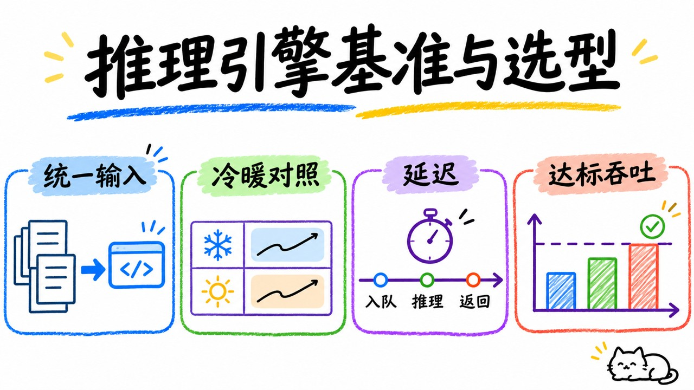
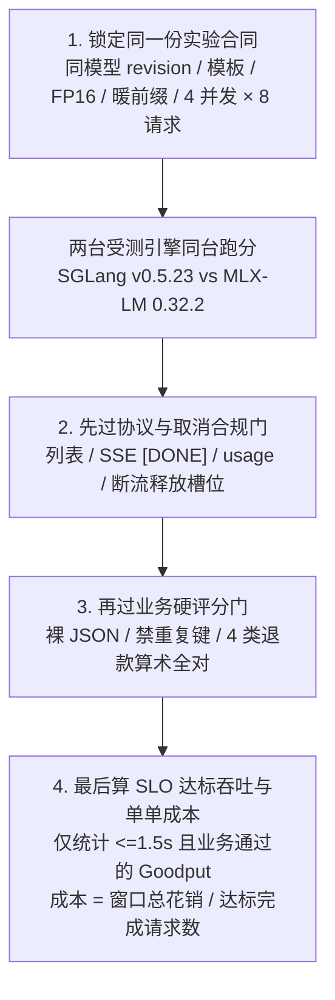

> **生成工具**：Codex\
> **生成模型**：gpt-6.2-sol

平时看别人做各种大模型推理引擎测评，最常见一张大柱状图写着「某某引擎高达 `200 Token/s` 吊打对手！」——可真把这种引擎搬回自己业务线上，结果往往发现：**它要么根本没按要求写裸 JSON（业务全废），要么长尾请求拖到几秒才吐出最后一个字直接超时！**

只盯着纯产字速度（`Token/s`）就像比谁往外扔空盘子更快。要把两款引擎拉上同一个严谨公正的擂台比高下，必须先订死同一张**包含协议、业务核验和耗时门槛的实验合同**。

> **先用大白话讲明白**：科学评测两台推理引擎，就像**让两家餐厅按一模一样的规矩现场打擂台**：
> 1. **食材与考卷彻底锁死（实验合同）**：两家必须吃同一版 `revision` 权重、一模一样分词器与聊天模板、一样精度（如 16-bit）、一模一样 `temperature=0` 与生成长度预算；冷开局 vs 暖预热也要严格分开记；
> 2. **先把不合规的废菜全扔进垃圾桶，才准算营业额（SLO Goodput）**：就算每秒爆炒 80 盘，可只要有一半放错了盐（算错业务数字 / 外面包代码围栏）或者超过 `1.5 秒` 还没端上桌（超时违约）——那些通通**不算进有效产出**！最后只算「**在延迟红线内准时上齐且味道全对的达标请求数 ÷ 时间**」，再拿租机费用一除得出每单真正有效成本！
> 3. **小心「打完一单才发下一单（闭环）」掩盖真实的排长队雪崩（开环）**：今天演示小测试为了轻量是「固定 4 线程打完一发补下一发（Closed-loop）」；但真要预测晚高峰雪崩，必须换成**不管你处理得过来没有、每秒强行按真实到达泊松节奏猛砸流量的开环压测（Open-loop）**！

## 1. 上擂台前：必须签死这份《基准实验合同》

随便放开一点微调参数都足以把两个引擎的差距拉歪。正式开跑基准测试前先锁定：
- **静态资产一致性**：相同的模型仓库和确切 Git `revision`、Tokenizer、Chat Template、权重精度（如 FP16）与 KV 精度、温度与最大输出 Token 上限；
- **可追踪与冷暖隔离**：每条请求带唯一稳定追踪 ID 并存下原始输入输出正文；「冷态」指全新重启进程或明令彻底刷空缓存状态（而且要注意：**「进程刚拉起」和「操作系统刚清空磁盘文件页缓存导致冷读磁盘文件」不是同一个冷度！**）；「暖态」走完一模一样的预热序列；涉及客户端半途断流或异常注入一律开独立专场，绝不污染主性能基准！
- **业务与负载约定**：本次采用 4 类退款样本（含常规混合、零值 `0`、全空 `null`、小数均值）连跑两轮共 `8` 条；严格业务要求**裸 JSON 对象（禁止外层代码围栏和额外字段、禁止重复键）且 `count/mean` 全对**，且规定端到端耗时 **`<= 1.5 秒`** 才算满足本次示范 **SLO（服务等级目标）**。

## 2. 先校验协议合规与断流回收，再比性能和达标吞吐

不要跳过协议校验直接上压力机！普通生成和流式输出的文本结果要在同等条件下逐一对准；验收范围包含 `/v1/models`、可见文字增量、`finish_reason`、准确 `usage` 计数与取消闭环证据（并且记得将服务报错、429 限流、主动取消与业务算错四类失败**分别统计**，绝不糊里糊涂混成一个错误率）。

以下数据来自同一台 **Apple M1** 上直接读取**完全相同的 16-bit MLX Qwen 权重快照**，跑同一脚本 [probe.py](../../experiments/serving/probe.py) 与相同预热步骤后的实测（抽取其中「**同前缀暖态 + 并发 4**」的 8 条对抗轮；说明：该场次中 SGLang 配置了最多同时运行 8 条请求上限，两边各自跑原生默认内存池与调度机制，详看原始记录 [sglang-probe.json](../../experiments/serving/sglang-probe.json) 与 [mlx-probe.json](../../experiments/serving/mlx-probe.json)）：

| 参战推理引擎 | 协议正常结束 | 业务严审通过 | 首字 P95 (`ms`) | 整条 P95 (`ms`) | 净生成速度 (`Token/s`) | 达标吞吐 (`SLO Goodput, req/s`) |
| --- | ---: | ---: | ---: | ---: | ---: | ---: |
| **SGLang `v0.5.23`** | `8/8` | `4/8` | **`127.4`** | **`519.2`** | **`83.1`** | **`3.96`** |
| **MLX-LM `0.32.2`** | `8/8` | `4/8` | `481.1` | `794.6` | `55.4` | `2.64` |

> **想再深入一层？（严苛核对数据背后的公正性声明！）**
> 有意思的是，这一轮两款引擎吐出来的总文本量**不约而同都是 `84` 个 Token**，且在严格裸 JSON 评分器下都是过了 **`4/8`**（那未过的 4 条同样掉进代码围栏或错算坑里）。而就纯速度来看，SGLang 在并发 4 下通过批调度与算子安排把 `首字 P95` 压到了 `127.4 ms`（大约 MLX-LM 的四分之一）并让达标吞吐达到 `3.96 req/s`。
> **极其关键的实事求是声明**：取消断连回收在 SGLang 侧另有隔离测试记录确认（[sglang-protocol.json](../../experiments/serving/sglang-protocol.json)），在 MLX-LM 侧走代理与浏览器取消测试验证；至于 vLLM 阵营，本次环境仅留下了早期容器与插件的启动记录（未完成同等条件 HTTP 压测）。因此本表格属于**小规模本机机制检验**，**绝不可以直接拿去当成生产集群在 NVIDIA H100 上选型买谁的决定依据！**

## 3. 怎样把数字扩展成真正能敲板买单的「生产选型报告」？

真轮到公司做大规模采购级基准对比（比如比高并发 NVIDIA GPU 机器上的 **vLLM vs SGLang**），照着这五步写出让人服气的硬核选型报告：
1. **业务红线一票准入**：先卡死最低业务准确率门槛——没过关就直接去调聊天模板、开结构化输出（记得验证解析器稳定性）或换权重，速度再快也不参评；
2. **达标前提下核算「每单真实金钱成本」**：只有稳在相同 **SLO**（同时卡住首字延迟、整条延迟和业务错误率）上限以内测出来的吞吐才有意义！随后用公式算出核心商业账：
   `每成功达标请求成本 = 测试窗口期归属总成本 ÷ 窗口内达标请求总数`
   （窗口分摊成本务必老老实实含上**多副本、冷启动预热期开销与空载冗余**，别忘了写明云机器时薪租价和失败重试计费口径）；
3. **补全多维场景与开环施压**：除了短小固定并发，必须补测真实长短混合分布、**开环按固定频率到达（Open-loop）**抗拥堵曲线、多组重复冷暖复现，以及服务端暴露的队列堆积数与缓存命中水位；
4. **验证参数「真同义对齐」**：对比两家引擎前务必逐项核实两边的张量并行、量化算法、KV 数据类型甚至 `--mem-fraction` 参数表达的是不是一回事，别一家拿 FP8 KV 跑去跟另一家 FP16 KV 比显存；
5. **把周边运维工程成本也摆上桌面**：工具调用（Tool Call）解析稳不稳、JSON Schema 支不支持、动态挂多 LoRA 方不方便、日志监控好不好接、升级与灰度回滚顺不顺手——这些全算总拥有成本（TCO）！[vLLM Benchmark CLI](https://docs.vllm.ai/en/latest/benchmarking/cli/) · [SGLang 文档](https://docs.sglang.io/) · [共用探针源码](../../experiments/serving/probe.py)

## 下一篇

拿到了单台实例「守住业务正确且不超时」的安全稳态上限（比如稳态最多扛 `5 请求/秒`）。可线上真实流量从来不是平坦如水的——平时风平浪静 `3 req/s`，突然月底结算猛冲进来连续 6 秒 `11 req/s` 的尖峰，而拉起一台新模型副本哪怕算最快也要整整 **4 秒** 加载与预热！这时候到底该**提前摆好几台常驻机器硬扛**，还是指望**看到排队就自动弹性扩容（Autoscaling）**？[**SERV-15《从尾延迟推到容量规划和弹性伸缩》**](serv-15-serving-capacity.md) 会用一行不藏私的离散排队演算程序算破「扩容晚到」真相！

[返回 LLM 与 Agent 学习路线图](https://blog.lacknb.cn/articles/2026/11/19/1795058329577.html)
