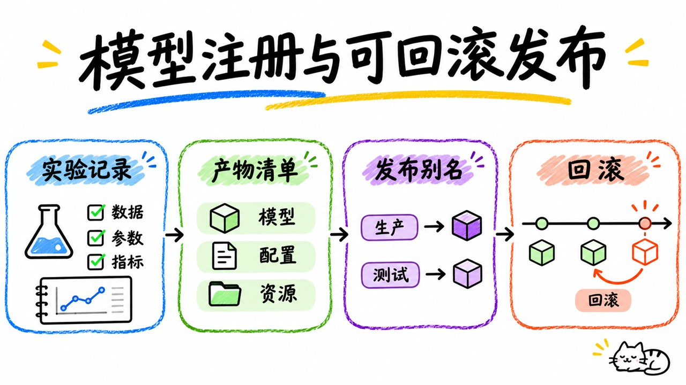
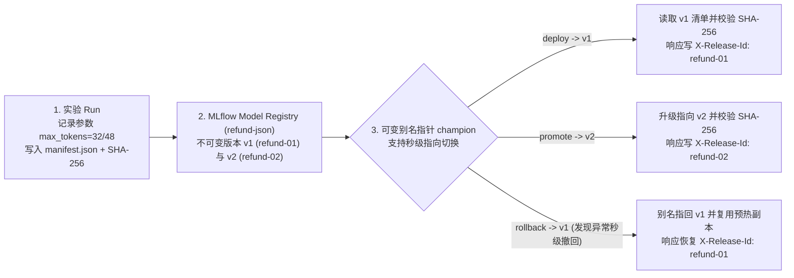

> **生成工具**：Codex\
> **生成模型**：gpt-6.2-sol

假想今天你把线上的退款模型最大输出从 `32` Token 改成了 `48` Token，或者悄悄换了一个新量化版本。第二天清晨客服冲过来报错「昨晚十点半有一批报表输出格式全裂了」！

这时候要是你们团队的日志里只孤零零记了一行 `"model": "qwen"`，那就全完了——你根本无法定位昨晚十点半生效的究竟是哪个 Git revision 的权重、哪套聊天模板、到底开没开约束、当时过没过离线门禁！**产物血缘（Artifact Lineage）**，干的就是给每一次发布「连根拔起全部前因后果并焊死唯一身份证」的苦差事。

> **先用大白话讲明白**：搞明白 **Tracking Run（实验记录）、Registered Version（注册版本）、Alias（动态别名）、Release ID（不可变发布号）** 的分工，就像**管理一家连锁品牌发版本出厂**：
> - **Run（研究档案袋）**：记录「哪一天用哪份脚本和参数做了哪次验证、得分是多少」，是只增不改的实验证据链；
> - **Version 1 / Version 2（封箱质检合格成品）**：从合格 Run 里挑选一份完整发布清单，打上 SHA-256 防伪蜡封入库编为第 `1` 版、第 `2` 版，入库以后内容终身不能偷改；
> - **Alias（如 `champion` 头牌指针牌）**：就像门口挂着一块可活动的牌子「今日主打推荐：第 `1` 版 -> 升级指第 `2` 版 -> 出事一秒拧回第 `1` 版」——**注意：网关只在请求刚开始接进门那一刹那读取 `champion` 并贴死固定不变的 `X-Release-Id: refund-01`，这样就算请求跑到一半管理员切了别名，这笔正在算的请求中途绝不会精分错乱！**



## 1. 彻底理顺实验、注册版本、别名与请求发布号四兄弟

**MLflow Tracking** 专门存研究和校验阶段的运行记录（`run`）；**Model Registry（模型注册库）**用来给一个模型族名（比如这里的 `"refund-json"`）排好顺序发一个个不可变版本号（Version `1`、`2`...），并在上面挂动态别名（如 `champion`）；而发到线上流量每一跳日志、HTTP 响应头里的 **`X-Release-Id`**（例如 `refund-01`、`refund-02`）则记录这张请求**真正落在了哪套一字不差的组合上**。

四个概念各司其职的对照一览：

| 身份对象 | 本篇演示实例取值 | 如果发生线上事故，它帮你立刻查出什么？ |
| --- | --- | --- |
| **`run`（实验 Run）** | MLflow 里的单次 Run ID | 追溯当时门禁通过截图、超参数和原始打包归档文件。 |
| **注册版本 (`Version`)** | `refund-json` 的 `1` 或 `2` | 精准锚定一套永不篡改的完整发布组合清单。 |
| **可移动别名 (`Alias`)** | `champion` | 给自动化路由脚本/部署流水线查「此刻该指派谁上岗」。 |
| **发布 ID (`X-Release-Id`)** | `refund-01`、`refund-02` | **随每条请求日志写死落盘**，从客户投诉瞬间反查回具体权重、模板、适配器、量化配置！ |

看清本例放进清单的到底有哪些必须锁死的要素（详见 [experiments/serving/registry.py](../../experiments/serving/registry.py)）：模型与分词器共同锁死到 exact revision `7ae557604adf67be50417f59c2c2f167def9a775`，聊天模板明确指向该仓库里的 `tokenizer_config.json`，加上 `adapter`、`quantization`、`max_tokens` 与评测数据 `fixture`。然后对整份 `manifest.json` 算一串 **SHA-256** 摘要直接打进版本标签 `manifest_sha256`！注意这里一个实用技巧：**只把轻量的发布清单文件 `manifest.json` 存成 MLflow artifact，庞大的模型权重文件依旧留在原本锁死哈希的权重仓库或对象存储，清单里只拿不可变路径和哈希指过去就行，省掉重复搬运几十 GB 文件的时间！** [MLflow 模型注册文档](https://mlflow.org/docs/latest/ml/model-registry/) · [MlflowClient API](https://mlflow.org/docs/latest/api_reference/python_api/mlflow.client.html)

## 2. 本机 SQLite 实战：注册两个版本、演练升级再一键回滚！

不用装重型数据库服务器，本地新建一个干净虚拟环境直接用轻量包 `mlflow-skinny` + **SQLite** 文件型数据库（启动时自动初始化建库）就能跑完注册、切换与校验全闭环：

```bash
python3 -m venv /tmp/serv-registry-venv
/tmp/serv-registry-venv/bin/pip install mlflow-skinny==3.9.0 sqlalchemy==2.1.9 alembic==1.20.1
/tmp/serv-registry-venv/bin/python experiments/serving/registry.py --dir /tmp/refund-registry
```

脚本实际依顺序执行了 **`deploy -> promote -> rollback`** 三步：每当把 `champion` 别名切到新版本时，校验代码不光看版本号对不对，还亲自从对应的 `run` 下载回 `manifest.json`，**重新算一遍 SHA-256** 跟版本标签里当初那串哈希对比一字不差才会过关！实测结果完整归档于 [registry-results.json](../../experiments/serving/registry-results.json)：

| 发布操作阶段 | `champion` 解析出版本 | 实测下载清单重新计算 SHA-256 校验 | HTTP 响应头写入追踪标识 |
| --- | ---: | --- | --- |
| **1. 首次上线 (`deploy`)** | 版本 `1` (`max_tokens=32`) | 匹配 `011f9ffdc3...` 通过 | `X-Release-Id: refund-01` |
| **2. 升级放量 (`promote`)** | 版本 `2` (`max_tokens=48`) | 匹配 `0b7423c3e8...` 通过 | `X-Release-Id: refund-02` |
| **3. 异常紧急回滚 (`rollback`)** | 瞬间拨回版本 **`1`** | 重新读回并二次核验 `011f9ffdc3...` 通过 | `X-Release-Id: refund-01` |

> **容易踩的坑（别以为改完一个别名就算完事了！）**：
> 1. **回滚速度陷阱**：上面 SQLite 里的别名字符串哪怕 `0.1 ms` 就指回版本 1 了，可要是你当初一升级顺手就把运行着旧版模型的 GPU 容器和权重全销毁了——紧急回滚时等容器冷拉几十 GB 权重、重分 KV Cache 再预热，照样得停服几分钟！要想做到真正的**低延迟热回滚**，至少要在切换过渡期内让上一版核心资产（文件缓存、兼容依赖或少许冷备/预热副本）随时可用；
> 2. **并发发版互相覆盖（Race Condition）**：如果两位同事或者两条 CI 流水线同一分钟先后调 `set_registered_model_alias("champion", ...)`，先完成的反而覆盖后完成的！所有修改生产别名的发布动作务必走单一串行部署锁或带版本期望号检查；
> 3. **别把「清单格式验收」当「业务评测合格」**：本脚本里的 `manifest_checks_passed` 验证的是清单字段齐全和指纹无损（且在入网真切流量前还得接上 [deployment_check.py](../../experiments/serving/deployment_check.py) 这类实机路由与业务冒烟），真正的模型算得准不准由离线评测集单独把关。

## 下一篇

版本台账、追踪编号、回滚指针全有了，现在正式把第四部分结尾刚导出的「独立 LoRA 适配器目录」和「完整合并权重目录」真正部署到本机单台服务器拉起跑起来！同时把 **`/health` 探活、预热拦截、并发闸门（超限弹 HTTP `429` + 断流不泄漏槽位）、`X-Release-Id` 动态切换与退回旧版** 全部接进一个完整可运行闭环，就看下一篇 [**SERV-08《从训练产物部署成单机推理服务》**](serv-08-single-node-deployment.md)！

[返回 LLM 与 Agent 学习路线图](https://blog.lacknb.cn/articles/2026/11/19/1795058329577.html)
