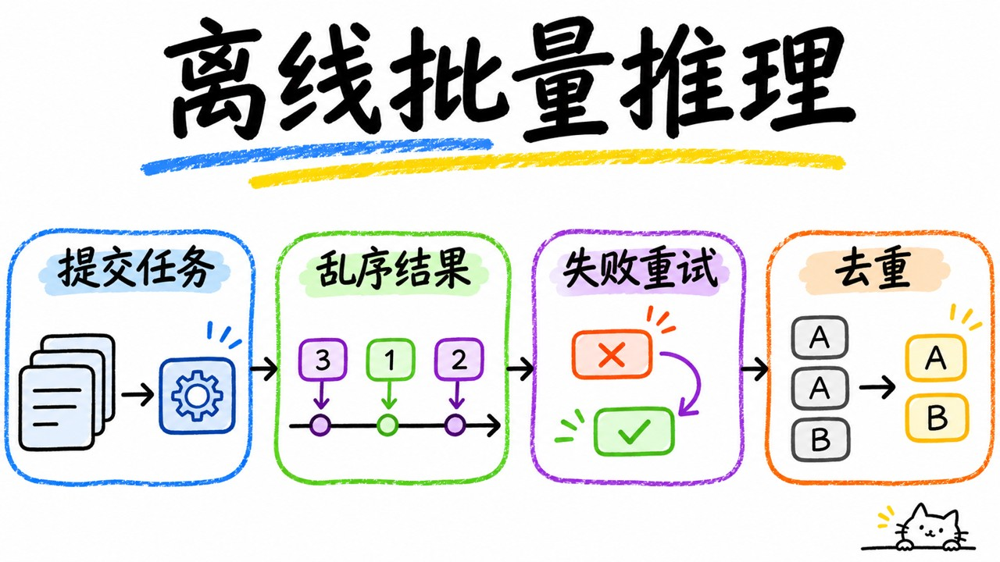
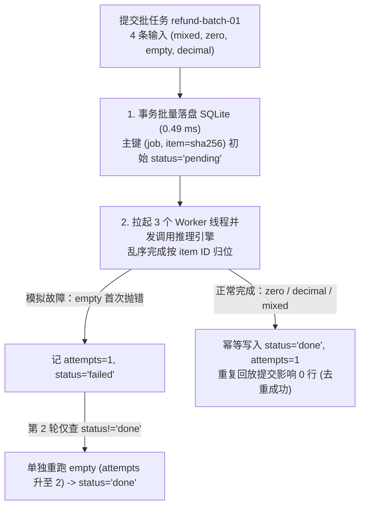

> **生成工具**：Codex\
> **生成模型**：gpt-6.2-sol

前面 15 篇一直在帮用户争分夺秒抢首字毫秒时间。但到了真实企业业务里，还有一大半大模型需求压根不需要「面对面秒回」：比如财务部门今天下了班一次性甩过来 4 份（或者几千份）等待统计的退款历史报表，明天早上查结果就行！

对于这种场景，还拿着在线网页同步逐条傻等着跑就太笨了：**先一口气把整批条目稳稳写进数据库拿张任务凭据号（`job_id`），后台开几个工人多线程并发去推；中间如果第 3 张突然超时崩掉，只需把第 3 张单独捞出来重跑一次；哪怕由于网络抖动某个工人把第 1 张干了两遍，写库那一步也凭借唯一签名与状态条件实现铁打的「只落一次账（幂等去重）」！** 顺便今天还会理清一个极易混淆的概念——**「业务应用写的离线批处理作业」vs「推理引擎底层那个 Continuous Batching」究竟差在哪里？**

> **先用大白话讲明白**：做可控、可恢复、防重复的 **离线批量推理作业（Offline Batch Job）**，就像**运营批处理中心开出一张带编号的点菜单**：
> - **稳定主键防串单 + 先落盘回执（0.49 ms）**：刚收到 `refund-batch-01` 四张 CSV 时，按 `job_id:sample` 算唯一哈希摘要当 **SQLite 复合主键** 先批量持久化标为 `'pending'`，当场甩给调用方任务单号结束等待！即使后边乱序完成（谁先算完谁先写），照样按唯一条目号精准归位！
> - **失败只重做坏掉的那一颗，不连累已完成的好兄弟**：第一轮让 `empty` 在请求前故意抛出故障变成 `'failed'`，同时让 `mixed` 故意睡 `400 ms` 模拟慢包——另外两张早已爽快变 `'done'`；第 2 轮调度只查 `status != 'done'` 把孤零零的 `empty` 捞起来补算一遍，其余 3 条纹丝不动！
> - **幂等写库防「重复发钱」（`rowcount == 0`）**：就算由于崩溃重连把同一份完成结果再次往数据库里交卷，SQL 语句带着铁锁 `WHERE job=? AND item=? AND status!='done'`——已标完 `'done'` 的条目影响行数必定严格为 **`0`**，绝不会把一份退款结果记账两遍！



## 1. 给每份批任务和每个条目钉死独立可重跑的边界

本次批任务 `refund-batch-01` 包含顺序提交的 4 张经典考验样本：`mixed`（混合）、`zero`（零值）、`empty`（全空）、`decimal`（小数均值）。为了做到哪怕重启机器或并发乱序都能对准原位，数据库表设计必须牢牢把握四条纪律：
1. **稳定可检索复合主键**：使用 `job_id:sample` 经 SHA-256 截断算出确定性的 `item` 标识（如 `13b7eccdfc2f1673`），连同 `job` 组合成 SQLite 表 `(job, item)` 复合主键；真正进企业生产环境还要一并存入**输入文本全文 SHA-256 校验码和当时指定的模型发布号 `X-Release-Id`**——下次碰到拿着相同 `(job, item)` 二次复提交时先验输入校验和，防止拿旧答案糊弄改过内容的新表！
2. **先持久化立项、再发确认回执**：事务一次性写满所有 `'pending'` 行立即返还作业号，才算安全立案。
3. **工人并发、乱序收回与租约防挂**：每个工作者线程或集群节点（Worker）抢任务做时，谁快谁先完、完成次序根本不必死守提交顺序；在多台机器争抢的生产系统里，工人领活要用原子更新挂一个带过期时间的**租约（Lease）**——哪台机半路断电拔网线了，租约一到超时中心自动收回来放给别人重做！
4. **消费与持久化必须天生抗重（幂等 Idempotent）**：因为重连或租约回收可能令同一个条目真正调用引擎计算了两回，数据库写入侧务必用状态机守门（比如只有当前不为 `'done'` 时才更新写入），把潜在重复后果消化于无形。（为专注检验核心状态机流转，下面示范脚本用单进程内部线程池充当协调器统一提交写入 SQLite。）

## 2. 本机运行实战：4 条入库、并发乱序、定点故障重试与去重归零

把指向的推理引擎服务（如 MLX-LM 0.32.2）跑在本地 `18083`，执行仓库里的 [batch.py](../../experiments/serving/batch.py)（注意传入全新的 `--db` SQLite 路径）：

```bash
python3 experiments/serving/batch.py --server http://127.0.0.1:18083 --model default_model \
    --db /tmp/refund-batch.sqlite --out /tmp/refund-batch.json
```

脚本设计了极其漂亮的对照与自检戏码：
- **先跑传统在线逐条基线**：老老实实 1 个接 1 个排队同步叫完 4 个请求，记下总墙钟耗时 `online_elapsed_ms`；
- **再跑批处理持久化作业流程**：事务建库提交 -> 3 线程并发派发 -> 在第 1 轮故意使坏让 **`empty` 在请求前就抛出异常 fail 掉**，并让 **`mixed` 睡 `400 ms`** -> 第 1 轮完事只捞没完成的重跑第 2 轮 -> **最后刻意对着一条已经完成落库的条目原封不动再刷一遍 `UPDATE ... WHERE status!='done'`，死死断言受影响数据库行数为 `0`！**

直接审阅这轮在 **Apple M1 + MLX-LM 0.32.2** 实机拿到的真实数据战报（完整落盘见 [batch.json](../../experiments/serving/batch.json)）：

| 测量指标项目 | 本机实测值 | 说明了什么架构事实？ |
| --- | --- | --- |
| **入库提交落盘耗时 (`submit_ms`)** | **`0.49 ms`** (`0.4929 ms`) | 只要不到半毫秒就能发回任务号，彻底解耦客户端等待！ |
| **传统在线逐条串联总耗时** | `2.21 s` (`2212.86 ms`) | 前一个卡着后面干瞪眼，没有任何并行重叠 |
| **并发+故障重试+注延时总耗时** | **`1.86 s`** (`1857.03 ms`) | 就算白挨了 `empty` 重试 + 人为 `400 ms` 睡眠卡顿，靠 3 并发照样比串行更早跑完！ |
| **实际完成乱序序列** | **`['zero', 'decimal', 'mixed', 'empty']`** | 后交的 `zero` 最早完、`mixed` 因睡眠掉到第 3、`empty` 第 2 轮补算收尾，全靠主键稳稳对号归位！ |
| **各条目尝试次数 (`attempts`)** | `empty: 2`，其余 3 条各 `1` | 真正实现失败单点恢复，绝不牵连那 3 条已成功的结果 |
| **幂等重复覆盖写影响行数** | **`0` 行** (`replayed_write_rows: 0`) | 完美验证防重复记账 |
| **最终业务严审通过情况** | `0/4`（四条全未过严审） | 注意所有条目全都正常收到了模型响应且返回了 `stop`；但由于 MLX 原始基座全部给答卷套了一层 ```` ```json ```` 围栏（甚至在 `zero` 也错成 `count: 0`），按严格裸 JSON 评分照样判 `false`——批作业管道稳固运行，不代表模型本身做对了业务题！ |

## 3. 彻底划清三个极易搞混的「Batch（批处理）」层级界线

> **想再深入一层？（应用批作业 vs 引擎连续批处理 vs 官方 Batch API）**
> 哪怕全叫 Batch，这三件事站在系统架构完全不同的三层，别搞混了：
> 1. **本篇搭的应用级离线批作业（Offline Batch Job）**：站在最上层应用/调度系统里，负责**任务落盘持久化、进度状态查询、失败条目定向重试、幂等防重复以及权限配额控流**；
> 2. **推理引擎里的连续批处理（Continuous Batching，见 [SERV-04](serv-04-paged-attention-batching.md)）**：躲在 GPU 调度器内核里面！决定同一个前向循环到底把哪几个请求凑进显卡里算——即使你在应用层慢慢悠悠开 3 个离线工人往里面发单，底层引擎依然可能把你这几条离线请求跟外面用户的在线请求顺畅混拼进同一个显卡批次里算！（因此衡量离线作业不能只夸那 `0.49 ms` 提交有多快，一定要单独统计「整批真做完的墙钟总耗时」、「加了重试以后的总有效通过率」、以及「分摊下来每条**成功条目**实际吃掉的算力和 API 账单」。）
> 3. **大模型厂商对外提供的云端 Batch API（如 OpenAI Batch API）** [OpenAI Batch API 文档](https://developers.openai.com/api/docs/guides/batch)：通常打包上传大 JSONL 文件换取约半价和 24 小时异步回传承诺；提交时务必为每行赋上稳定的业务唯一 **`custom_id`**——这样哪怕大厂后端给你打乱顺序吐回结果文件，你照样一秒精准按 `custom_id` 缝回自己数据库，并且顺手把包含错因的那几条单独抽出来重起下一小批重算！

> **大白话小结（Batch 1～5 全路线收官）**：到这里，第五部分「**推理引擎与模型部署（SERV-01～SERV-16 共 16 篇）**」正式圆满打通！回顾整条 63 篇的成长路径，我们从一粒词元怎么经过 Tokenizer 和 Transformer 注意力变成下一个预测字（Part 1 `F`），穿过多模态与结构化约束 HTTP/SSE 协议（Part 2 `API`），练出一套铁面无私、能防泄题与接管爆单回滚的评测体系（Part 3 `LE`），亲自手把手喂进数据预训练、LoRA/QLoRA、SFT/DPO/GRPO 蒸馏造模型（Part 4 `TRN`），最后再顺着源码把权重搬上单机、多卡、流控灰度、容灾扩容以及耐故障离线的真实服务（Part 5 `SERV`）——一台完整可控的模型底座工程大厦已经全部立住了！

[返回 LLM 与 Agent 学习路线图](https://blog.lacknb.cn/articles/2026/11/19/1795058329577.html)
