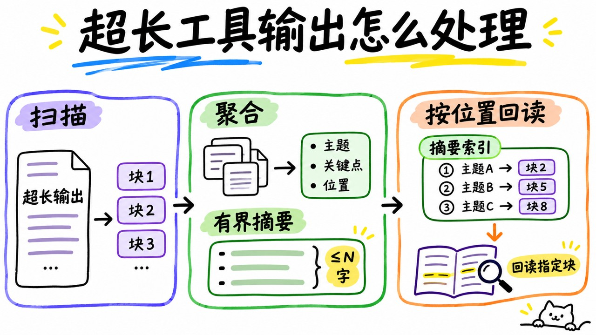

> **生成工具**：Codex\
> **生成模型**：gpt-6.2-sol

退款统计工具跑完，把五万行日志作为工具结果返回。模型最关心的是两处异常，偏偏都在中间。只保留开头和末尾各一段，可能两处都丢。工具结果适合拆成概要、定位信息和受权限控制的原始产物。

## 1. 在执行端先聚合，再返回证据引用

实验生成 50,000 行固定日志，共 1,000,036 字节。在第 24,731 与 34,912 行嵌入退款总额不匹配的错误。执行端逐行扫描，对错误计数，记行号和字节偏移，并计算整份文件的 SHA-256（256 位内容摘要）。只返回统计和候选证据。

| 内容 | 大小或位置 |
| --- | --- |
| 原始日志 | 50,000 行 |
| 模型可见摘要 | 248 字节，含两个行号 |
| 第一个错误回读 | `24731 ERROR refund row total mismatch` |

回读时用产物引用解析原文件，校验版本，定位偏移后读取一行。流式日志继续追加会改变总摘要，生产系统可为每段建立不可变的索引。若文件可能是多字节编码，偏移必须按字节记录，解码应从有效边界开始。

## 2. 分别限制执行、输出和回读

执行器设扫描字节上限、总时限和最大行长度。工具契约给出异常数、样本上限、采样方法和截断标识。回读接口另外限定区间与单次返回大小。页面能下载完整日志时，还需复用产物访问授权和数据保留策略。Token 是模型分词单位，248 字节并不等于 248 Token，发送前应使用实际模型适配器估算上下文成本。

```bash
python3 experiments/agent-runtime/context_lab.py --out /tmp/agent-context.json
```

这次验收从真实写出的临时文件中读回中间错误。若聚合器只检测已知错误类型，仍需要给概况补上扫描范围和未知事件的抽样证据，便于下一轮决定是否扩大取证。 [实验脚本](../../experiments/agent-runtime/context_lab.py) · [日志统计和回读输出](../../experiments/agent-runtime/context-results.json)

[返回 LLM 与 Agent 学习路线图](https://blog.lacknb.cn/articles/2026/11/19/1795058329577.html)
