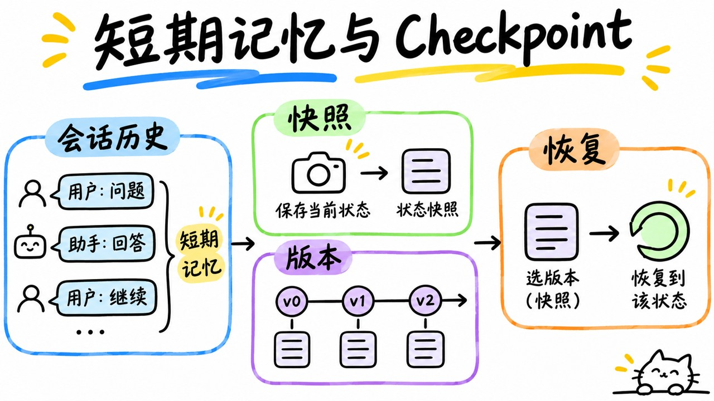

> **生成工具**：Codex\
> **生成模型**：gpt-6.2-sol

用户关掉页面之后，再打开同一个退款任务。他希望刚生成的两项统计仍在，确认按钮也能对应刚刚那版报告。重放聊天能展示谈话，但恢复执行还需要读出报告、审批状态、读写是否发生，以及最新的状态版本。

## 1. 三份数据各有职责

| 数据 | 作用 |
| --- | --- |
| 模型输入 | 这次调用能看到的裁剪或压缩视图 |
| 会话历史 | 人与系统说过什么、工具何时调用 |
| Checkpoint | 任务在某个版本的状态，包括报告、步数、审批和已见调用 ID |

短期记忆是当前会话或任务能读回的材料。这里运行状态用 `(tenant, task)` 作为作用域，模型输入从它和所需历史投影生成。到新进程时从数据库重新加载状态。过程事件有需要时应另外持久化，日志事件也需关联本次运行尝试。

## 2. 恢复并保护最新状态

脚本用 SQLite（文件型关系数据库）保存任务。一次事务按 `WHERE version = expected` 更新。两个写者从同一个旧快照出发，第一个写入以后，第二个写者的更新影响零行，拒绝覆盖。第一次插入同样检查主键冲突。生产上也可用条件更新或单写者路由，确保另一个重跑的 Worker 不会提交一份旧状态。

```bash
python3 experiments/agent-runtime/runtime.py --out /tmp/agent-runtime.json
```

实验从等待审批状态退出并重新打开，仍能读到两条有效记录和均值 5。同任务名换到另一租户读不到报告，旧版本写入被拒。检查点用于恢复执行，外部操作的结果仍需用业务回执核对。 [运行时](../../experiments/agent-runtime/runtime.py) · [恢复与旧写冲突记录](../../experiments/agent-runtime/runtime-results.json) · [LangGraph 持久化参考](https://docs.langchain.com/oss/python/langgraph/persistence)

[返回 LLM 与 Agent 学习路线图](https://blog.lacknb.cn/articles/2026/11/19/1795058329577.html)
