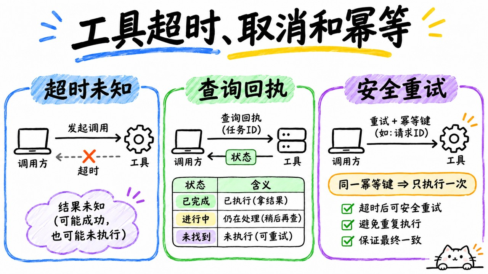

> **生成工具**：Codex\
> **生成模型**：gpt-6.2-sol

归档工具超时。它可能没收到请求，也可能已经完成写入，只是答案没传回来。遇到这种未知结果，先查「这一笔动作」的状态，再决定是否重试。幂等表示重复执行同一个业务动作时，最终只产生一次相应业务效果。

## 1. 先判断哪里失败

| 观察 | 处理 |
| --- | --- |
| 参数不合法或权限拒绝 | 返回明确错误，纠正输入或补授权 |
| 只读查询的暂时故障 | 在限时和次数内退避，保留同一请求关联 |
| 写操作超时，结果未知 | 用业务动作 ID 查回执，再决定是否重试 |
| 用户取消 | 停止继续调度，向可取消的操作传递取消，并核对已发出的写操作 |

一次尝试的 `tool_call_id` 有助追踪，业务动作 ID 则跨尝试稳定。这里以退款任务 ID、动作名、报告 SHA-256 摘要构成动作 ID，并用租户划分命名空间。批准另一版报告时摘要会变，已有批准无法沿用。服务应在数据库唯一键或下游明确的幂等接口上实现这个关系。

## 2. 实际模拟写成后丢回执

读取行 `4, NA, 6` 得到两条、均值 5。程序验证当前报告已确认，提交归档事务，然后故意抛出 `TimeoutError`。此时检查点仍显示 `approved`。重新打开 SQLite 后按同一动作 ID 查到报告哈希，恢复任务为 `completed`，归档表行数为 **1**。

```bash
python3 experiments/agent-runtime/runtime.py --out /tmp/agent-runtime.json
```

如果外部服务既无稳定幂等接口又无结果查询，保留结果未知和原始动作 ID，转到人工核对。对可重试读请求设置最大尝试数、总体时限和抖动。工具执行中的本地取消只能证明本地不再等待，外部服务是否中止要看回执或查询。 [运行时与故障注入](../../experiments/agent-runtime/runtime.py) · [恢复轨迹](../../experiments/agent-runtime/runtime-results.json)

[返回 LLM 与 Agent 学习路线图](https://blog.lacknb.cn/articles/2026/11/19/1795058329577.html)
