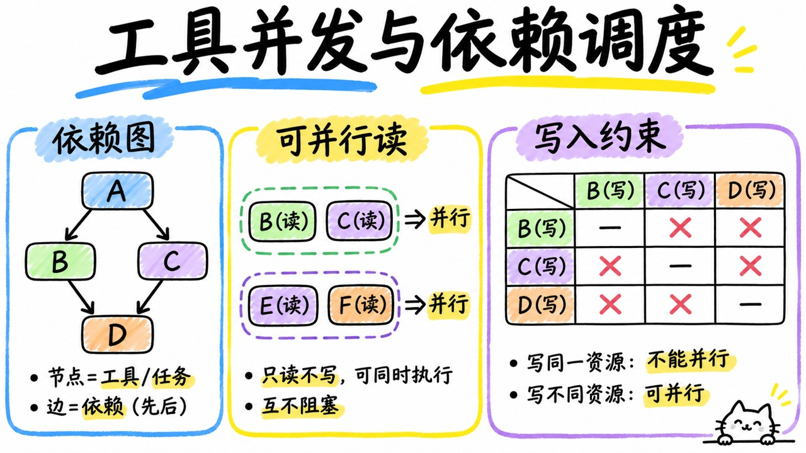

> **生成工具**：Codex\
> **生成模型**：gpt-6.2-sol

两个人一起核账，一个数有效退款，一个翻规则手册。谁先交结果都可以，但写报告的人要等两个答案齐了。最后把报告锁进档案柜，还要等用户确认。

本篇用下面这份 CSV（逗号分隔值文件）走一遍。第一行 `refund` 是列名，下面是两笔退款和一个缺失值。

```csv
refund
4
NA
6
```

统计工具排除 `NA` 后得到 2 条、平均每条 `(4 + 6) ÷ 2 = 5` 元。字段字典明确 `NA` 是缺失值。报告需要同时写下数字和口径。

```text
统计 ───┐
        ├→ 组装报告 → 用户确认 → 归档
字典 ───┘
```

## 1. 先把依赖写出来

依赖图中的箭头表示后一步需要前一步提供数据或满足条件。例如报告需要两份读取结果，归档需要当前版本的确认。这张图是 DAG（Directed Acyclic Graph，有向无环图），沿着箭头走不会绕回原节点。调度器只把前置条件已经满足的节点交给执行器。

先检查两件事。两项读取是否各自拿得到输入？它们是否会互相修改正在读的数据？本例两项读取都可以立即开始，并使用同一批固定输入。若统计的规则来自字典回包，图就要改成「字典 → 统计 → 组装」。若两个节点都写同一份报告，要约定写入顺序或合并规则。即使有十个能同时开始的节点，也可用容量为 2 的信号量（把它想成只有两把钥匙）限制同一时刻只有两项进入。

## 2. 回包可乱序，组装靠调用标识

脚本用 `asyncio.Semaphore(2)` 限制并发，用事件控制返回顺序。它刻意让先启动的统计晚一点返回，练习按节点归并。

| 顺序 | 实际事件 | 报告此刻拿到了什么 |
| ---: | --- | --- |
| 1 | `start:statistics` | 统计任务已启动 |
| 2 | `start:dictionary` | 字典任务也已启动 |
| 3 | `finish:dictionary` | 字典回包 `{"missing":"NA"}`，仍缺统计值 |
| 4 | `finish:statistics` | 统计回包 `{"count":2,"mean":"5"}` |
| 5 | `assemble` | 合并为 `{"count":2,"mean":"5","missing":"NA"}` |

离线实验用两个有名字的任务变量保存归属，再分别等待。接真实工具接口时，通常每次调用有独立的 `call_id`。下面的伪代码展示如何用该编号归并。一批并行读取中，同一个工具也可能被调用两次，调用编号可以区分两次回包。

```text
required = {statistics, dictionary}
pending = {call_01: statistics, call_02: dictionary}
results = {}

on_result(call_id, outcome):
    if call_id is not in pending:
        return
    node = pending.remove(call_id)
    results[node] = outcome
    if every required node has succeeded:
        save_report(results[statistics], results[dictionary])
        move_to(awaiting_approval)
    else if pending is empty:
        record_missing_or_failed_dependencies(results)
```

这一段只把成功的读取交给报告组装。真实服务还要把回包绑定到具体任务和尝试，并让组装的状态转换能抵抗重复回包。归档节点应在用户确认该版报告之后才可执行。

## 3. 少一个回包时，哪一步还能继续

如果字典成功、统计因列名错误返回 `ValueError`，可以保留字典和错误信息，向用户说明统计未完成。报告缺了必填统计数据，组装条件仍未满足。等列名修正后，可以单独重新调度统计。复用字典前，先核对它是否仍对应同一个输入版本。

脚本还用 `asyncio.wait_for` 让一个本地协程超时，并通过它的 `finally` 清理段记录取消。如果工作在别的进程或服务里运行，本地协程停止等待后，还要向下游请求取消或查询最终状态。归档等写操作的超时结果核对可接着看 [AGT-08](agt-08-tool-retries.md)。

## 4. 复跑并检查三项结果

在仓库根目录运行下面的命令。它只用 Python 标准库，本地完成事件回放。

```bash
python3 experiments/agent-runtime/orchestration.py --out /tmp/agent-orchestration.json
```

打开输出的 `scheduling`，检查 `events` 中字典先于统计结束，`merged` 仍然含两份数据。`partial` 为 `["ok", "ValueError"]`，说明成功结果和异常都被收集。`timed_out_task_cancelled` 为 `true`，说明本地协程走了清理段。审批与归档是本文给出的下一步调度约束，这个并发实验实际运行到读取、组装和异常收集。

[并发和取消代码](../../experiments/agent-runtime/orchestration.py) · [原始实验输出](../../experiments/agent-runtime/orchestration-results.json)

## 练习判断两个读取还能不能并发

现在把固定的 `NA` 规则从统计器里拿掉。统计器必须先问字典，获得「`NA` 视为缺失」后才能计算。尝试先画新的依赖图，再写下字典失败时哪些节点能启动。

先预测下面三次运行中，会出现几次 `start:statistics`，以及能否组装报告。第三次把 CSV 里的 `NA` 换成 `MISSING`，字典也改用这个值。

```bash
exercise_dir=$(mktemp -d)
for scenario in dictionary-first dictionary-unavailable different-marker; do
    python3 experiments/agent-runtime/orchestration.py \
        --schedule-exercise "$scenario" --out "$exercise_dir/$scenario.json"
    cat "$exercise_dir/$scenario.json"
done
```

| 场景 | 用输出核对自己的预测 |
| --- | --- |
| `dictionary-first` | `finish:dictionary` 之后才出现 `start:statistics`，报告为 2 条、均值 5、缺失标记 `NA`。 |
| `dictionary-unavailable` | 只有字典开始和失败两个事件，状态为 `blocked`，报告为 `null`。 |
| `different-marker` | 顺序仍由依赖决定，报告为 2 条、均值 5、缺失标记 `MISSING`。 |

箭头变为「字典 → 统计 → 组装」。即使还有空闲执行位，统计也要等规则到手。第三次运行还验证统计器确实用了回包中的规则。如果它仍只跳过 `NA`，就会尝试把 `MISSING` 当成金额解析。组装成功的两次都停在 `awaiting_approval`，由用户决定是否归档。

[返回 LLM 与 Agent 学习路线图](https://blog.lacknb.cn/articles/2026/11/19/1795058329577.html)
