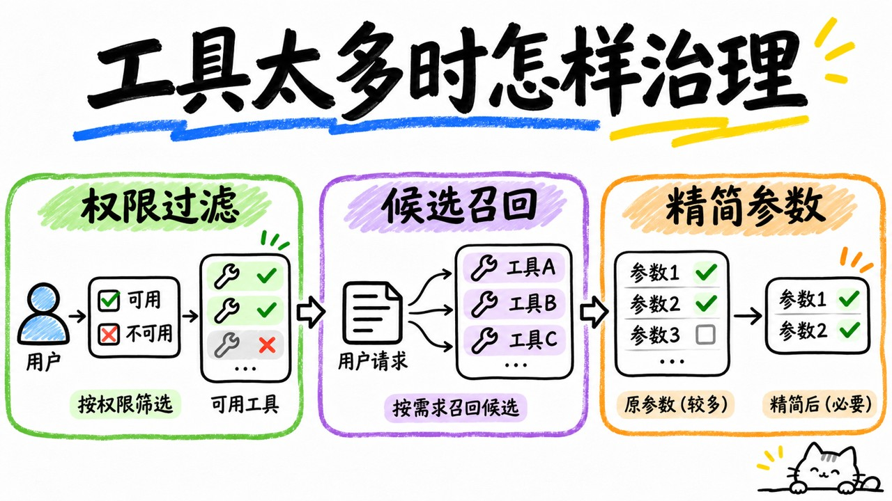

> **生成工具**：Codex\
> **生成模型**：gpt-6.2-sol

部署一套报表助手后，工具逐渐变多。退款统计、CSV 预览、日志搜索、确认归档之间容易出现同义词。多数任务只需几个工具，先用权限和工作阶段缩小目录，再把最相关的工具说明交给模型。

## 1. 先过滤，再排序，执行前复查

第一层按租户、用户权限和环境筛选，另一团队的工具连候选都不进入。第二层按当前任务领域和类别缩小范围。第三层用关键词、向量或规则排序，再取前 k 个候选。读表工具的 Schema（结构化参数约束）应说明列名、数据集引用与上限。工具定义尽量短，安全控制仍由执行器检查。能检索到归档工具只代表它可被考虑，真正提交还要绑定批准。

## 2. 用四条意图区分召回与选择

离线脚本使用四条固定意图和关键词集合。正确工具进入前 2 名的次数叫 Recall@2，本例为 **4/4**。把四条候选交给固定动作序列模拟选择，最终正确 **3/4**。问题「预览退款 CSV」已召回 `csv_preview`，模拟选择仍挑了 `csv_stats`。这一行说明召回和选择要分开定位。这是测量方法的教具，选择准确率不是实际模型的性能。

```bash
python3 experiments/agent-runtime/orchestration.py --out /tmp/agent-orchestration.json
```

若正确工具不在前 k，查领域路由、索引内容、授权范围或关键词别名。若已经在候选里，查描述是否互相重叠、参数能否揭示何时使用、两个动作是否都适合用户意图。还可统计多带了多少工具 Token，以及「不该调用工具」时的误选。 [候选与逐例结果](../../experiments/agent-runtime/orchestration-results.json)

[返回 LLM 与 Agent 学习路线图](https://blog.lacknb.cn/articles/2026/11/19/1795058329577.html)
