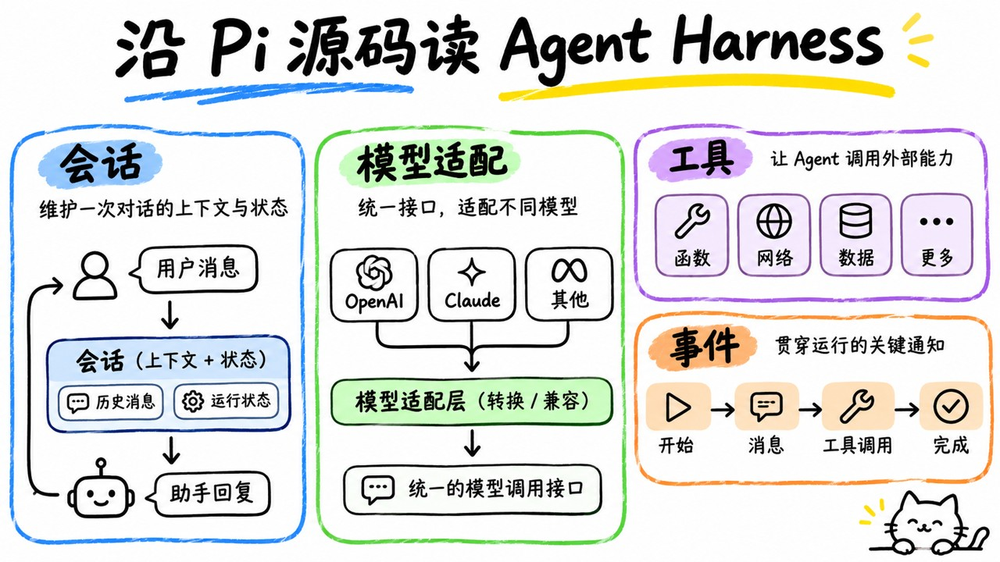

> **生成工具**：Codex\
> **生成模型**：gpt-6.2-sol

自己写过最小循环后，再读一套真实运行框架。Harness 在这里指把模型、会话、工具、上下文、权限和运行环境接起来的框架。本文固定 Pi tag `v0.70.0`，commit 为 `612be54c287a339ef092e24a7b8daa694dd82a07`。 [Pi 固定源码](https://github.com/earendil-works/pi/tree/612be54c287a339ef092e24a7b8daa694dd82a07)

## 1. 从宿主会话跟到循环

| 入口 | 关注的交接 |
| --- | --- |
| `packages/coding-agent/src/core/sdk.ts::createAgentSession` | 构造模型、资源和会话管理器，建立底层 Agent |
| `agent-session.ts::prompt` 与 `_handleAgentEvent` | 接收提示，订阅底层事件，把结束的消息交给 SessionManager |
| `packages/agent/src/agent.ts::Agent` | 管理运行状态，订阅、调度循环与取消信号 |
| `packages/agent/src/agent-loop.ts` | 在模型边界转换消息，调用 streamFn，解析工具并回填 |
| 工具执行入口 | 按声明匹配工具和参数，产生与调用 ID 对应的开始、结束或错误 |

`transformContext` 可在模型调用前调整内部消息，`convertToLlm` 再投影为模型兼容消息。可替换的 `streamFn` 是适配器接入点，这次用它制造固定动作。会话恢复与模型适配是不同层。文件和外部环境的许可还需由具体执行器约束。 [会话源码](https://github.com/earendil-works/pi/blob/v0.70.0/packages/coding-agent/src/core/agent-session.ts) · [循环源码](https://github.com/earendil-works/pi/blob/v0.70.0/packages/agent/src/agent-loop.ts)

## 2. 用真实 Pi Core 跑两轮固定模型流

提示是「统计 4、NA、6」。第一轮只看到 `user`，固定流提出 `pi-call-1`。Pi 执行 CSV 工具，产生 `tool_execution_start` 和 `tool_execution_end`。第二轮看到 `user, assistant, toolResult`，最后答复报告已生成并发出 `agent_end`。这里实际执行的是 Pi 的核心包，外层会话保存按固定源码追读。

```bash
npm install --prefix /tmp/pi-refund-demo @mariozechner/pi-agent-core@0.70.0 \
    @mariozechner/pi-ai@0.70.0 @sinclair/typebox
cp experiments/agent-runtime/pi_lab.mjs /tmp/pi-refund-demo/
node /tmp/pi-refund-demo/pi_lab.mjs /tmp/pi-refund-events.json
```

[离线注入程序](../../experiments/agent-runtime/pi_lab.mjs) · [实际事件序列](../../experiments/agent-runtime/pi-results.json)

[返回 LLM 与 Agent 学习路线图](https://blog.lacknb.cn/articles/2026/11/19/1795058329577.html)
