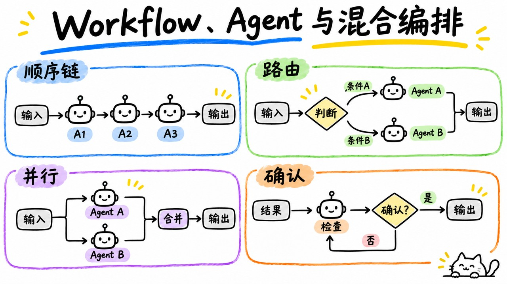

> **生成工具**：Codex\
> **生成模型**：gpt-6.2-sol

退款任务的统计公式是固定的，用户怎样描述目的却不完全固定。「算退款均值」与「点一遍这几行」可能指同一条工作流。混合编排允许模型帮助理解意图，但把可确定的动作留给程序。

## 1. 五种常见安排

| 模式 | 退款例里的用法 |
| --- | --- |
| 顺序链 | 读表 → 校验列 → 计算 |
| 路由 | 从退款统计或其它报表选择目标流程 |
| 并行汇聚 | 统计和字典同时执行，按节点 ID 汇总 |
| 评估后改写 | 验证条数与均值，再针对差错修正 |
| 自主循环 | 面对不完整任务，决定先澄清还是先查只读数据 |

Workflow（工作流）显式列出步骤及分支。Agent 可在有边界的任务内决定下一步。结合两者时可给模型较小的决策面，遇到低确定性就进入澄清状态。批准归档依然是明确的人工节点，任何派生分支都要核对同一个当前报告。

## 2. 跑一份固定退款任务

实验把结果汇聚到 `{"count":2,"mean":"5"}`。可并行读取先采集统计和字段字典，一次草稿错误由确定性校验发现，修复后进入 `awaiting_approval`。模型选择由固定序列模拟，程序负责明确边界和记录结果。遇到多方结论冲突时，可重算客观字段，并保留各自的来源。

```bash
python3 experiments/agent-runtime/orchestration.py --out /tmp/agent-orchestration.json
python3 experiments/agent-runtime/runtime.py --out /tmp/agent-runtime.json
```

[路由和合并结果](../../experiments/agent-runtime/orchestration-results.json) · [审批与终态](../../experiments/agent-runtime/runtime-results.json) · [Anthropic 工作流模式](https://www.anthropic.com/research/building-effective-agents)

[返回 LLM 与 Agent 学习路线图](https://blog.lacknb.cn/articles/2026/11/19/1795058329577.html)
