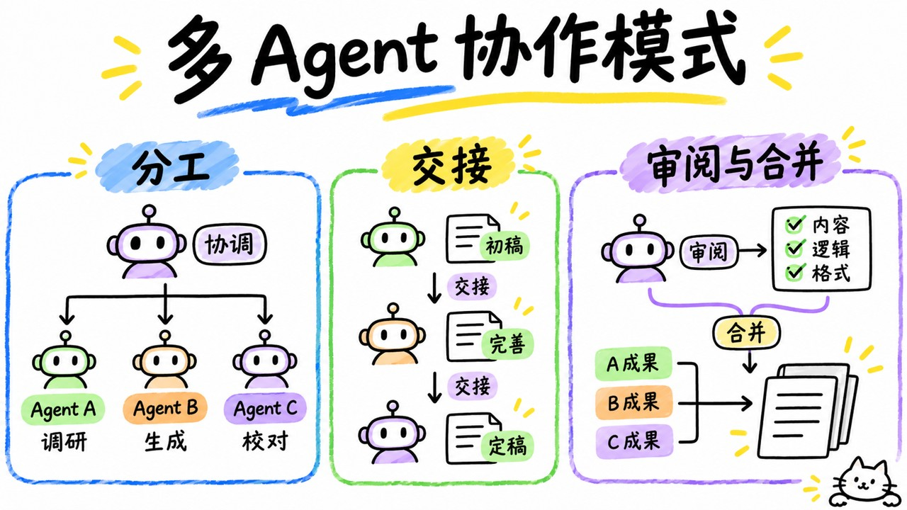

> **生成工具**：Codex\
> **生成模型**：gpt-6.2-sol

统计助手给出两条有效记录，审阅助手给出三条。多安排一个角色，系统就得明确谁接任务、各自能看什么、冲突怎么解决，以及谁能归档。

| 模式 | 退款任务中的交接 |
| --- | --- |
| 编排者与 Worker | 编排者保留任务状态，Worker 分别负责统计和数据字典 |
| Handoff（领域交接） | 报表入口把财务子任务交给专门角色，明确谁继续跟用户对话 |
| 生成者与评审者 | 一方拟报告，一方返回统计差异和证据 |
| 共享队列 | 多 Worker 原子领取任务，靠租约和动作 ID 处理超时与重复投递 |

## 1. 用可验证证据裁决冲突

本例的统计 Worker 返回 `{"count":2,"mean":"5"}`，审阅 Worker 返回 `{"count":3,"mean":"5"}`。编排者记录冲突字段 `count`，从同一 CSV 独立重算后选择两条，再进入等待审批。这两个 Worker 输出是固定教具，可用来验证结果汇聚规则，不得当作真实多模型性能比较。

每个 Worker 只拿任务所需的字段和证据引用。跨角色需要共享的是输入版本、可核验结果和必要状态，冗长的私有上下文不必全发。权限单独划分，两个读角色都不能归档，只有任务所有者在用户确认当前报告后能提交。

## 2. 把多 Agent 的成本一起量

额外角色可能提高覆盖，也增加模型调用、工具调用、证据传输、重试和协调。测试同一批任务的正确率、耗时、消耗与人工干预次数。不同任务适合不同模式，统计业务已有确定性的公式时，直接重算能给出更明确的冲突裁决。

```bash
python3 experiments/agent-runtime/orchestration.py --out /tmp/agent-orchestration.json
```

[冲突数据与权限结果](../../experiments/agent-runtime/orchestration-results.json) · [Anthropic 的多智能体案例](https://www.anthropic.com/research/multi-agent-research-system)

[返回 LLM 与 Agent 学习路线图](https://blog.lacknb.cn/articles/2026/11/19/1795058329577.html)
