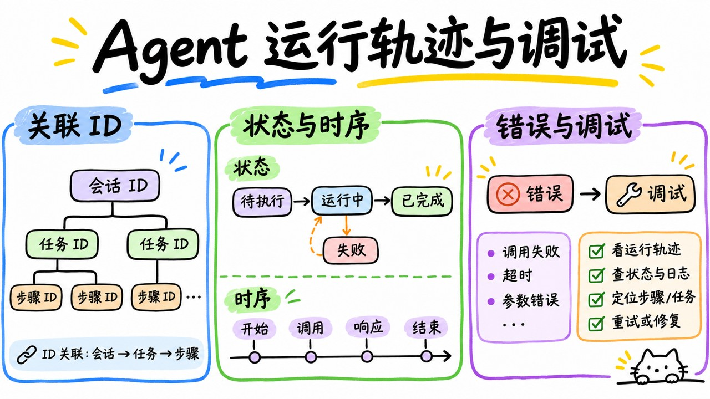

> **生成工具**：Codex\
> **生成模型**：gpt-6.2-sol

用户问「怎么还没归档？」只看最后一句回答，无法区分模型没输出动作、工具被拒、数据库已写但回执丢失。运行轨迹把这些阶段按标识串起，定位哪一层要处理。

## 1. 每个 ID 的范围和寿命

| 字段 | 本例用途 |
| --- | --- |
| 任务标识 | `refund-01` 跨进程仍相同 |
| 序号 | 当前这份内存事件片段中的顺序，重开后从新片段开始 |
| 步骤跨度 | `step-1` 标记第一轮决策，用于关联后续执行 |
| 工具调用 ID | `c-1` 给调用与工具结果配对 |
| 检查点版本和动作 ID | 恢复时找最新状态，以及是否归档了同一报告 |

Span（跨度）表示某一步从开始到完成的活动。分布式追踪可以使用同一 trace ID（链路标识）与父子 span ID 对齐上下游。客户端和服务计时需要记录时钟口径。本例只有事件及逻辑次序，实例间延迟需要另外测量。生产的持久时间线可按 `(task, attempt, seq)` 合并，或由统一存储分配全局任务序号。

## 2. 从证据定位阶段，再作恢复动作

正常首段观察到模型提出统计、工具成功返回两条且均值 5，随后 Checkpoint（检查点）停在 `awaiting_approval`。故障测试中，归档已写入却没收到回执，后续片段读到对应业务动作并记录 `reconciled`。两份记录的状态版本连得起来，回执可证明业务已经完成。日志还覆盖非法参数、重复调用和未审批的写入失败，利于把失败归到对应环节。

```bash
python3 experiments/agent-runtime/runtime.py --out /tmp/agent-runtime.json
```

留给评测的轨迹应保留必要的 ID、事件类型、校验结果与输入版本。真实 CSV、凭据或不必要的自由文本可用引用、哈希和字段白名单处理。回放轨迹时核验最终状态与副作用次数，便于在下一章按失败类型批量比较。 [离线运行轨迹](../../experiments/agent-runtime/runtime-results.json) · [OpenTelemetry 追踪概念](https://opentelemetry.io/docs/concepts/signals/traces/)

[返回 LLM 与 Agent 学习路线图](https://blog.lacknb.cn/articles/2026/11/19/1795058329577.html)
