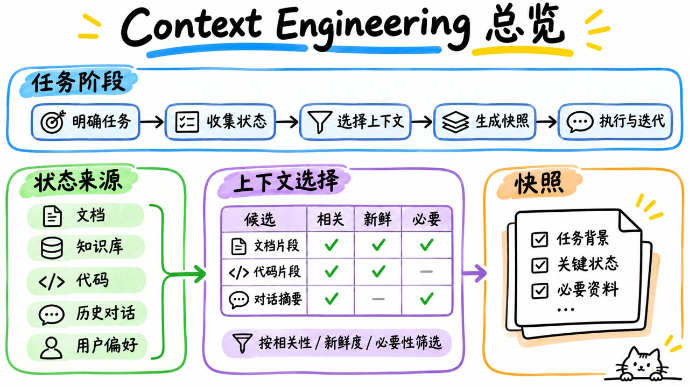

> **生成工具**：Codex\
> **生成模型**：gpt-6.2-sol

第一轮还没读数据，退款助手只需了解任务和权限。拿到 `count=2`、`mean=5` 后，模型需要看证据来写报告。等用户准备审批时，模型还要知道当前报告的摘要标识，以及它尚未获得确认。Context Engineering（上下文工程）就是设计这些信息的来源、选取方式、出现时机和预算。

## 1. 给信息指定所有者和使用期限

| 信息 | 权威来源 | 进入模型上下文的时机 |
| --- | --- | --- |
| 归档审批约束 | 运行时策略配置 | 每轮需要记住的高优先级约束 |
| 步骤、报告版本与审批 | 任务 Checkpoint | 报告形成或进入审批 |
| 统计值和计算出处 | 与调用 ID 对应的工具观察 | 生成报告与解释 |
| 详细 CSV、日志或中间文件 | 产物存储与可授权读回接口 | 限量预览或需要定位时 |
| 用户偏好与旧消息 | 有版本的历史或受控记忆 | 与当前任务有关时 |

Checkpoint（检查点）是可在下一次执行读回的状态。产物引用让模型知道去哪找资料，又不必把整份文件复制进请求。上下文中保存的摘要过期时，应回到原来源核对。

## 2. 用阶段推进做上下文快照

脚本按固定顺序构建三个视图。准备阶段包含系统约束和用户目标。报告阶段加上 `csv-1` 的调用和观察。审批阶段额外带报告 SHA-256 摘要与 `approval=missing`。JSON 序列化后计算摘要，便于检查模板、字段顺序或内容层级变更是否影响输入。

```bash
python3 experiments/agent-runtime/context_lab.py --out /tmp/agent-context.json
```

三阶段快照的摘要不同。报告阶段和审批阶段共享同一份工具观察，审批阶段的业务字段来自状态而非从文本猜测。回归时可同时比较快照结构和业务状态。例如「约束仍出现」属于上下文断言，「不确认时归档记录为零」属于执行断言。前者能发现组装回退，后者检查运行时是否兜底。 [上下文工程原文](https://www.anthropic.com/research/effective-context-engineering-for-ai-agents) · [快照和哈希](../../experiments/agent-runtime/context-results.json)

[返回 LLM 与 Agent 学习路线图](https://blog.lacknb.cn/articles/2026/11/19/1795058329577.html)
