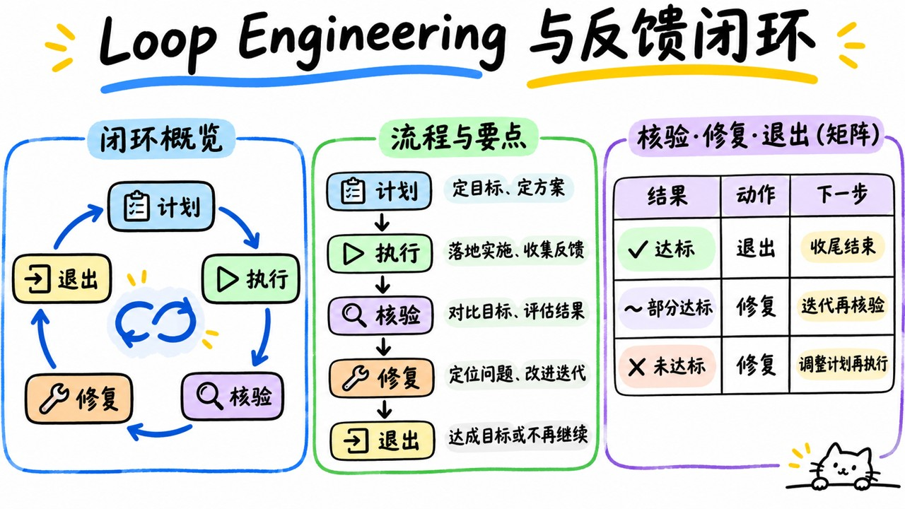

> **生成工具**：Codex\
> **生成模型**：gpt-6.2-sol

报表助手给出 `{"count":3,"mean":"5"}`，乍看合理，但把 `NA` 算成一条。Loop Engineering（循环工程）在本例中关注「产出之后怎样核验、修正和退出」。

## 1. 写清验收、下一步和停止条件

先用确定性程序计算期望 `{"count":2,"mean":"5"}`。核验器报告 `count` 不符，把它交给修复步骤。下一步提交的新草稿再次过同一核验。无进展时不继续空转。脚本对 `(count, mean)` 记录候选签名。业务系统还可以把验收通过的子目标和剩余错误作为进展量。

| 输入序列 | 结果 |
| --- | --- |
| 首稿条数 3，第二稿条数 2 | 第 2 轮通过 |
| 两份草稿内容相同且都错 | 第 2 轮发现重复，转人工 |
| 两份不同草稿都错，预算仅两轮 | 达到上限，保留问题给用户 |

## 2. 三层循环状态各自计数

基础工具循环在一次模型调用后转工具，再把结果给下一轮。反馈循环把一版完整的报告交给核验器，决定修复或退出。跨会话接力要持久化报告、未解决的问题、审批与版本，用户回来后再从状态继续。同步轮次、外层修复次数和人工等待时限应各自有预算。通过核验也只说明报告合格，归档仍待业务审批。

```bash
python3 experiments/agent-runtime/orchestration.py --out /tmp/agent-orchestration.json
```

[反馈脚本与三类结果](../../experiments/agent-runtime/orchestration-results.json) · [评估与优化模式](https://www.anthropic.com/research/building-effective-agents)

[返回 LLM 与 Agent 学习路线图](https://blog.lacknb.cn/articles/2026/11/19/1795058329577.html)
