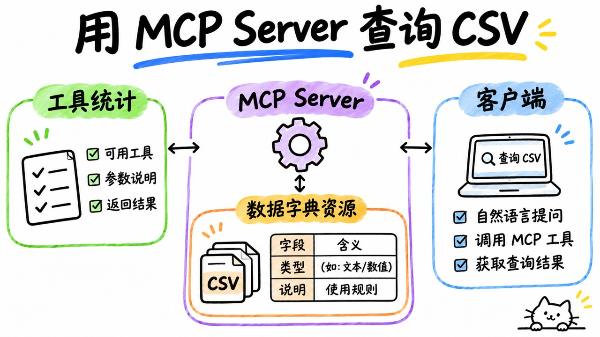

> **生成工具**：Codex\
> **生成模型**：gpt-6.2-sol

准备三行数据 `4`、`NA`、`6`。把统计程序放进 MCP Server，宿主提供列名，服务端返回来源、条数和均值。数据字典通过资源接口单独读取。工具只处理固定数据集，不收文件路径。

## 1. 给工具和资源写小而明确的契约

实验使用官方 Python SDK `mcp==1.27.0` 的 `FastMCP`。用装饰器注册 `csv_stats`，列名类型为 `Literal["refund"]`，即只接受指定列。结果类型包含 `source`、整数 `count` 和字符串或空值 `mean`。数据字典资源使用 URI `report://refund/dictionary`，给出缺失规则和均值类型。输出预算先在工具侧规约，结果内容也实测小于 128 字节。

```json
{"source":"refund-fixture","count":2,"mean":"5"}
```

## 2. 先让协议客户端跑过失败路径

```bash
python -m pip install mcp==1.27.0
python experiments/agent-runtime/mcp_lab.py --out /tmp/mcp-report.json
```

脚本在同机通过 stdio 拉起子进程。第一条有效调用拿到结构化对象。非法列名与未知工具返回 `isError`。工具延迟参数在测试里设 400 ms，客户端设 30 ms 时限，触发超时，后续合法调用仍成功。客户端超时的观察只覆盖等待结束和会话仍可用。服务端能否及时取消数据库或外部查询，应另行验证。

接入 Agent 时，宿主只暴露授权工具，把结果连同来源和调用 ID 回填，再产出退款报告。开放远端之前需让工具对服务身份再次校验，只接受经过授权的数据集标识，批量查询与大产物应设独立预算。 [服务端与客户端代码](../../experiments/agent-runtime/mcp_lab.py) · [调用结果](../../experiments/agent-runtime/mcp-results.json) · [MCP Tools 规范](https://modelcontextprotocol.io/specification/2025-11-25/server/tools)

[返回 LLM 与 Agent 学习路线图](https://blog.lacknb.cn/articles/2026/11/19/1795058329577.html)
