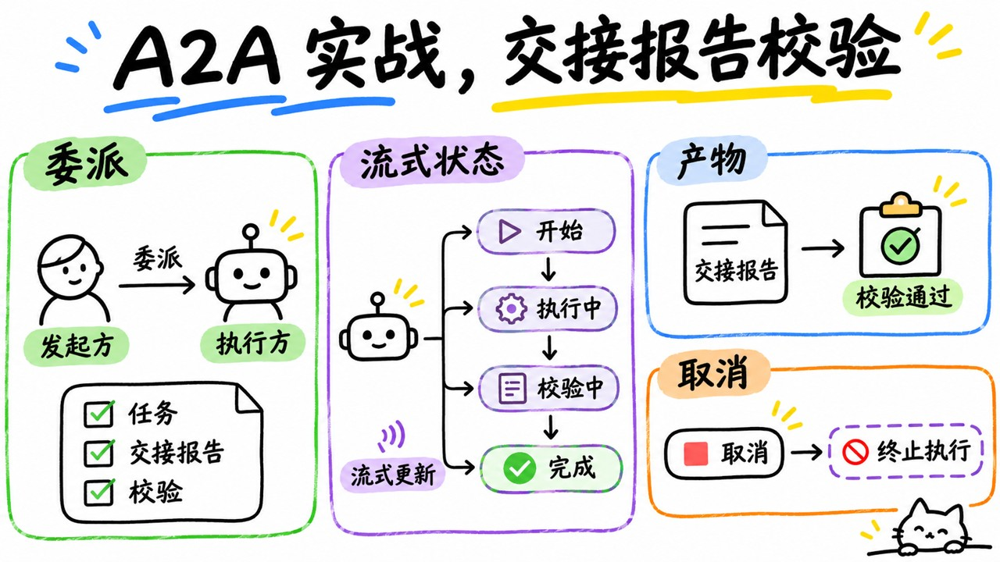

> **生成工具**：Codex\
> **生成模型**：gpt-6.2-sol

报告 Agent 发出请求「复核退款统计」。对方返回任务标识，校验的结果应与相应报告版本匹配。任务持续时客户端可轮询或订阅。取消与断流也要用明确的状态区分。

## 1. 让任务 ID、消息 ID 和业务关联 ID 各有用途

`messageId` 标记一条消息。A2A 任务 ID 由远端生成，供 `tasks/get` 与 `tasks/cancel` 使用。报告应用另外用 `application-001` 记录「这一笔复核委派」已经映射到哪个任务。实验同一个关联 ID 请求两次，只执行一次校验。生产上应用映射应持久化并原子写入。发送超时且任务 ID 尚未知时，需要服务端幂等契约或其它核对入口，单靠调用方内存去重无法保证跨进程重试。

## 2. 按实际回包验证几个分支

| 场景 | A2A 0.3.0 的执行结果 |
| --- | --- |
| 同步委派 | `message/send` 返回 `completed`，产物统计是 `{"count":2,"mean":"5"}` |
| 流式 | 先 Task，再状态更新、Artifact 更新和终态更新 |
| 重新查询 | 用从流里缓存的任务 ID 调用 `tasks/get`，可读到 `completed` |
| 取消进行中的任务 | `tasks/cancel` 返回 `canceled`，再次查询仍如此 |
| 校验失败 | 返回 `failed` |
| 隔离作用域查询 | 另一个任务存储返回 `-32001`，任务未找到 |

这里的流式承载为 SSE（服务器发送事件），每条 `data` 携带 JSON-RPC 响应。测试客户端在读完流后新发查询验证可回读，未模拟真实网络上的半包丢失。中途断流时，若已经记住任务 ID，可使用查询恢复，或检查服务是否支持重订阅。服务器按测试作用域隔离存储，生产还需把经过认证的身份绑定到任务和产物。校验 Agent 没有归档工具和权限。 [A2A 0.3.0 规范](https://a2a-protocol.org/v0.3.0/specification/)

```bash
python -m pip install 'a2a-sdk[http-server]==0.3.22'
python experiments/agent-runtime/a2a_lab.py --out /tmp/a2a-refund.json
```

[官方 SDK 实验代码](../../experiments/agent-runtime/a2a_lab.py) · [流式、取消与失败记录](../../experiments/agent-runtime/a2a-results.json)

[返回 LLM 与 Agent 学习路线图](https://blog.lacknb.cn/articles/2026/11/19/1795058329577.html)
