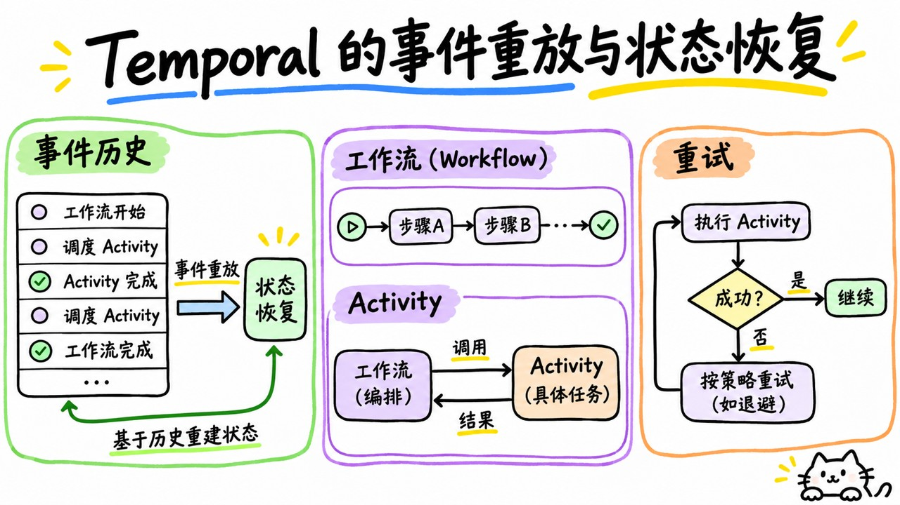

> **生成工具**：Codex\
> **生成模型**：gpt-6.2-sol

手写检查点保存「当前走到哪」。Temporal 工作流还可以用事件历史重建执行过程。退款流程包括读取统计值、等待审批、归档三段。恢复时，已记录的统计值可直接用于后续阶段，归档失败仍可能重试。

## 1. Workflow 与 Activity 的执行范围

Workflow 是在重放中应产生相同命令的编排代码。Activity 是在工作流外做实际操作的步骤，在本例中读取 CSV 与写入归档。模型调用、网络请求或外部写操作都适合放进 Activity。活动完成后，Temporal 持久化结果。Workflow 重放根据历史得到已有结果，并按确定性顺序继续。时钟、随机数和并发应使用 SDK 支持的工作流接口。 [Temporal 工作流定义](https://docs.temporal.io/workflow-definition)

## 2. 停掉 Worker 后再发审批

Python SDK `1.21.1` 实验用 Temporal 的测试环境。Workflow 得到 `{"count":2,"mean":"5"}` 后进入等待审批，第一台 Worker 停止。审批 Signal（信号）持久化后，由下一台 Worker 接续。归档 Activity 首次提交 SQLite 记录后模拟回执失败，第二次重试使用同一动作 ID。读 Activity 执行 1 次，归档 Activity 执行 2 次，归档记录为 1 行。

历史导出共 24 个事件，用 SDK 的 Replayer 在离线重放。原 Workflow 通过。把首条 Activity 改成开定时器的版本，Replayer 报 `NondeterminismError`，因为命令类型和已存历史不一致。编排变更要按框架的版本策略兼容旧实例。 [Temporal Python 测试](https://docs.temporal.io/develop/python/testing-suite)

```bash
python -m pip install temporalio==1.21.1
python experiments/agent-runtime/temporal_lab.py \
    --history experiments/agent-runtime/temporal-history.json --out /tmp/temporal-replay.json
```

上述命令只重放存档历史。加 `--record` 可使用 SDK 测试环境重新采集到指定路径，首次可能取得测试服务器二进制。Activity 的幂等写由 SQLite 唯一键保证，所以历史重放通过与业务只归档一条分别实测。 [离线重放代码](../../experiments/agent-runtime/temporal_lab.py) · [实验结果](../../experiments/agent-runtime/temporal-results.json)

[返回 LLM 与 Agent 学习路线图](https://blog.lacknb.cn/articles/2026/11/19/1795058329577.html)
