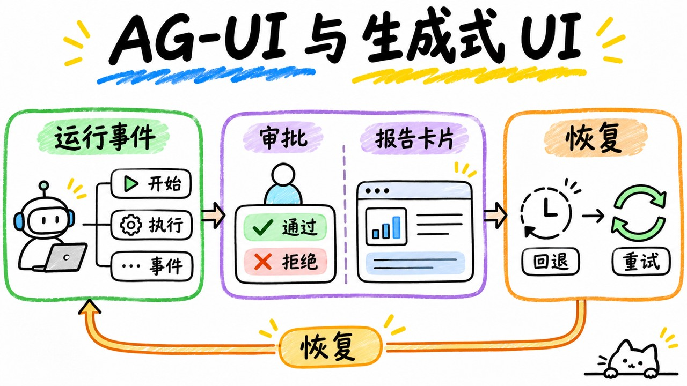

> **生成工具**：Codex\
> **生成模型**：gpt-6.2-sol

上传 `4`、`NA`、`6` 的退款 CSV 后，页面先显示正在计算，再展示「有效 2 条，均值 5」，提示确认当前报告。AG-UI（Agent User Interaction Protocol，智能体与界面交互协议）负责把运行事件带给界面。A2UI（Agent-to-UI，智能体到用户界面的声明式协议）描述界面要显示哪些组件。客户端用自己已安装的组件来画卡片。 [AG-UI 事件](https://docs.ag-ui.com/concepts/events) · [A2UI 消息](https://a2ui.org/concepts/messages/)

## 1. 同一任务走过事件和组件

| 数据 | 本例的作用 |
| --- | --- |
| `RUN_STARTED` | 标识这次运行所属会话与运行 ID |
| `TOOL_CALL_START`、参数、`TOOL_CALL_END` | 表示工具调用已发起，参数传完 |
| `TOOL_CALL_RESULT` | 给出工具真实结论和调用 ID |
| A2UI `createSurface`、`updateComponents`、`updateDataModel` | 创建展示面，定义 Card 及 Text，把 Text 绑定到 `/summary` |
| `STATE_SNAPSHOT` | 提供可用于重连的完整业务状态 |
| `RUN_FINISHED`，结果为 `interrupt` | 当前运行停在需要人确认的时刻 |

Python 官方 AG-UI 编码器把事件转成 SSE（服务器发送事件）。这个示例把 A2UI 消息放在自定义事件 `refund/a2ui` 里，这是本应用的约定。A2UI 部分通过固定版本的官方 JSON Schema 核验，额外测到未支持组件会被拒绝。 [A2UI 固定协议源码](https://github.com/a2ui-project/a2ui/tree/5ff1b05f02d39f969b52a942e78e864ef3ac01fa/specification/v1_0) · [编码与组件数据](../../experiments/agent-runtime/ui-results.json)

## 2. 重连后接受快照，审批绑定报告哈希

接收者在处理完序号 3 时断开，回来先收到序号 6，检测到缺口。随后拿到序号 7 的权威快照，恢复两条、均值 5 和待审批状态，重放同一序号会被忽略。序号是本应用的游标。SSE 只负责传事件，不能保证业务状态在断线后自动补齐。

确认时用新的运行 ID 发带 `resume` 的请求，答复中断 ID `confirm-01`，并携带当前报告哈希。后台核对报告版本，旧哈希被拒，当前哈希归档一次。另一个分支模拟取消，得到 `cancelled`，不进入归档。在仓库中用浏览器打开 `experiments/agent-runtime/ui_demo.html`，选择同目录的 `ui-results.json`，即可离线查看事件和报告卡片。页面的按钮展示对应协议报文，审批写入与回收由 Python 测试实际验证。 [离线回放页面](../../experiments/agent-runtime/ui_demo.html) · [验收脚本](../../experiments/agent-runtime/ui_lab.py) · [事件与恢复结果](../../experiments/agent-runtime/ui-results.json)

重新生成记录时，将固定提交的 `specification/v1_0/json/agent_to_renderer.json`、`common_types.json` 和 `catalogs/basic/v1/catalog.json` 放到同一目录，再运行下列命令。这里的 Schema 是用于校验 JSON 字段的规则文件。

```bash
python -m pip install ag-ui-protocol==1.0.0 jsonschema
python experiments/agent-runtime/ui_lab.py --schemas /tmp/a2ui-schemas --out /tmp/ui-results.json
```

[返回 LLM 与 Agent 学习路线图](https://blog.lacknb.cn/articles/2026/11/19/1795058329577.html)
