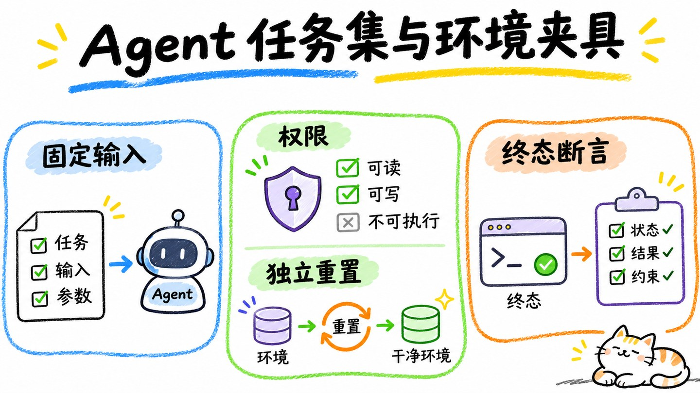

> **生成工具**：Codex\
> **生成模型**：gpt-6.2-sol

测一道「生成退款报告」的题，需要给做题的人同一张表，也要让每次考试都从一个空档案柜开始。Fixture（测试夹具）就是开考前准备好的数据、文件、环境状态和工具回包。题目说想完成什么，夹具保证实验从约定的地方开始。

## 1. 把题目的五项约定留在同一处

| 项 | 退款报告题 |
| --- | --- |
| 用户目标 | 统计退款金额有效条数和平均值，确认后归档 |
| 初始状态 | 三行 `4, NA, 6`，独立工作目录，空数据库 |
| 允许工具 | 读 `refund` 列，提交报告给用户，批准后归档 |
| 验收产物 | 一个 JSON（JavaScript Object Notation，文本结构化数据）报告，有效条数 2，均值 5 元 |
| 业务约束 | 空值不计入，批准绑定到报告内容，批准前零写，批准后最多一条 |

把金标准写成独立常量。本题的 `2` 和 `5` 可以手算。若评分器也用被测统计代码算「正确答案」，两边会一起把 `NA` 算成零，错误就能拿满分。

## 2. 同一题跑两种环境

| 模式 | 本例实际运行 | 用来发现 |
| --- | --- | --- |
| 固定回包 | 统计工具直接回 `{"count":2,"mean":"5"}`，报告和归档照常写 | 回包到了以后处理错、确认恢复失败、写错报告 |
| 组件集成 | 现有运行时实际解析 CSV、用十进制算术计算、写 SQLite | 列名与解析规则错误，统计与落库接线问题 |

两条路径共用实际归档和独立检查。固定回包直接取独立 fixture 常量，因此只用来确认统计工具之后的流程。把真实统计也跑一遍，才验证了从原始三行到报告字段的路径。本地 SQLite 代表本例的真实组件，生产数据库的鉴权、迁移和超时还需要自己的集成用例。[共用运行时](../../experiments/agent-runtime/runtime.py)

## 3. 每次运行重新建一套环境

`evaluate()` 给每次运行一个临时目录和一份空数据库，任务结束即释放。批准阶段在同次运行里重开数据库，以便验证恢复。下一次从新的文件开始，上一题的归档和批准不会被误计入这一次。将来如果用一个外部测试服务，至少给每个运行独立命名空间，并核对清理确实生效。

这组实测里，普通三行在固定回包和真实集成都通过。另加一题只有两个 `NA`，真实集成产出 `{"count":0,"mean":null}`，说明没有分母时均值缺失。往任务集加样本时，可以先加全空、错列、写入回执丢失这类行为不同的边界，再扩大输入数量。运行 `python3 experiments/agent-eval/eval_lab.py`，查看 `fixtures` 和 `correct`。[实验代码](../../experiments/agent-eval/eval_lab.py) · [实际输出](../../experiments/agent-eval/eval-results.json)
