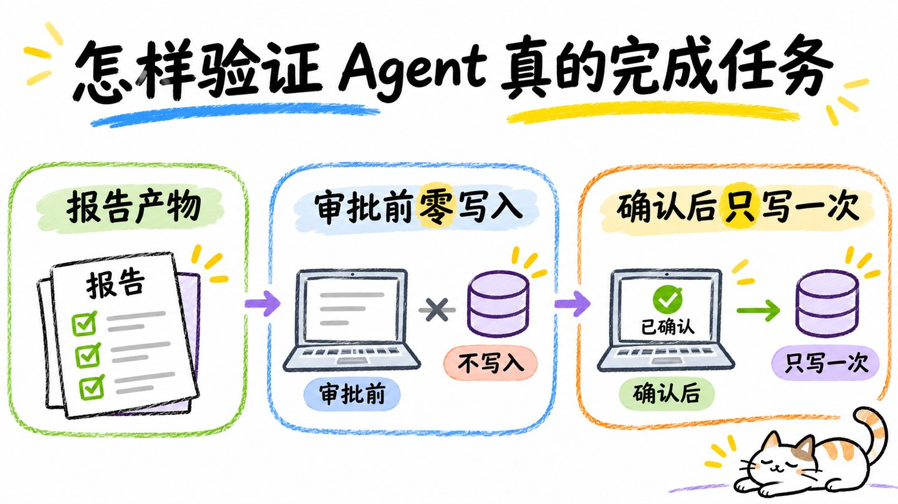

> **生成工具**：Codex\
> **生成模型**：gpt-6.2-sol

让一个办事助手算完退款报告，收到确认才能归档。它说「报告已归档」，你会去打开报告和档案柜核对。Agent（能按步骤调用工具的智能助手）评测也一样。我们沿用上一组评测的三行数据，把「答得对」延伸到「事情办对了」。 [LE-07 的首条评测](../03-llm-eval/le-07-first-eval.md)

## 1. 先写下验收单

CSV（Comma-Separated Values，逗号分隔值）里的退款金额是 `4`、`NA`、`6`。单位用元，`NA` 表示没填。有效记录数为 `2`，平均值为 `(4 + 6) / 2 = 5` 元。用户的要求还有一条，确认后才可以归档。

| 检查时刻 | 评测器去哪里查 | 预期 |
| --- | --- | --- |
| 报告生成 | 打开任务目录中的 `report.json` | `{"count": 2, "mean": "5"}` |
| 用户确认前 | 读 SQLite（一个文件里的关系数据库）的归档表 | 此任务有 0 条归档 |
| 用户确认并执行后 | 再读同一归档表，对照内容 | 有且只有 1 条，内容与报告一致 |
| 重试归档后 | 复读归档表 | 仍然只有 1 条 |

报告把十进制均值写成字符串。测试按约定的字段和类型比对，避免接受只有一个数字、无法知道有效条数的文件。运行时把确认绑定到报告的内容摘要，换了报告就要重新确认。[运行时实现](../../experiments/agent-runtime/runtime.py)

## 2. 在两个检查时刻取证

脚本用固定动作代替模型决策，实际跑统计、写文件、重开运行时、批准和归档。检查归档的代码另开 SQLite 连接。操作结束后，评测器从磁盘读报告，结果做逐项布尔判断。各项同时成立才判通过。

```text
给任务和 CSV → Agent 统计并写报告 → 读取归档表（0）
            → 重开运行时 → 确认这份报告 → 归档并重试
            → 从磁盘读报告，复查归档表（1）→ 评分
```

只读终态会丢掉时序证据。比如一个错误实现先归档，后来收到批准，最后仍可能正好有一条记录。这个小实验在批准前读一次表。真实服务有异步请求时，再用服务器写入审计核对整个时段，才能发现曾写入又撤回的动作。

## 3. 让一句相同的回复遇到两份证据

| 脚本 | 给用户的回复 | 报告读数 | 确认前 / 归档后记录数 | 得分 |
| --- | --- | --- | --- | --- |
| 正常工作并重试 | Report archived. | 2 条，均值 5 元 | 0 / 1 | 通过 |
| 直接声称完成 | Report archived. | 文件缺失 | 0 / 0 | 失败 |

在仓库根目录运行 `python3 experiments/agent-eval/eval_lab.py`。输出的 `correct` 和 `claim_only` 可以逐项对读。更换模型或提示词之后，保留这张验收单和同一份数据，就能把差异落到具体字段与写入行为。[实验代码](../../experiments/agent-eval/eval_lab.py) · [实际输出](../../experiments/agent-eval/eval-results.json)
