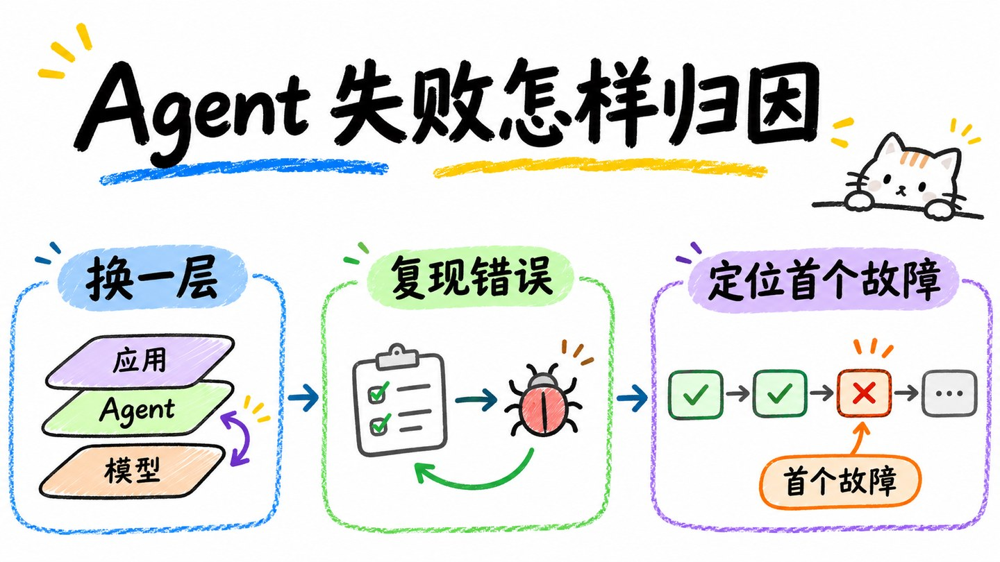

> **生成工具**：Codex\
> **生成模型**：gpt-6.2-sol

退款报告写成了 3 条，有可能是助手挑错了工具，也可能是工具把 `NA` 计入，或报告模板改坏了结果。归因就是问「哪一步第一次偏离了已知事实」。Harness 是模型周围负责工具调用、权限、状态和交接的运行程序。知道首个错误在决策、工具还是 Harness，才能决定去哪查。

## 1. 先确认各层本应交出什么

正常路径读 `refund` 列，工具返回有效 2 条、均值 5 元。报告应原样使用这两个数。恢复后仍能取出这份报告，批准和归档它。只看最后有无归档，会把不同故障混到一起。

| 每次只注入一处变化 | 实测首个失败阶段 | 对照潜在原因 |
| --- | --- | --- |
| 选择 `read_everything` | `tool_selection` | 决策输出或工具表 |
| 使用列名 `amount` | `arguments` | 参数生成或 schema 转换 |
| 统计函数抛错 | `tool_execution` | 工具可用性、错误处理 |
| 工具返回 3 条、均值 3.333333 元 | `tool_output` | 缺失值或统计规则 |
| 恢复时丢失报告 | `restore` | Harness 检查点读取 |
| 工具结果正确，渲染时把条数加 1 | `artifact` | 汇总映射或报告渲染 |

六条路径都被独立判分拒绝。尤其是最后两类统计错误。工具输出已经错误时，报告只是把坏数据传下去。工具交接正确而报告错误时，应先检查它们之间的映射。归档表也可能仍是正确的，这时需要把报告和库里的内容都拿来比较。 [本地实测](../../experiments/agent-eval/eval-results.json)

## 2. 用替换实验确认线索

以坏统计值为例，保留同一份输入、同一工具名和同一列名，先复现失败，再把统计组件的回包替换为可信的 `{"count":2,"mean":"5"}`。固定回包路径实测通过，说明应先查这个工具输出。如果替换后仍然失败，查下一个交接点，保留原本的故障记录。

工具没选对时，先固定并重放正确调用。如果同一个调用仍失败，就继续检查工具执行。检索型任务也可以把检索结果替换成一份已核过且含完整出处的证据，再重放同一输入。这样能把「找不到资料」与「读到了却没用上」分开。一次改好提示词、工具和数据库后即使恢复通过，也无法知道哪个改动奏效。

运行 `python3 experiments/agent-eval/eval_lab.py`，读 `attribution` 中的第一个失败阶段、后续轨迹和各项分数。真正修复时要在原环境复跑受影响路径，再看其它故障用例是否仍按预期拦截。 [实验代码](../../experiments/agent-eval/eval_lab.py)
