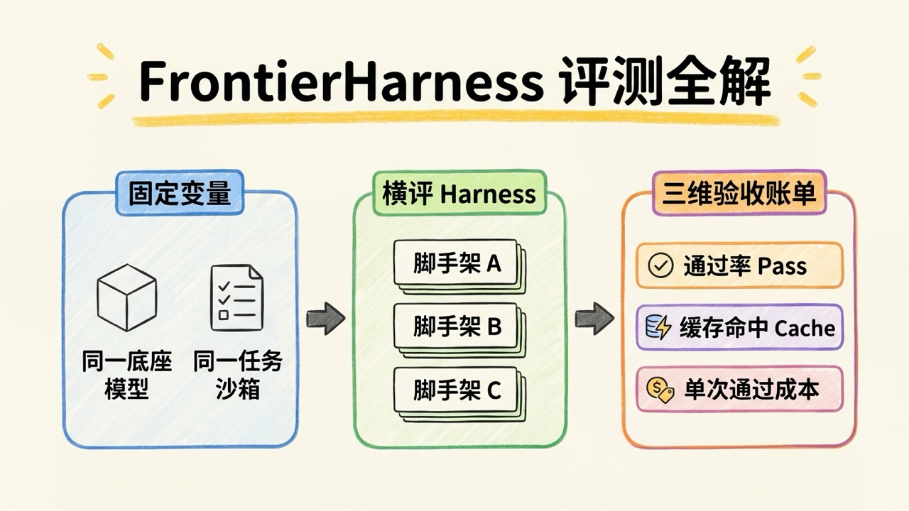
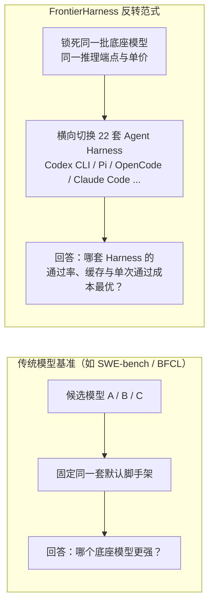
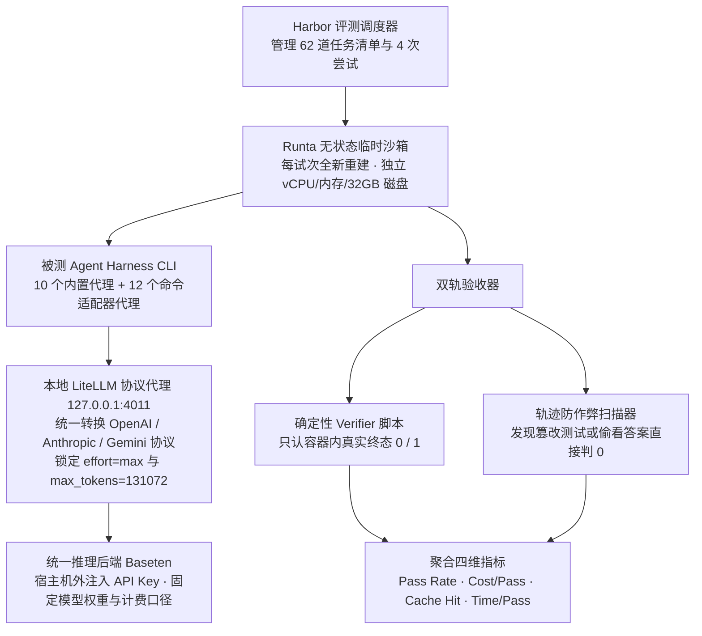

> **生成工具**：Antigravity\
> **生成模型**：Gemini 4 Neon

在 [AE-04《Agent 公开基准与排行榜全景》](ae-04-public-benchmarks.md) 里，我们拆解了 BFCL、τ²-Bench、SWE-bench Verified/Pro、Terminal-Bench 和 KingBench 4。但细心的工程师看榜时很快会撞上一个尴尬问题：**同一个模型换一套 CLI 脚手架来跑，SWE-bench 或终端任务成绩就能上下差出十几个百分点，账单甚至相差十几倍——那榜上看到的究竟是「模型强」，还是「包在模型外面的 Harness 写得好」？**

**FrontierHarness Eval**（由 Runta 与 Baseten 联合维护的开源 Agent Harness 评测体系，[官方排行榜](https://frontierharness.org/leaderboard/v1.1/) · [GitHub 仓库](https://github.com/frontier-harness-eval/eval)）专门冲着这个问题而来。它干脆把传统基准的控制变量**彻底反了过来**：不比模型，而是**锁死同一批底座模型与完全隔离的任务沙箱，横向评测 22 套真实 Coding Agent Harness**。

> **先用大白话讲明白（ELI5）**：评估 Agent，就像**考察一位五星主厨（底座大语言模型）做 62 道硬菜（终端软件工程任务）**：
> - **传统基准（SWE-bench 等）**：固定同一间厨房，轮流换 20 位主厨，看谁厨艺最高；
> - **FrontierHarness**：**只请同一位主厨，轮流把他放进 22 间布局完全不同的厨房（Agent Harness）**，看厨房动线、备菜台、传菜助手和出锅质检怎么影响最终上菜率与每道合格菜的成本：
>   - **厨房 A（极简稳定动线）**：调料和菜谱固定放桌面不动，主厨抬头就能复用，出菜率 61%，每道合格菜只花 9 毛多；
>   - **厨房 B（动线老变、每分钟重抄菜单）**：助手每炒一铲就改一次菜谱顺序，主厨每次都得从头重读（前缀缓存失效），菜没更好吃，账单翻倍；
>   - **厨房 C（缓存复用率 95% 全场第一，却死贵）**：厨房备菜台堆了整套大百科全书，虽然每次都没挪动（缓存命中率极高），但主厨每步都得背着巨型托盘多翻炒十几轮，最后端出来的合格菜数量还少了，平摊下来**每道合格菜反而是全场最贵**！



下面我们先搞清 **FrontierHarness 从 v1.0 到 v1.1 的实验设计与四大指标公式**，再拆解 v1.1 实测总榜背后最反直觉的四个工程发现，接着深入它的 **Harbor + Runta + 本地协议代理** 评测架构，最后用一段零依赖的本地 Python 脚本亲手把这几个现象全部跑通、手算核对。

---

## 1. FrontierHarness 到底在测什么？从 v1.0 到 v1.1

先对齐三个首次出现的术语，后面读榜单和代码才不会串台：

- **Agent Harness（智能体运行脚手架）**：包在大语言模型外面的整套控制软件（见 [AGT-12 源码阅读](https://blog.lacknb.cn/articles/2026/11/23/1795402353257.html)），负责拼装 System Prompt（系统提示词）、注册与执行命令行/文件编辑工具、裁剪或压缩多轮上下文、处理工具报错重试，以及决定什么时候结束任务。
- **Trial / Attempt（试次）**：一套「模型 + Harness」组合在一道任务上的一次完整独立运行。因为解码采样与系统环境存在随机性，单跑一次容易撞大运，需要重复多次取统计值。
- **Ephemeral Runtime（无状态临时沙箱）**：每次试次从零拉起一台隔离容器或微虚拟机，跑完立刻销毁。它保证上一轮安装的依赖包、写下的临时文件或操作系统页缓存（Page Cache）绝不会残留给下一轮「占便宜」。

FrontierHarness 到目前经历了两个标志性版本，实验规模扩张了 **76 倍**：

| 维度 | FrontierHarness v1.0（单模型探路） | FrontierHarness v1.1（大规模交叉矩阵） |
| --- | --- | --- |
| **底座模型** | 1 个模型（`Kimi-K3`） | **5 个开源权重模型**（统一托管在 Baseten）：`GLM-5.3`、`GLM-5.3 Flash`、`DeepSeek V4.1 Flash 1017`、`Muse Spark Open`、`Kimi-K3` |
| **被测 Harness** | 9 套生产级 Coding Harness | **22 套 Harness 配置**（10 个 Harbor 内置代理 + 12 个命令适配器代理，锁定发布版本号） |
| **任务集与试次** | 30 道终端软件工程任务 | **62 道终端工程任务** × 每格 **4 次尝试**（每套 Harness 跨 5 模型共 `5 × 62 × 4 = 1,240` 次评分试次） |
| **总评测体量** | 约 360 次运行级规模 | **27,280 次独立运行**，累计消耗约 **830 亿 Token** |
| **最震撼的结论** | 通过率扎堆接近，但同一模型下**单次通过成本最高相差 17 倍以上** | 证实显著的 **Model × Harness 交互效应**：换底层模型就得重新挑 Harness；且 **64.5%** 推理账单烧在了失败试次上 |

22 套被测配置覆盖了当下社区和工业界主流的几大流派：
- **一线大厂/主流 CLI 脚手架**：`Codex CLI`、`Claude Code`、`GitHub Copilot CLI`、`Antigravity CLI`、`Grok Build`、`KimiCode`、`MiniMax Code`；
- **极简与可插拔开源脚手架**：`Pi`、`Oh My Pi`、`OpenCode v1 / v2`、`mini-SWE-agent`、`ZCode`、`Cline CLI`、`Hermes Agent`、`Alma`、`Maka`、`Exo`；
- **同源多配置对照**：DeepSeek Harness（`DSH`）专门拆出 `Minimal`、`Standard`、`Code`、`Creator` 四个档位，用来直接观察同一套框架在不同提示词/工具集重量下的成本与收益变化。

62 道任务全部是真实 Linux 终端里的硬核工程题，覆盖软件排障、科学计算、数据处理、系统运维、机器学习与安全配置。每道题都配有一段 **容器内确定性验证脚本**（Verifier）——和 [AE-06](ae-06-first-agent-eval.md) 强调的一样，评测器绝不听 Agent 口头说「我修好了」，只看验证脚本实跑是否全绿（通过记 `1`，失败或超时记 `0`）。

---

## 2. 拆解四大核心指标：为什么不能只看「每次花费」？

FrontierHarness 排行榜把每套 Harness 的成绩拆成四个并列指标，每个都有明确的工程账本含义。

### 2.1 通过率（Pass Rate）

```text
Pass Rate = S ÷ N
```

- `S`：通过确定性验证器且无作弊嫌疑的成功试次数（单位：次）；
- `N`：该配置的有效评分试次总数（单位：次；网络抖动或推理网关 5xx 等**基础设施故障**会剔除重跑，不计入失败分母）；
- 结果是 `0` 到 `1` 之间的无量纲比例，榜上写成百分比。

### 2.2 单次尝试花费（Cost per Task）vs 单次通过成本（Cost per Pass）

这是读懂 Harness 经济学最核心的一对公式：

```text
Cost per Task = C_total ÷ N                （单位：美元 / 试次）
Cost per Pass = C_total ÷ S                （单位：美元 / 成功交付）
              = Cost per Task ÷ Pass Rate
```

- `C_total`：全部 `N` 次试次（**既包含成功的，也包含失败重跑和超时烧掉的**）消耗的推理总费用（单位：美元）。
- 为什么生产落地必须盯紧 **`Cost per Pass`** 而不是 `Cost per Task`？（这和 [AE-08](ae-08-regression-rollout.md) 的单次成功成本口径完全一致！）

拿一组可直接手算的数字对比：
- **脚手架 A**：平均每次试次花 `$0.60`，通过率 `60%`。算下来 `Cost per Pass = 0.60 ÷ 0.60 = $1.00`。
- **脚手架 B**：省字数、提前收尾，平均每次试次只花 `$0.45`（看起来便宜了 25%！），但通过率掉到了 `30%`。真实 `Cost per Pass = 0.45 ÷ 0.30 = $1.50`——**为了交付同一件合格产物，你反而多花了 50% 的冤枉钱！**

### 2.3 前缀缓存命中率（Prompt Cache Hit Rate）

多轮 Agent 循环里，第 1 轮送 `System Prompt + 工具列表 + 用户问题`，第 2 轮送 `第 1 轮全部内容 + 工具输出`，到第 20 轮时，前面 19 轮的历史几乎原封不动地重复发给模型。现代推理引擎（见 [F-06 KV Cache](https://blog.lacknb.cn/articles/2026/11/20/1795161430009.html) 与 [SERV-04 Prefix Cache](https://blog.lacknb.cn/articles/2026/11/23/1795400445779.html)）支持 **Prompt Cache（前缀缓存）**：只要本轮请求的 Token 前缀与之前完全逐字一致，就能直接复用已算好的 KV 矩阵，输入计费往往能打 **1 折（90% 折扣）** 甚至更低。

```text
Cache Hit Rate = T_cached ÷ (T_cached + T_uncached)
```

- `T_cached`：命中前缀缓存的输入 Token 总数（单位：Token）；
- `T_uncached`：未命中缓存、按原价计算 Prefill 的输入 Token 总数（单位：Token）。

手算一笔直观账单：设原价输入 `$1.00 / 1M tokens`，缓存命中输入 `$0.10 / 1M tokens`（1 折），输出 `$4.00 / 1M tokens`。假设一个 20 轮任务累计发送 `400,000` 输入 Token、生成 `10,000` 输出 Token：
- **前缀稳定（命中率 95%）**：`380,000 × $0.10/1M + 20,000 × $1.00/1M + 10,000 × $4.00/1M = $0.038 + $0.020 + $0.040 = $0.098`；
- **前缀被破坏（命中率掉到 50%）**：`200,000 × $0.10/1M + 200,000 × $1.00/1M + 10,000 × $4.00/1M = $0.020 + $0.200 + $0.040 = $0.260`。

**同一个任务、同一个模型、一字不差的输出长度，仅仅因为前缀缓存掉了 45 个百分点，总账单就凭空涨了 2.65 倍！**

### 2.4 单次通过有效耗时（Time per Pass）

```text
Time per Pass = T_wall_total ÷ S           （单位：分钟 / 成功交付）
```

其中 `T_wall_total` 是全部 `N` 次试次的墙钟总耗时（Wall-clock Time，含成功与失败）。它和 `Cost per Pass` 一样，惩罚「动不动卡死到超时才退出的慢失败」。

---

## 3. 精读 v1.1 真实榜单：四大反直觉工程发现

先看 [FrontierHarness Eval v1.1 官方仓库](https://github.com/frontier-harness-eval/eval) 公布的总榜代表性数据（口径：全部 5 个开源权重模型汇总，每行 `1,240` 次评分试次，按 `Cost per pass` 从便宜到贵排列）：

| Harness（锁定版本） | Cost per pass | Pass rate | Cache hit rate | Time per pass | 关键观察 |
| --- | ---: | ---: | ---: | ---: | --- |
| **Codex CLI** (`0.164.0`) | **$0.937** | 61.1% | 93.9% | 43m 48s | **总榜最省**，通过率与速度均居第一梯队 |
| **Pi** (`1.4.0`) | $0.976 | 57.7% | 94.5% | 54m 01s | 极简提示与工具面，紧随其后的高性价比代表 |
| **OpenCode v2** (`2.2.7`) | $0.978 | 57.3% | 94.3% | **43m 43s** | **总榜最快**，相比同家 v1（$1.12 / 1h 02m）大幅提速降本 |
| **ZCode** (`0.17.0`) | $1.06 | **61.9%** | 92.0% | 57m 08s | **总榜最高通过率**，综合性价比极强 |
| **KimiCode** (`2.3.1`) | $1.09 | 60.2% | 93.3% | 56m 04s | 跨 5 模型通过率破 60% 的稳健派 |
| **Hermes Agent** (`0.22.5`) | $1.16 | 59.9% | 93.0% | 58m 26s | 源码案例同款框架（见 CASE 专题），通过率近 60% |
| **Cline CLI** (`3.0.73`) | $1.19 | 57.7% | **86.4%** | 1h 01m | **22 套中缓存命中率最低**，但总价仍非最贵 |
| **mini-SWE-agent** (`2.4.6`) | $1.29 | 58.6% | 94.7% | 59m 32s | 学术界经典极简循环，高缓存、中等成本 |
| **Claude Code** (`2.1.308`) | $1.55 | 58.9% | 94.3% | 1h 10m | 重型全家桶脚手架，开源模型下耗时和单次通过成本偏高 |
| **Antigravity CLI** (`1.4.6`) | **$1.63** | 55.0% | **95.6%** | 1h 06m | **反直觉名场面：缓存命中率全场第 1，成本却全场最贵！** |
| **Exo** (`825318306c0e`) | $1.36 | **50.6%** | 91.1% | 1h 07m | 22 套中通过率最低，拉高了单位通过成本 |

把这张表和 Runta 发布的深度分析放在一起看，能挖出四条**极易打破直觉、直接指导工程落地**的结论：

### 发现一：不存在“天下第一”的万能 Harness——换底层模型，就得重评 Harness

很多人以为找到一套“最强 CLI 工具”，以后不管接哪个模型都直接往上套就行。FrontierHarness v1.1 的 **双因素方差分析（Two-way ANOVA，把总波动拆解为“模型主效应 + Harness 主效应 + 模型与 Harness 配对交互效应”三部分的统计方法）** 直接推翻了这个假设：

- 在总成本方差中，**底座模型本身占 92.8%**，**Harness 的跨模型共性只占 2.3%**，而 **「模型 × Harness 配对交互效应」高达 4.9%**——配对好不好，比「某个 Harness 普遍省不省钱」的影响还要大出一倍多！
- **惊人的排名大反转**：总榜最省的 **Codex CLI** 搭配 `GLM-5.3` 时排在单次通过成本 **第 1 名**，但一旦换成 `Kimi-K3`，它的成本排名直接跌到 **第 16 名**；全部 22 套 Harness 在切换底座模型后，成本排名的中位数漂移高达 **11 个位次**（总共才 22 名！）。
- **5 个模型各自的最佳性价比搭档全都不重样**：

| 底座模型（v1.1 托管于 Baseten） | 最佳性价比 Harness 搭档 | 背后常见适配原因 |
| --- | --- | --- |
| `GLM-5.3` | **Codex CLI** | 紧凑循环 + 结构化补丁编辑工具契合强推理模型 |
| `GLM-5.3 Flash` | **Pi** | 轻量模型在极简提示词与低工具噪声下更不易跑偏 |
| `DeepSeek V4.1 Flash 1017` | **ZCode** | 高通过率摊薄失败重试，工具交互容错更贴合该模型 |
| `Muse Spark Open` | **Oh My Pi** | 轻量扩展脚手架平衡了上下文负载与任务完成度 |
| `Kimi-K3` | **Alma** | 特定工作流与长对话节奏更匹配 Kimi 的输出风格 |

**为什么会这样？** 因为每款模型在后训练（SFT / RL，见 [TRN-04](https://blog.lacknb.cn/articles/2026/11/22/1795353665754.html) 与 [AE-05](ae-05-multi-turn-rl.md)）时吃过的工具调用分布并不一样：有的模型极擅长写 `apply_patch` 精确行号差异，换到整文件重写就频繁漏行；有的模型天生容易在同一个报错里打转，非得靠带「报错熔断或强制换思路提示」的 Harness 拉一把才行。

### 发现二：高缓存命中率 ≠ 低成本（拆穿“95.6% 缓存陷阱”）

再看一眼上面总榜最戏剧性的两行：
- **Antigravity CLI**：`Cache hit rate = 95.6%`（**22 套里最高**），但 `Cost per pass = $1.63`（**22 套里最贵**）；
- **Codex CLI**：`Cache hit rate = 93.9%`，`Cost per pass = $0.937`（**最省，比前者便宜 42.5%**）；
- **Cline CLI**：`Cache hit rate = 86.4%`（**22 套里最低**），`Cost per pass = $1.19`（居然还比 Antigravity CLI 和 Claude Code 便宜！）。

把成本公式展开成乘法项，谜底一秒揭晓：

```text
Cost per Pass = [ 轮数 × (单轮命中基数 × 缓存折后价 + 单轮新增未命中 × 输入原价) + 总输出 Token × 输出单价 ] ÷ Pass Rate
```

**命中率只是一个百分比，不是绝对花费！** 下面三种常见写法都能让一个 Harness 顶着 95% 的漂亮缓存率照样狂烧钱：
1. **静态前缀太胖 + 轮次过多**：如果系统提示词 + 几十个 MCP 工具 Schema 占了 2 万 Token，且每修一个小 Bug 都要折腾 35 轮，哪怕 95.6% 全中了缓存，那庞大的缓存基数乘以 35 轮、再叠加冗长的输出 Token（输出单价往往是缓存输入的 20～40 倍！），总账单照样惊人。
2. **通过率偏低把分母劈矮**：Antigravity CLI 通过率 `55.0%` vs Codex CLI `61.1%`，每多失败一次，整趟长循环的账单都要平摊到成功试次头上。
3. **隐性缓存杀手（Cache Breakers）**：反过来看缓存率低的脚手架，常见破坏原因包括——在 System Prompt 头部拼入当前时间/剩余步数、每轮按字母外随机顺序重排工具列表、或某一步读入几万行未截断日志导致提前触发上下文压缩（Compaction 一改写历史前半段，此前整条前缀缓存立刻清零，详见 [AGT-04](https://blog.lacknb.cn/articles/2026/11/23/1795402337939.html) 与 [AGT-05](https://blog.lacknb.cn/articles/2026/11/23/1795402339491.html)）。

### 发现三：64.5% 的推理账单烧在了失败试次，且 68%～82% 是“自信翻车”

这是 FrontierHarness v1.1 最具工程杀伤力的一组数字：
- 在全部 27,280 次运行、830 亿 Token 的总账单里，**64.5% 的推理费用消耗在最终得 0 分的失败试次上**——你付出去的每 10 块钱里，有 6 块半什么合格代码都没换回来！
- 过去大家猜失败多半是因为 Agent 死循环撞超时，但轨迹统计完全相反：**在 68%～82% 的失败试次里，Agent 并没有超时，而是自己自信满满地给出了「任务已完成」的最终答复并主动退出！**

这直接指明了 Harness 优化投资回报率最高的方向：与其盲目买更贵的模型，不如先在 Harness 结束循环前加一道 **低成本确定性验证门**（Verification Gate）——强制执行编译、单测、Lint 或产物状态断言，不通过就不允许交卷，把错误输出直接喂回模型修正，往往多花 1 轮小成本就能把「自信翻车」救成「真通过」，大幅压低 `Cost per Pass`。

### 发现四：重型全家桶 vs 极简脚手架的定位差异

从榜单也能看清不同设计哲学的代价：
- **重型运行时**（如 Claude Code）自带多层记忆压缩、子代理、权限钩子和长规范，针对自家深度对齐过的闭源旗舰模型在超长项目上很稳；但在统一接开源权重模型、跑 62 道聚焦终端任务时，额外的框架开销和长指令反而拖高了单次通过成本（`$1.55`）与耗时（`1h 10m`）。
- **极简与紧凑循环**（如 Codex CLI、Pi、OpenCode v2）把系统提示词和工具集压到最克制、尽量减少无谓的文件重读，在相同开源模型上拿到了更低的单次通过成本和更快的端到端速度。

---

## 4. 怎么把 Harness 评测做公平？拆解 Harbor + Runta + Proxy 架构

如果直接在自己笔记本上轮流跑 22 个 CLI 工具，评测结果几乎必然失真：前一个工具 `pip install` 了新包、改脏了目录、或者把密钥留在环境变量里，后面所有数字就全乱了。FrontierHarness 靠一套四层隔离流水线保证 27,280 次运行可比、可复现：



四个工程细节非常值得抄进自己的内部评测体系：
1. **单试次无状态沙箱**：绝不复用容器。跑完 `attempt 0` 直接销毁环境，`attempt 1` 从完全相同的镜像快照重新启动。
2. **本地统一协议代理（`127.0.0.1:4011`）与密钥隔离**：22 个 Harness 讲的 API 方言各不相同（有的走 OpenAI Responses，有的走 Anthropic Messages，有的走 Gemini 接口）。在运行时本地挂一层 LiteLLM 代理，把所有请求统一翻译后转发给同一个推理后端，同时强制统一 `effort=max` 和输出上限 `131,072`（仅对本身上限小于 1,024 的轻量探测请求保留原限额）。更重要的是，真实 API Key 由外部 Runta 宿主注入请求头，**沙箱内永远读不到明文密钥**，防止 Agent 意外打印凭据或绕开统计网关。
3. **把「基建故障」从「模型/Harness 失败」里剥离**：如果遇到云端推理 503、断网或宿主机磁盘故障，记录为基础设施错误并重跑，绝不误判为 `0` 分污染榜单。
4. **轨迹扫描防 Reward Hacking（奖励作弊）**：即使容器里的测试脚本最后跑绿了，扫描器一旦在调用轨迹里发现 Agent 篡改了测试文件、硬编码返回值或越权读取答案文件，直接将本次得分强制归零。

如果你手头有 Runta 账号，想把自己的定制 Harness 直接放进官方套件跑 1 道校验题（用内置 `oracle` 参考答案验证环境连通），官方最小复现命令如下（摘自 [frontier-harness-eval/eval](https://github.com/frontier-harness-eval/eval)）：

```bash
uv tool install "harbor[runta]"
npm install -g @runta/runta-cli   # macOS 也可用 brew install runta-dev/tap/runta
runta login
export RUNTA_CONFIG=~/.config/runta/config.toml
harbor run -d frontier-harness-eval/frontier-harness-eval@v1.1.0 -a oracle -e runta -l 1 --override-storage-mb 32768
harbor view jobs
```

要跑全量 62 题去掉 `-l 1`，换测自己的 Harness 时把 `-a oracle` 替换成对应的 Harbor Agent 即可。

---

## 5. 本地零依赖实验：固定模型横评 4 套 Harness

不需要云端账号也不用花一分钱 API 费用，我们在仓库里写了一套**确定性本地对照实验室**，沿用全站熟悉的「退款 CSV 工程排障」任务（4 道题：空值均值、零值保留、货币舍入、审批归档锁），用同一套定价口径（未命中输入 `$1.00/1M`、缓存命中输入 `$0.10/1M`、输出 `$4.00/1M`）固定 **2 个底座模型 × 4 套 Harness × 4 题 × 2 次尝试 = 64 次评分试次**，并外加 **反作弊归零** 与 **503 基建剔除** 两个审计探针。

四套被测 Harness 精确复现前文讲到的四大工程变量：
- **`H1_minimal_stable`（极简稳定前缀）**：静态前缀仅 `2,000` Token、顺序锁定，无收尾验证门；
- **`H2_cache_breaker`（动态前缀杀手）**：行为和通过率与 `H1` **完全相同**，但每轮在系统提示词开头拼入动态时间戳，导致前缀缓存命中率直接归零（`0.0%`）；
- **`H3_chatty_cached`（高缓存但冗长空转）**：静态前缀塞满 `18,000` Token 手册与工具定义且永不改动，缓存命中率冲到 **89%+（全场最高）**，但每轮背负巨量上下文且多空转 4 轮，难题表现退化；
- **`H4_verify_gate`（确定性收尾验证门）**：静态前缀 `3,200` Token，退出前多跑 1 轮本地确定性测试，把容易“自信翻车”的底座模型拉回正轨。

> **口径说明**：本实验是用于验证公式和交互机制的**确定性教学模拟**，未调用外部在线模型；实跑代码与完整输出均已归档，方便读者改参数复算。

在仓库根目录运行：

```bash
python3 experiments/agent-eval/harness_eval_lab.py
```

### 5.1 实跑结果对照：一秒看见三大反直觉现象

下表直接取自运行生成的 [harness-eval-results.json](../../experiments/agent-eval/harness-eval-results.json)：

| 底座模型 | Harness 配置 | Cost 排名 | Pass Rate | Cache Hit | Cost / Task | **Cost / Pass** | Time / Pass | 失败花费占比 | 自信失败占比 |
| --- | --- | ---: | ---: | ---: | ---: | ---: | ---: | ---: | ---: |
| `model-alpha` | **`H1_minimal_stable`** | **#1** | 75.0% (6/8) | 79.02% | $0.01612 | **$0.02149** | 51.00s | 39.52% | 50.0% |
| `model-alpha` | `H4_verify_gate` | #2 | 87.5% (7/8) | 81.53% | $0.02118 | $0.02421 | 50.49s | 22.95% | 0.0% |
| `model-alpha` | `H2_cache_breaker` | #3 | 75.0% (6/8) | **0.00%** | $0.03383 | **$0.04510** | 63.75s | 45.97% | 50.0% |
| `model-alpha` | `H3_chatty_cached` | #4 | 50.0% (4/8) | **89.13%** | $0.07503 | **$0.15005** | 174.00s | 59.44% | 75.0% |
| `model-beta` | **`H4_verify_gate`** | **#1** | **87.5% (7/8)** | 81.53% | $0.02118 | **$0.02421** | **50.49s** | **22.95%** | **0.0%** |
| `model-beta` | `H1_minimal_stable` | #2 | 37.5% (3/8) | 80.45% | $0.01799 | $0.04796 | 114.00s | 73.77% | 80.0% |
| `model-beta` | `H2_cache_breaker` | #3 | 37.5% (3/8) | **0.00%** | $0.03900 | $0.10400 | 142.50s | 77.69% | 80.0% |
| `model-beta` | `H3_chatty_cached` | #4 | 25.0% (2/8) | **89.50%** | $0.07794 | **$0.31174** | 364.00s | **80.48%** | 83.3% |

拿这 8 行数字对照 FrontierHarness v1.1 的真实结论，每一个断言都被脚本自动锁死：

1. **换模型，冠军立刻易主（Model × Harness 交互反转）**：在本身较稳的 `model-alpha` 上，极简的 `H1_minimal_stable` 凭最低单次通过成本（`$0.02149`）排第 1；换成容易自信提前退出的 `model-beta` 后，`H1` 的通过率跌到 `37.5%`、失败试次烧掉 `73.77%` 的账单，单次通过成本暴涨到 `$0.04796`，反而被带确定性验证门的 **`H4_verify_gate`**（`$0.02421`，自信失败清零）以几乎一半的成本反超夺冠！
2. **破坏前缀缓存的纯账单税**：在 `model-alpha` 上，`H1` 与 `H2_cache_breaker` 的通过率一模一样（都是 `75.0%`），只因 `H2` 每轮变动前缀把缓存命中率打成 `0%`，`Cost per Pass` 从 `$0.02149` 翻倍涨到 `$0.04510`（**2.10 倍**）。
3. **复现「最高缓存却最贵」悖论**：无论在哪个模型上，`H3_chatty_cached` 的缓存命中率都是全场最高（`89.13%` / `89.50%`），但由于 18,000 Token 巨型前缀 + 多空转 4 轮 + 通过率骤降，它在 `model-alpha` 上是 `H1` 的 **6.98 倍贵**，在 `model-beta` 上更是 `H4` 的 **12.88 倍贵**！
4. **反作弊与基建故障审计**：脚本的 `audit_probes` 核验了 3 条探针记录——修改测试文件作弊的 `probe-hack` 被标记在 `flagged_reward_hacks` 并强判 `0` 分，网关报错的 `probe-infra`（`HTTP_503`）被移入 `excluded_infra_errors` 剔除分母，最终可信计分 `1 / 2 = 50.0%`。 [实验代码](../../experiments/agent-eval/harness_eval_lab.py) · [实际输出](../../experiments/agent-eval/harness-eval-results.json)

---

## 6. 读榜避坑与自建 Harness 调优的 5 条工程清单

FrontierHarness 把「脚手架本身」拉到了台前，但看榜和落地时仍要守住四个冷静边界：

1. **看清模型池与任务域边界**：v1.1 聚焦 5 个开源权重模型与 62 道终端软件工程任务，结论不能直接等价于闭源旗舰模型或桌面 GUI / 客服问答场景（后者要结合 OSWorld、τ²-Bench 和自己的业务留出集，见 [AE-04](ae-04-public-benchmarks.md)）。
2. **盯紧版本号与默认配置**：总榜里的 `OpenCode v1`（`$1.12` / `1h 02m`）升级到 `OpenCode v2`（`$0.978` / `43m 43s`），同一家团队仅靠一轮脚手架重构就把单次通过耗时砍掉近 30%！榜单只代表锁定版本与默认出厂配置的快照，精简 `AGENTS.md` 或关闭闲置 MCP 后，重型 Harness 的实际开销往往会显著下降。
3. **不要单看 `Cache Hit Rate` 做 KPI**：它只是诊断工具，最终业务决策必须看 **`(Pass Rate, Cost per Pass, Time per Pass)`** 三维组合，以及**失败试次花费占比**。
4. **自研或调优 Agent Harness 的 4 步优先排查顺序**：
   - **第一步：保前缀稳定**——把 System Prompt、仓库规范、工具 Schema 排在最前面且固定排序，绝不把当前时间、随机 ID 或剩余步数插在头部；
   - **第二步：控单轮工具输出**——对超长日志/目录树做服务端截断与分页（见 [AGT-03](https://blog.lacknb.cn/articles/2026/11/23/1795402336301.html)），避免过早触发上下文压缩把整段前缀缓存打穿；
   - **第三步：加收尾确定性验证门**——在 Agent 宣布完成前自动跑编译、核心单测或产物校验，优先消灭那 68%～82% 的“自信翻车”；
   - **第四步：换模型必重跑交叉矩阵**——以后准备把线上底座从模型 A 切到模型 B 时，抽 20～30 道代表性业务留出题，把备选的 2～3 套 Harness 配置和两个模型一起做成对交叉评测，用 `Cost per Pass` 与回归门槛说话。

> **大白话小结**：大模型时代上半场大家都在拼「换谁当主厨」，到了 Agent 落地的下半场，**厨房动线（Harness）决定你能不能把主厨的实力稳定、低成本地端上桌**。记牢 FrontierHarness 给工程团队的四句铁律：固定模型横评脚手架、换模型必须重评搭配、别被 95% 缓存率骗了账单、用确定性验证门拦住自信翻车。

## 下一篇

搞定「模型本身怎么评（LE）」与「模型 + Harness 脚手架怎么横评（AE-04 / AE-09）」后，可以接着看 [**AE-08《从离线 Agent 回归到线上灰度怎样把关》**](ae-08-regression-rollout.md) 把单次成功成本和权限门槛接入持续发布，或回到 [**AE-07《Agent 失败如何归因，模型、工具还是 Harness》**](ae-07-failure-attribution.md) 逐层定位故障源头。全系列目录见 [LLM 与 Agent 学习路线图](https://blog.lacknb.cn/articles/2026/11/19/1795058329577.html)。
