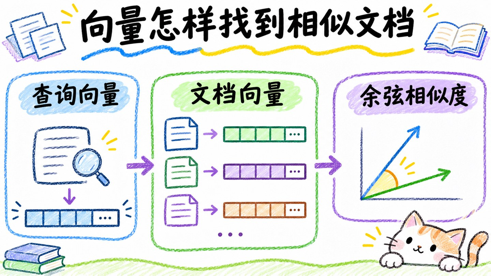

> **生成工具**：Codex\
> **生成模型**：gpt-6.2-sol

用 `blank reimbursement` 搜退款字典，字典写的是 `missing refund`。像查词典一样按字面搜，两个说法对不上。Embedding（嵌入）是把文本映射成一串数字，让相似内容有机会落在相邻的位置。检索时，Query 是用户查询，Document 是入库文档片段。两边需要进入兼容的向量空间。

## 1. 先用三个维度手算

给 toy 示例三个维度，依次是「退款、缺失、规则」，每个坐标表示这一类词的计数。查询 `blank reimbursement` 用同义表变成 `q = (1,1,0)`。退款缺失值片段的简化向量 `d = (2,1,0)`，规则片段为 `r = (1,0,1)`。

- 内积 `q·d = 1×2 + 1×1 + 0×0 = 3`，逐维乘后相加。
- 向量长度 `||q|| = √2`、`||d|| = √5`。余弦就是内积除以两个长度，`3 / √10 ≈ 0.949`。
- 规则片段的余弦为 `1 / (√2 × √2) = 0.5`。把每个向量除以自己的长度后，余弦可以直接算成内积。全零向量按实验约定记 0 分。

维度无物理单位。生产模型的上百个维度通常没有单独人类标签，模型可能给查询和文档提供不同编码入口。训练过的模型能学出比手写同义表更复杂的关系。 [Sentence Transformers 编码文档](https://sbert.net/docs/sentence_transformer/usage/usage.html)

## 2. 看小实验的正面与边界

| 输入 | 本次结果 |
| --- | --- |
| `blank reimbursement` | BM25 关键词路径无结果，手写向量路径第一名为 `missing` |
| `CR-17 refund amount currency` | 混合检索第一名为 `amount`，精确编号仍保留 |
| 词典外的新同义词 | 简化代码缺乏相应映射，需要再标注验证 |

实测用 Python 的词频和同义规则帮助读者看清每一步。它不测真实嵌入模型的效果。迁移模型时保留旧索引，用同一批文档重建新索引。查询编码器与索引按模型版本成对切换，复核维数、归一化、同义词和精确编号。向量不能仅凭维度相同就混用。 [向量代码](../../experiments/rag-knowledge/retrieval_lab.py) · [实验输出](../../experiments/rag-knowledge/retrieval-results.json)
