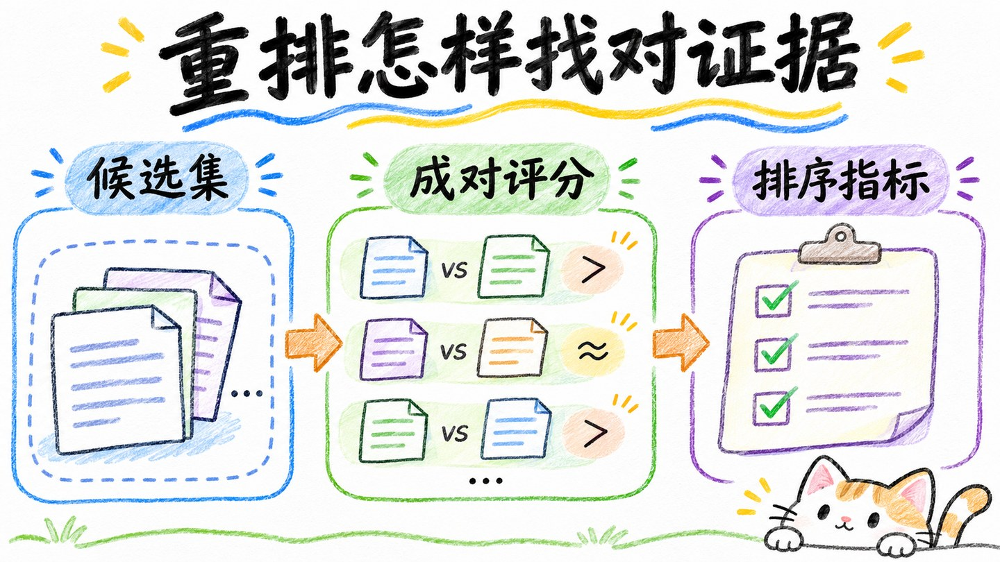

> **生成工具**：Codex\
> **生成模型**：gpt-6.2-sol

查「报销归档要批准吗」时，常见问答页反复提到 refund 和 approval，排得很高。真正给答案的，可能是更短的政策正文。Rerank（重排）就是拿着问题和初筛的几段文字再细读一遍，给每一对重新打分。

## 1. 两阶段的输入不同

第一段先用便宜的检索把全库缩到 4 张卡。第二段的 Cross-Encoder（交叉编码器）把问题和某一张卡同时送入模型，同一层的注意力可以联系两边的词，最后产出一个相关分。你可以从 `(query, candidate)` 列表批量评分。与能预先存文档向量的双编码器相比，这一步要为每个查询重新计算。 [Sentence Transformers 重排示例](https://www.sbert.net/examples/sentence_transformer/applications/retrieve_rerank/README.html)

这次实测用了规则化成对评分复现接口。规则先数共同词；两边都包含批准与归档，再加 3 分；候选用 `only` 表达约束时再加 2 分。输入是 `reimbursement approval archive`。表里的数值来自 Python 脚本，不是模型评分。

| 候选 | 混合召回名次 | 成对分 | 新名次 |
| --- | ---: | ---: | ---: |
| FAQ | 1 | 2 | 3 |
| 受理部门 | 2 | 2 | 4 |
| 保留期 | 3 | 6 | 2 |
| 正式审批规则 | 4 | 8 | 1 |

## 2. 亲手算一行交叉注意力

脚本另演示了同一对输入中的一行注意力。把查询里的归档词记为查询向量 `q=(1,0)`，把候选里的两个词写成键向量 `k1=(1,0)`、`k2=(0,1)`。每个坐标无单位，向量维数是 2。逐对作内积再除以 `√2`，得到 `[0.707,0]`。用 Softmax（取指数后除以总和）归一化后，两个词的权重约为 `[0.670,0.330]`。第一个词若只是泛主题，把键改成 `(0,1)` 后，两者权重各为 0.5。完整 Cross-Encoder 会对拼接输入的多层输出读出相关分。这里用手配向量演示一行交互，表里的最终排序仍来自上一节的固定打分。

## 3. 名次指标与最终回答要分开

该题唯一金标准在第 4 名，重排后到第 1 名。前 1 的 Recall（召回覆盖率）由 0 到 1。MRR（Mean Reciprocal Rank，跨题平均首个相关项倒数排名）在单题上由 `1/4` 到 1。nDCG（Normalized Discounted Cumulative Gain，归一化折损累积增益）在前 4 项用 `1/log2(1+r)` 给相关项按名次折损，这题约从 0.431 到 1。距离顶端越近，权重越高。

重排只整理已有候选。若审批规则没被召回，加大重排模型也看不到它。实验还发现，给回答器传前 2 张卡时把保留期也写入答案，引用相关性降了。上线对照应同时盯候选召回、最终答案、批量评分请求耗时、候选数和每次查询成本。这里用 4 对固定规则验证机制，未测托管模型性能与价格。 [成对打分代码](../../experiments/rag-knowledge/retrieval_lab.py) · [实际排序与判分](../../experiments/rag-knowledge/retrieval-results.json)
