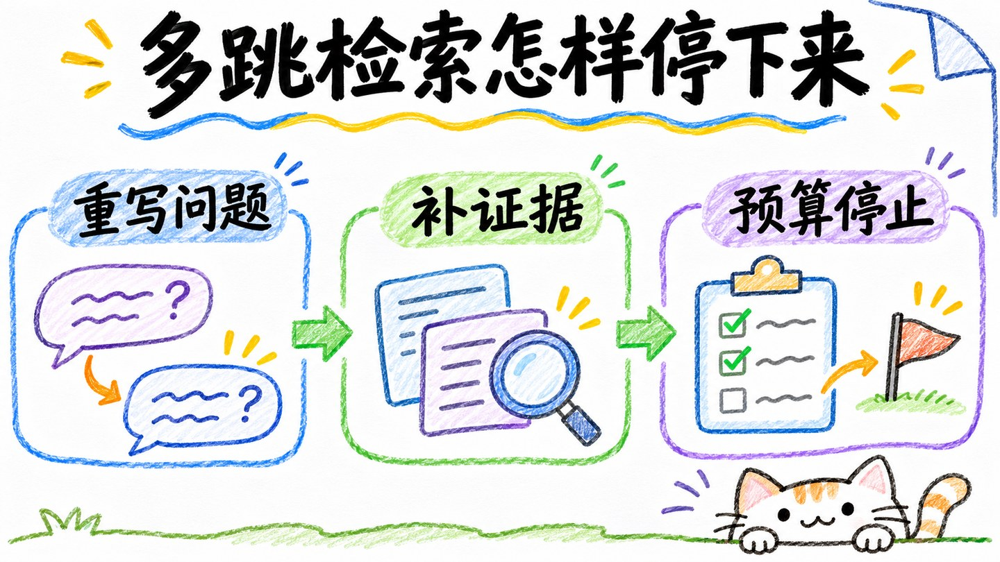

> **生成工具**：Codex\
> **生成模型**：gpt-6.2-sol

问题是「办理退款归档的柜台，工作日几点开门」。退款资料写负责部门，另一份服务说明写那个部门的时间。直接搜问题时可能只能找到其中一半。Agentic RAG 是让智能助手把检索当成工具，根据已经找到的证据判断下一次搜什么，以及何时结束。

## 1. 上一次结果决定下一次的查询

| 步骤 | 发给检索工具的查询 | 得到的证据 |
| --- | --- | --- |
| 第 1 跳 | `refund archive requests` | `routing/v1/p1#alias`，由 records desk（档案柜台）受理 |
| 第 2 跳 | `records desk opens weekdays` | `routing/v1/p2#window`，工作日 09:00 开门 |

回答是「工作日 09:00」，附两条引用。第一条解释为什么这里查的是档案柜台，第二条直接支持时间。本次用规则抽取部门名、生成新查询，能看清 Agent 循环在哪一步获得新信息。实际模型可在同样的接口提出查询，由应用控制预算与权限。

## 2. 预算、去重、答复三条停止路径

| 条件 | 实测调用数 | 动作 |
| --- | ---: | --- |
| 一跳基线 | 1 | 只有部门名，退出并拒答 |
| 预算两跳 | 2 | 取得时间，完整答复 |
| 移除部门映射，下一跳没有新查询 | 1 | 同一查询不再发送，拒答 |

花了多少次调用和回答效果要一起报。生产还可记录查询耗时、证据重叠、工具费用以及模型用量。对简单事实题，第一条证据齐全便可结束。复杂题可以先做两跳再给一次小的补证预算，前提是上一跳带回了能缩小查询范围的新线索。模型得到的证据仍要按原路径核验授权。

运行 `python3 experiments/rag-knowledge/workflow_lab.py` 查看 `multi_hop`。 [可执行代码](../../experiments/rag-knowledge/workflow_lab.py) · [实际轨迹](../../experiments/rag-knowledge/workflow-results.json)
