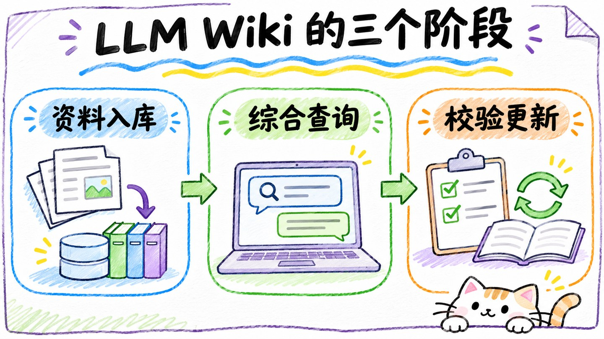

> **生成工具**：Codex\
> **生成模型**：gpt-6.2-sol

每次问「归档政策是什么」，都要从几份手册重新找、重新概括。可以把已经核对过的知识编译成一页。LLM Wiki 是让语言模型协助整理和维护这类页面的做法。页面提供阅读入口，重要结论仍能回到原始资料核实。 [Karpathy 的 LLM Wiki 原文](https://gist.github.com/karpathy/442a6bf555914893e9891c11519de94f)

## 1. 三层各放什么

| 层 | 实验中的内容 |
| --- | --- |
| 资料层 | 退款数据字典和政策的原文快照，每段保留来源、版本与页码 |
| Wiki 页面层 | `refund-amount.md` 与 `archive-policy.md`，汇总同主题材料并链接快照 |
| Schema（维护约定） | 同主题只一页，来源必须在当前版本目录且链接有效，缺证据时做显式标记 |

Ingest（资料入库）把同一主题的文字汇到页面。Query（查询）先读政策页，按保留期的链接打开同一版本原文。Lint（规则校验）检查重复标题和无效引用。本例在临时目录生成 Markdown 和出处文件，使用固定编译规则复核维护流程。实际 LLM 可以协助归类和撰写，当前版本与引用仍交由可审计的规则验证。

## 2. 先发现冲突，再更新派生页面

两份来源分别写 30 天和 45 天。实验把它们和各自版本列出来。假定已确认 v3 是新生效版本，重新编译 `archive-policy`，回查链接指向 45 天原文，再删除重复页面。下次来源撤下时，Lint 首先报旧引用无效。重建后页面保留审批说明，保留期标明 `Source unavailable`，后续查询不能继续复述旧数字。

| 检查 | 实测 |
| --- | --- |
| 冲突检测 | 同一主题读到 30、45 两个版本 |
| 主题重复 | 两个页面使用 `archive-policy` |
| 更新后查询 | 阅读归档页面与新的原文快照，都写 45 天 |
| 原文失效后 | 先报坏链接，重建后保留缺失提示 |

这套 Wiki 可为 RAG 提供更清晰的导航或候选内容。问当前有效指标时，可并行检索原始资料，按当前权限和生效版本确认。运行 `python3 experiments/rag-knowledge/workflow_lab.py` 查看 `wiki`。 [Wiki 维护代码](../../experiments/rag-knowledge/workflow_lab.py) · [维护结果](../../experiments/rag-knowledge/workflow-results.json)
