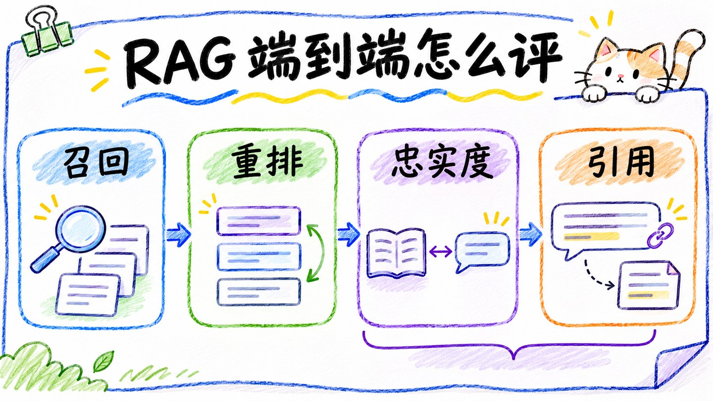

> **生成工具**：Codex\
> **生成模型**：gpt-6.2-sol

退款助手说「保留 90 天」，还附上学校政策第 2 页。点过去发现写的是 30 天。这份回答的引用地址指向相关条款，但陈述仍不忠实。端到端评测要能把这两件事拆开。

## 1. 给每一站自己的问题

| 阶段 | 要看什么 | 本例 |
| --- | --- | --- |
| 文档 | 原文是否解析完整，位置和版本是否保留 | 扫描件 `NA` 行是否能从第 2 页检索 |
| 初召回 | 前 K 个候选覆盖多少相关证据 | 跨段题前 1 只有 `missing`，覆盖 1/2 |
| 重排 | 有用的证据是否更靠前 | 正式审批条款从第 4 升至第 1 |
| 答案忠实度 | 每个陈述是否由引用片段支持 | 学校政策写 30 天，答案说 90 天就失败 |
| 引用正确性 | 引用是否指向人工标注的正确条款 | 写对天数但引用审批条款仍失败 |

K 是取到的候选条数。忠实度本例用原文字符串去对照，可信，但认不出等义改写。引用检查确认地址是否属于本题可用的金标准证据。自动判分还要用一小批人工样本校准。 [Ragas 上下文召回](https://docs.ragas.io/en/stable/concepts/metrics/available_metrics/context_recall/) · [Ragas 忠实度](https://docs.ragas.io/en/stable/concepts/metrics/available_metrics/faithfulness/)

## 2. 固定回答器，只换给它的材料

| 特意制造的差异 | 召回覆盖 | 忠实 | 引用命中 |
| --- | ---: | --- | --- |
| 跨段题只给第一条 | 0.5 | 无答案 | 无答案 |
| 跨段题给齐标准材料 | 1.0 | 通过 | 通过 |
| 给正确证据，手工注入 90 天 | 1.0 | 失败 | 通过 |
| 写对 30 天，指向批准规则 | 1.0 | 失败 | 失败 |

最后一行的「忠实失败」是相对它实际引用的条款而言。证据包别处有正确原句，所以严格答案文本仍能匹配。这个差别说明为何答案、陈述和引用需要各自的分数。对无答案题，另记正确拒答和误拒答。人工抽查可以同时选自动分高却被投诉的样本和自动分低但同义改写的样本，再按首个失败阶段修复。

运行 `python3 experiments/rag-knowledge/workflow_lab.py` 看 `diagnostics`。 [诊断代码](../../experiments/rag-knowledge/workflow_lab.py) · [实际结果](../../experiments/rag-knowledge/workflow-results.json)
