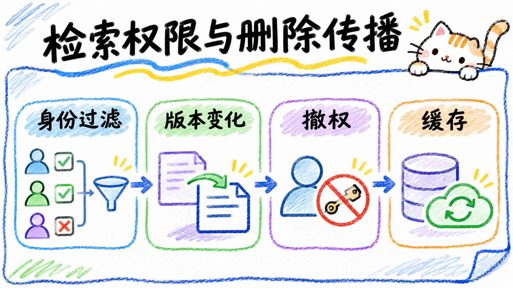

> **生成工具**：Codex\
> **生成模型**：gpt-6.2-sol

学校的退款政策写保留 30 天，合作方写 90 天。两份资料可能很像，关键词和向量也会把它们排在一起。租户是系统隔开的组织空间。检索前先确定请求属于哪个组织，以及它此刻能读哪些文件。

## 1. 从文档一路带上权限和版本

索引里的每张卡保存 `tenant`（归属组织）、`source`（文档 ID）、`version`（版本）。应用从登录身份取租户，读取权威授权和版本台账，然后先过滤再召回、重排和组织证据。当前用户看不到的文字，不应发送到候选重排器。引用入口也再次用当前权限验证，处理对话里保存的历史链接。ACL（Access Control List，访问控制列表）为每份文档保存当前允许读它的主体。 [Azure 文档级访问控制](https://learn.microsoft.com/en-us/azure/search/search-document-level-access-overview)

## 2. 用旧缓存回读一次

| 时刻 | 真实观察 |
| --- | --- |
| 学校有权读政策 v2 | 学校可以查到 `policy/v2/p2#retention`，合作方引用同一个位置被拒绝 |
| 刚撤权，索引和引用缓存仍在 | 旧引用被拒绝，学校授权后的候选为空 |
| 删除传播完成 | 政策旧块被移出，旧缓存条目被清除 |
| 新版重新发布并授权 | 只接受 `policy/v3/p2#retention`，新正文为 45 天 |

示例把组织、文档及版本的映射当作权威台账，缓存只保留引用，任何命中都重新核验。真实服务的摘要缓存也可能包含原文。缓存键要纳入授权范围和版本，新授权状态查不到时先拒绝。撤权应先切断读取，再异步删除正文、向量、缓存和衍生引用，记录清理水位。重复的旧索引消息以版本比较过滤。验证并发时要覆盖「查询刚开始，权限马上撤回」和「旧版本消息晚到」两类顺序。已交付到客户端的旧正文需要独立的会话访问策略。

运行 `python3 experiments/rag-knowledge/retrieval_lab.py` 查看 `tenant`。 [实验代码](../../experiments/rag-knowledge/retrieval_lab.py) · [实际输出](../../experiments/rag-knowledge/retrieval-results.json)
