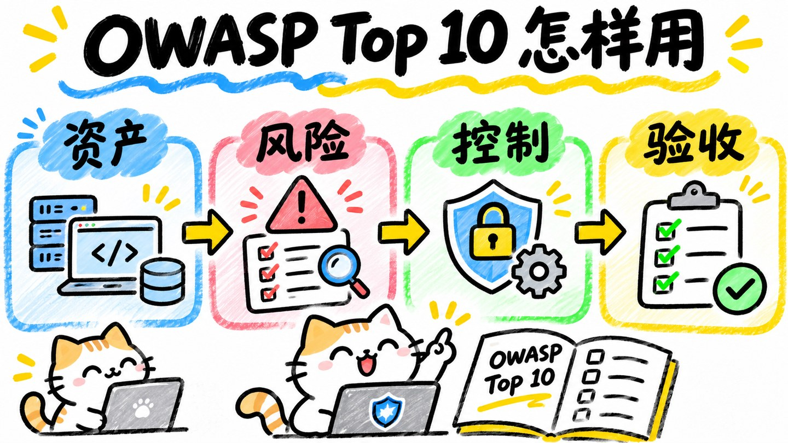

> **生成工具**：Codex\
> **生成模型**：gpt-6.2-sol

想象有个助理能替你读表、写报告和归档。表里有什么、谁能读报告、谁能批准归档，是三件不同的事。安全工作可以从问「哪些东西要保护，谁有权做什么」开始。

## 1. 先选对清单

OWASP（Open Worldwide Application Security Project）基金会支持面向应用安全的开放项目。它的 Top 10 是给开发者和安全团队建立共同语言的风险清单。GenAI（Generative AI，生成式人工智能）安全项目维护面向生成式应用与 Agent 的资料。LLM（Large Language Model，大语言模型）清单适合从输入、数据与输出看一条应用链。Agent 是能按目标多步调用工具的智能助手，它还需要检查身份、代理权限和工作流状态。 [OWASP 基金会](https://owasp.org/about/) · [OWASP Developer Guide](https://devguide.owasp.org/en/07-training-education/05-top-ten/) · [生成式 AI 安全项目](https://genai.owasp.org/)

## 2. 画出这份报告走过的边界

```text
上传者 → 应用接收 CSV → 执行器计算 → 产生报告草稿
                 浏览器 ← 展示草稿
审核者 → 独立审批服务 → 归档代理 → 归档存储
```

CSV 是逗号分隔值文件。上面的「信任边界」指从一个权限或身份范围跨到另一个时需要重新校验，例如从应用到可写归档存储。文件里的文字属于上传数据。审核者的身份由可信入口校验，批准的动作和报告版本另行存储。

| 资产 | 威胁与影响 | 控制 | 负责人 | 验收证据 |
| --- | --- | --- | --- | --- |
| 原始退款数据 | 报告查询跨组织，暴露退款细节 | 服务端检查请求身份与租户 | 数据服务 | 合成合作方身份被拒绝 |
| 草稿展示 | 意外字段进页面，造成误读或泄露 | 输出结构、引用范围和文本编码 | 应用前端 | 多余字段拒绝，合法内容能展示 |
| 正式归档 | 未审批、审批对象变化，产生错误档案 | 保存审批绑定，再按当前状态决定 | 归档服务 | 确认前零条、变更拒绝、确认后只一条 |
| 调用预算 | 重试继续消耗配额 | 将预算扣减与写入放在同一事务 | 平台运行时 | 写入失败时配额恢复，合法重试成功 |

先给风险排优先级，结合发生概率、影响和能否恢复。下一步把验收条件写成测试，并留下日志或业务结果。清单更新时也要保留用过的版本号，避免同一个编号在不同年份指向不同风险。

运行 `python3 experiments/agent-guardrails/guardrails_lab.py`，检查以上矩阵对应的合成结果。 [控制用例](../../experiments/agent-guardrails/guardrails_lab.py) · [实际输出](../../experiments/agent-guardrails/guardrails-results.json)
