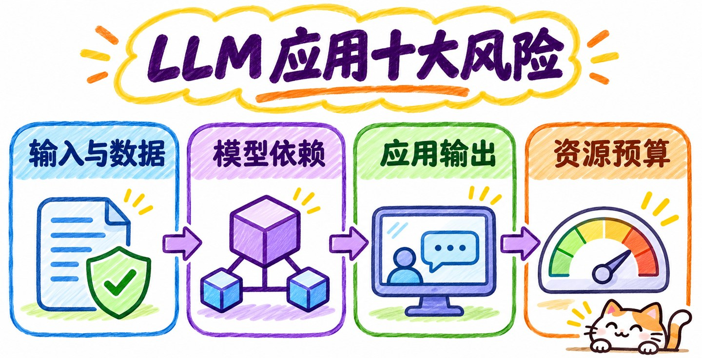

> **生成工具**：Codex\
> **生成模型**：gpt-6.2-sol

如果退款问答能回数字、找手册，也能请归档系统执行动作，安全检查要覆盖整条链。LLM（Large Language Model，大语言模型）只是其中一个部件。此处按 OWASP 2026 年正式发布版整理。该版调整了编号，`LLM03` 已是行动能力过宽，`LLM08` 是隐藏上下文暴露，`LLM10` 是输出处理不当。 [2026 正式清单](https://github.com/GenAI-Security-Project/GenAI-LLM-Top10/blob/main/2026/README.md)

## 1. 输入、数据和供应链

| 编号与含义 | 从退款应用看影响 | 防护与验收条件 |
| --- | --- | --- |
| LLM01 提示注入 | 上传内容干扰模型对任务的解释 | 区分数据和控制面，审批由受信服务签发。文件可以读取，受保护动作仍等待审批 |
| LLM02 敏感信息泄露 | 报告、日志或模型请求带入内部数据 | 最小化输入并分类，限制日志字段。用标记过的合成记录确认只有允许字段进入日志 |
| LLM03 行动能力过宽 | 统计助手拥有超出任务所需的写权限 | 精确授权，写操作另审批。只读身份读统计成功，归档申请仍受审批控制 |
| LLM04 供应链 | 模型、依赖或连接器变更带来未知行为 | 建立组件清单，核验发布来源与版本。未批准版本进入待复核状态 |
| LLM05 数据与模型投毒 | 不可信材料持久进入检索库或训练数据 | 审核来源、分批入库并保留快照。未审来源保持不可查询，回退后恢复已审版本 |

## 2. 资源、答复和运行时

| 编号与含义 | 从退款应用看影响 | 防护与验收条件 |
| --- | --- | --- |
| LLM06 无界资源消耗 | 长输入或连续重试占满请求额度 | 限输入、调用次数和截止时间。达到预算后返回明确状态，不再增加写入 |
| LLM07 错误信息 | 助手说保留 90 天，但现行政策是 30 天 | 关键数值回源核对，证据不足时拒答。人工样本同时核对数值、版本和出处 |
| LLM08 隐藏上下文暴露 | 内部上下文、策略细节或运行资料被意外呈现 | 策略中避免放秘密，对输出和遥测做字段级控制。批准字段仅由应用提供，内部备注不展示 |
| LLM09 向量与嵌入弱点 | 相似文档找到了别的租户的政策 | 检索前按租户与文档版本过滤，引用打开时再次授权。撤权后引用立即不可读 |
| LLM10 输出处理不当 | 结构化答复直接进入页面或下一步执行 | 用 Schema 校验字段和类型，按显示上下文编码，下游独立检查动作。格式错误不触发写操作 |

Schema 是字段及类型的约定。出站输出的文字、证据标识和动作建议各有自己的处理路径。合成实验覆盖内容规则、结构、跨边界授权和写入预算的样例。表中知识库入库审计、供应链治理、真实模型质量等是验收设计，实际覆盖要以各服务提供的日志和测试为准。 [官方发布说明](https://genai.owasp.org/resource/owasp-genai-llm-top-10-2026/) · [护栏结果](../../experiments/agent-guardrails/guardrails-results.json) · [知识库权限实验](../08-rag-and-wiki/kb-09-tenant-retrieval.md)
