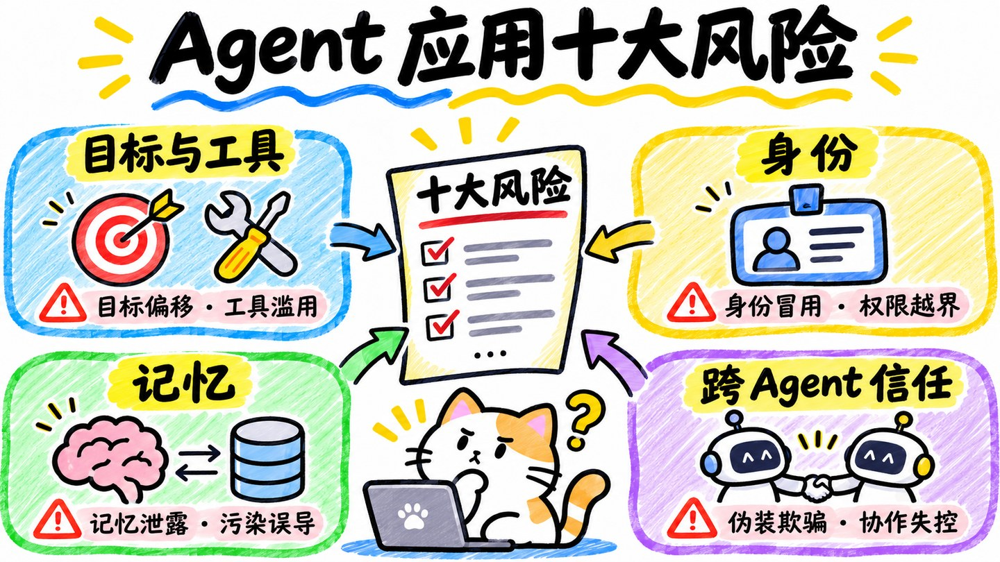

> **生成工具**：Codex\
> **生成模型**：gpt-6.2-sol

一个退款助手可以从读文件一路做到归档。错误也可能一路传过去。OWASP 为这类靠多步动作完成任务的应用整理了 2026 年 Agentic Applications 清单。它用 `ASI01` 到 `ASI10` 标识条目。这里把每条放回同一条退款流程。 [官方发布页](https://genai.owasp.org/resource/owasp-top-10-for-agentic-applications-for-2026/)

## 1. 从目标、权限走到工具执行

| 编号与含义 | 退款 Agent 的影响 | 验收检查 |
| --- | --- | --- |
| ASI01 目标劫持 | 原本生成草稿的任务偏到别的业务动作 | 把任务目的与权限留在受信状态里，文档读取后写操作仍要求审批 |
| ASI02 工具被误用 | 正确的工具用到了不允许的资源或目标 | 代理同时检查工具名、动作、资源；未知目标拒绝 |
| ASI03 身份与权限滥用 | 工作身份或委派范围超出了组织、任务或有效期 | 独立校验主体、租户、目标服务、授权范围与寿命；跨租户拒绝 |
| ASI04 Agent 供应链风险 | 工具、技能或服务注册发生未批准更新 | 按审批记录固定发布版本和摘要；清单变化进入复核 |
| ASI05 意外代码执行 | 生成内容走进具有代码执行能力的组件 | 固定类型的工具输入，隔离执行器并限制文件和出站网络；文本作为数据处理 |

## 2. 从状态、协作走到审计与恢复

| 编号与含义 | 退款 Agent 的影响 | 验收检查 |
| --- | --- | --- |
| ASI06 记忆与上下文投毒 | 未审草稿成为后续会话信以为真的长期记录 | 分开会话笔记和已审事实，按来源、版本、租户回查；未审记录不进入正式证据 |
| ASI07 Agent 间通信不安全 | 接收方拿到错误身份或任务上下文的消息 | 验证对端、目标服务与任务绑定，不同任务的委派被拒绝 |
| ASI08 级联故障 | 归档失败又触发下游索引、通知和重试 | 事务、幂等和有界重试。写入失败恢复预算，最终只生成一个归档 |
| ASI09 人与 Agent 的信任被滥用 | 页面让审核者误认即将批准的文件和范围 | 审批页显示具体动作、文件版本、目标和后果；任一字段变化重新审批 |
| ASI10 失控 Agent | 任务持续偏离目标或不断尝试操作 | 独立限制动作、预算和终止条件，保留停机控制；预算耗尽不做新写入 |

同一场景可以同时落在两份清单。归档建议被下游当成执行指令，LLM10 关心输出怎样交给下游；ASI02 关心工具能否在当前任务操作这个资源；ASI03 关心调用身份凭什么有这个权力。把这些控制落到不同层，并对每层留下验收证据。 [LLM 2026 清单](https://genai.owasp.org/resource/owasp-genai-llm-top-10-2026/) · [工具审批结果](../../experiments/agent-guardrails/guardrails-results.json) · [第三方信任结果](../../experiments/agent-guardrails/trust-results.json)
