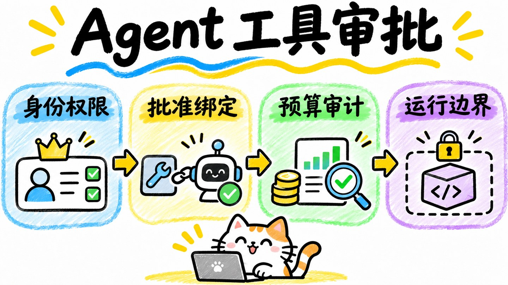

> **生成工具**：Codex\
> **生成模型**：gpt-6.2-sol

用户允许助手做的是「给我报告草稿」。归档意味着把结果写进正式业务记录，所以需要另外确认。Agent 可以负责提出工具动作，真正掌握归档权限的是执行代理。它验证身份、许可和审批记录后才写数据库。

## 1. 审核者批准的是这份报告

有效退款是 4 和 6，平均 5，`NA` 表示缺失。这里用内容哈希指纹标记报告。它由 SHA-256（输出 256 位摘要的哈希算法）计算，内容变化后摘要随之变化。

```text
审批绑定 = 动作 + 租户 + 目标资源 + 报告版本 + 内容摘要
执行前校验 = 当前身份 + 目标许可 + 绑定吻合 + 有效期 + 当前存档来源
```

外部文本读出来后标记为上传文档。归档仍须从独立入口取得审批记录，审批服务还会核对权威登记的报告摘要。执行代理对未知资源、主体租户不符、过期或对象被更换的批准分别返回可审计的拒绝原因。记录里留执行人、租户、动作、顺序和结果，避免附上原始报告。

## 2. 看数据库说了什么

| 操作 | 实测状态 |
| --- | --- |
| 读取上传备注 | 被标记为上传文档，可用作数据 |
| 无批准、跨租户或未知目的地 | 分别拒绝，未归档 |
| 用原批准提交改过的报告，或权威登记的内容已变 | 要求重新批准或标记版本过期 |
| 人工注入提交前故障 | SQLite 回滚，归档 0 条，预算恢复到 1 |
| 合法重试后再发同一动作 | 第一次写入，第二次识别已归档，最终 1 条 |
| 超预算的新版本 | 被拒绝，现有记录保留 |

SQLite 是文件型关系数据库，本例用内存实例。归档写入与扣点在一个事务，且用租户、资源与版本建立唯一约束。这样提交前失败可恢复，已完成的动作也不会重复计费。跨独立服务时，通常需要单独记录幂等键和执行回执，并核对下游状态。

## 3. 三层控制各管什么

应用层提供用户意图、批准页面和可信报告版本。工具代理核验身份、目标、配额，留下结构化结果。Sandbox（沙箱，隔开执行环境的边界）限制可访问文件、网络和资源。实验只演示工具代理的逻辑目录和数据库行为，真实文件和网络边界需要在部署平台分别验证。 [实验代码](../../experiments/agent-guardrails/guardrails_lab.py) · [状态与审计结果](../../experiments/agent-guardrails/guardrails-results.json)
