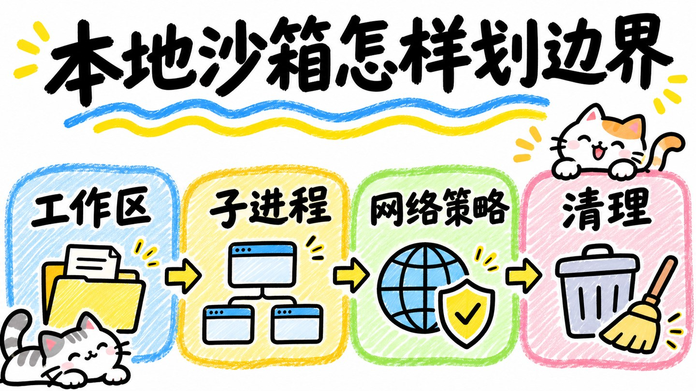

> **生成工具**：Codex\
> **生成模型**：gpt-6.2-sol

## 先用大白话理解

你让编程助手去文件柜里取一张表，允许它用计算器，也允许它在草稿纸上写结果。关键问题是，它顺手让别人代办时，别人能不能拿到你没给它的纸。系统里的这个「别人」叫子进程，即程序启动的另一个程序。如果只保护第一层，第二层可能不在同一份边界里。

实验只有合成数据。脚本算出两条有效退款和均值 5，还检查一个同目录之外的合成标记文件和一个本机临时回环监听器。这个监听器只用于验证系统边界。回环（Loopback）是机器和自己通信的地址，本例使用 `127.0.0.1`，没有访问外部站点。

## 1. 先从一个任务目录开始

编排脚本创建临时目录、任务工作区和一份假想的「另一团队标记」。给退款计算的输入永远是同一份 `refunds.csv`。Python 先打印 `READY`，读取三笔 `4, NA, 6`，写出报告后才执行类型固定的边界检查。

```text
任务脚本 ──只读──> refunds.csv
        ──写入──> workspace/report.json
        ──核验──> 合成标记文件、新建的 Python 子进程、临时回环监听器
```

对照组能读标记、能代理子进程读标记、能连同一个监听器。这一步很重要。没有这个正对照，看到「连接失败」时，你分不清是策略生效了，还是测试根本没把监听器开起来。报告算对和边界符合预期也是两条单独的断言。

## 2. macOS 进程策略对系统调用做拒绝

实测主机为 macOS 15.5 arm64。系统命令 `sandbox-exec` 的手册已标注废弃。本实验用它观察进程策略的效果。示例策略保留默认行为，只对合成文件的读和网络操作施加拒绝。入口程序可以启动自己的 Python 子进程，子进程仍然读不了同一标记。父进程读取工作区所需输入、写报告，业务动作正常完成。

这是一个针对固定夹具的最小实验策略。真实 Coding Agent 若处理不可信代码，需要明确允许的目录、文件读写边界、进程和网络策略，并为实际使用的工具验证继承情况。macOS 应用可参考系统的 App Sandbox；它与这个历史命令的实现接口不同。 [Apple App Sandbox](https://developer.apple.com/documentation/security/app-sandbox)

## 3. Docker 给任务一个不同的文件视图

在 Docker Desktop 的 Linux 虚拟机中，用 Docker 28.5.1 运行 Python 3.12.12。宿主处理流程用 Python 3.14.0。算法文件和输入表以只读方式挂入容器，输出目录单独可写。只读根文件系统限制容器根目录的写入；挂进去的工作区仍按专门的可写设置工作。容器使用非 root（非管理员）用户，移除附加能力，限制进程数和内存，禁止增加权限。

网络使用 `none`。Linux 的回环仍存在。实测还看到若干处于 `down` 的内核隧道设备，这些名字本身说明不了网络可用性。我们另外核对没有 IPv4 默认路由、没有常见的 `eth0` 网卡、临时监听器不可达。 [Docker 容器参数](https://docs.docker.com/engine/containers/run/) · [Docker none 网络](https://docs.docker.com/engine/network/drivers/none/)

| 验收项 | 未加策略的本机 | macOS 夹具策略 | Docker 夹具 |
| --- | --- | --- | --- |
| 统计并写报告 | 2 条、均值 5 | 2 条、均值 5 | 2 条、均值 5 |
| 父进程读另一标记 | 可读 | 权限拒绝 | 路径不可见 |
| 子进程读另一标记 | 可读 | 权限拒绝 | 路径不可见 |
| 访问临时回环监听器 | 可达 | 权限拒绝 | 不可达 |
| 以可写方式打开只读任务输入 | 本组未做该断言 | 本组未做该断言 | 文件系统拒绝 |

这组实验只用了当前进程创建的夹具。路径不可见，因为它没有被挂进容器。权限拒绝则是路径存在、系统拒绝打开。把这两个结果分别记下，排查时能直接想到该核对挂载还是权限策略。

## 4. 删容器，再看报告和目录

脚本拿容器 ID 做清理。移除后查不到同一个容器，但宿主挂载的 `report.json` 仍在。最后退出临时目录管理器时，这份报告和内部标记一起被清理。容器、挂载目录、独立存储是三条生命周期，验收报告应分别列出它们的清理结果。

实验需要已运行的 Docker 引擎、现有 macOS 命令与缓存过的 Python 镜像。只下载通用 Python 运行时。固定 `--pull never` 让测量过程中不触发镜像下载。

```bash
docker pull python:3.12.12-slim
python3 experiments/sandbox-runtime/local_lab.py --samples 10
```

读结果时先看 `boundaries` 的真实状态，再看 `cleanup`。这些观察针对当前镜像与配置。额外挂载、网络打开或容器权限变化后，要重跑对应验收。 [任务脚本](../../experiments/sandbox-runtime/refund_job.py) · [实验驱动](../../experiments/sandbox-runtime/local_lab.py) · [实际结果](../../experiments/sandbox-runtime/local-results.json)
