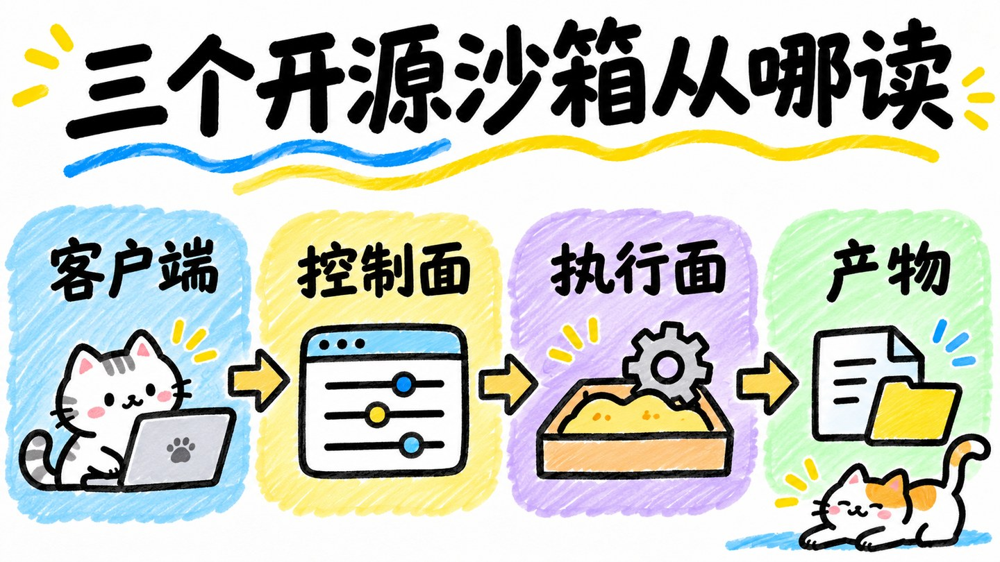

> **生成工具**：Codex\
> **生成模型**：gpt-6.2-sol

## 先用大白话理解

三个服务都能说「给我一个房间跑脚本」。真正有用的比较，是找到负责发房间号的人、负责布置房间的人、负责送文件与收报告的人。读源码也按这条线找。这样遇到「接口成功但报告拿不到」，就知道要查客户端、控制面、执行服务还是存储。

我们拿同一份小任务走一遍。启动带 Python 的环境，送入 `refunds.csv`，运行统计，读回报告并销毁。三行 `4, NA, 6` 应得到有效条数 2、均值 5。下面的源码路线是固定版本的阅读记录。

## 1. E2B，从 SDK 的 create 往里走

第一站看 Python SDK 的 `sandbox_sync/main.py`。沿 `Sandbox.create` 和获取信息、终止方法检查客户端如何持有 Sandbox ID，以及什么时候拿到可以跑命令的对象。再打开同目录下的 `commands/command.py` 和 `filesystem/filesystem.py`，把「请求管理沙箱」与「在给定沙箱执行命令、读文件」分开。 [Python SDK 固定提交](https://github.com/e2b-dev/E2B/blob/08c4eeba6d08413779ec3fa5e7ac0edf3f608b33/packages/python-sdk/e2b/sandbox_sync/main.py)

第二站看 E2B Runtime 仓库的 API 处理。沿 `sandbox_create.go` 追创建请求怎样进入 orchestrator（编排器），再看 `pkg/server/sandboxes.go` 的节点服务。创建、命令和文件服务是不同的接口。运行时仓库还包含 envd（访客中的执行与文件代理）和 Firecracker 相关实现。托管服务的具体地区、套餐限制和策略以官方文档与实际合同为准。 [Runtime API 创建入口](https://github.com/e2b-dev/runtime/blob/e3d5b7feac6cb9e1017cfd2add007901d508e2cb/packages/api/internal/handlers/sandbox_create.go) · [编排服务入口](https://github.com/e2b-dev/runtime/blob/e3d5b7feac6cb9e1017cfd2add007901d508e2cb/packages/orchestrator/pkg/server/sandboxes.go) · [E2B 托管文档](https://docs.e2b.dev/)

沿这条路径问三个问题。创建请求用哪个模板？执行工作通过什么运输到访客？报告是在会话里临时存放，还是已保存到独立卷？知道这三件事后，才能正确理解重连、暂停与销毁。

## 2. OpenSandbox，从生命周期路由追到 Docker 或 Kubernetes

OpenSandbox 的 SDK 把对象创建、命令和文件操作给到调用方。服务端从 `api/lifecycle.py` 看入口：请求经过模型校验，然后交给选定的服务实现。Docker 路径读 `services/docker/docker_service.py`，跟到容器创建、准备 execd 和运行。execd 是负责执行命令等操作的沙箱内代理。Kubernetes 路径读 `services/k8s/kubernetes_service.py`，再看工作负载和服务端点如何建立。Kubernetes（简称 K8s）负责调度一组节点上的工作负载。用了 Kubernetes 后，隔离强度仍取决于节点和配置选定的运行时。 [生命周期路由](https://github.com/opensandbox-group/OpenSandbox/blob/release-1.2.0/server/opensandbox_server/api/lifecycle.py) · [Docker 后端](https://github.com/opensandbox-group/OpenSandbox/blob/release-1.2.0/server/opensandbox_server/services/docker/docker_service.py) · [Kubernetes 后端](https://github.com/opensandbox-group/OpenSandbox/blob/release-1.2.0/server/opensandbox_server/services/k8s/kubernetes_service.py)

本次实测使用 `release-1.2.0` 服务镜像和 `1.2.1` Python SDK，运行已有的本机 Docker 后端。上传、命令、下载、续租与销毁走通，销毁后查询返回 HTTP 404。 在其它部署中，认证、入口代理、容器能力、可挂载目录和出站策略应逐项核对。源码里存在某选项，只表明可以配置。测试应再读实际生效的状态。

## 3. CubeSandbox，从 CubeAPI、CubeMaster 走到 Cubelet

CubeAPI 提供外部接口。先读 `CubeAPI/src/handlers/sandboxes.rs` 看 HTTP 请求怎样分发给服务。在架构文档确认 CubeMaster 管理调度和实例状态，随后看 `Cubelet/services/cubebox/cube_container_create.go`，定位每台执行节点上的实例创建。沿接口继续读虚拟机、网络与存储。CubeShim 管理虚拟机生命周期，KVM（Kernel-based Virtual Machine，Linux 内核虚拟化机制）提供硬件虚拟化接口。CubeVS 和 CubeEgress 分别出现在网络转发和出站控制链，CubeCoW 则管理写时复制的存储。CoW 指多个实例可以先共享底层内容，各自写入时再维护自己的变化。 [固定版本架构文档](https://github.com/TencentCloud/CubeSandbox/blob/6843e3f97e670e8e5f1e8b720f8538938dcaf700/docs/architecture/overview.md) · [CubeAPI 接口入口](https://github.com/TencentCloud/CubeSandbox/blob/6843e3f97e670e8e5f1e8b720f8538938dcaf700/CubeAPI/src/handlers/sandboxes.rs) · [Cubelet 创建入口](https://github.com/TencentCloud/CubeSandbox/blob/6843e3f97e670e8e5f1e8b720f8538938dcaf700/Cubelet/services/cubebox/cube_container_create.go)

读这里时，区分模板缓存与实例状态。若模板是已经准备好的文件系统和启动状态，实例申请、节点分配、访客就绪和命令执行仍是各自的阶段。本文按固定提交阅读 CubeSandbox 路径。KVM 运行验证需要相应 Linux 主机。

## 4. 用同一份问题表对齐三个项目

| 问题 | E2B | OpenSandbox | CubeSandbox |
| --- | --- | --- | --- |
| 从哪看客户端和控制面 | Python SDK、Runtime 里的 API 和编排器 | SDK、生命周期路由与服务实现 | CubeAPI、CubeMaster |
| 从哪看执行边界 | Runtime、访客代理和 MicroVM | execd、Docker 或 K8s 后端 | Cubelet、CubeShim 和虚拟化层 |
| 从哪看网络与文件 | 沙箱端点、网络策略和文件服务 | 路由或代理、网络策略、文件接口与卷 | CubeVS、CubeEgress 与存储层 |
| 本文证据 | 官方文档和固定提交源码 | 本机 API + 固定发布版源码 | 架构文档和固定提交源码 |

先画出「申请 → 执行 → 文件 → 销毁」，验证用同一份数据能否走通，才能把启动方式或项目特性放进设计选择。 [API 结果](../../experiments/sandbox-runtime/opensandbox-results.json) · [生命周期文章](sbx-03-remote-lifecycle.md)
