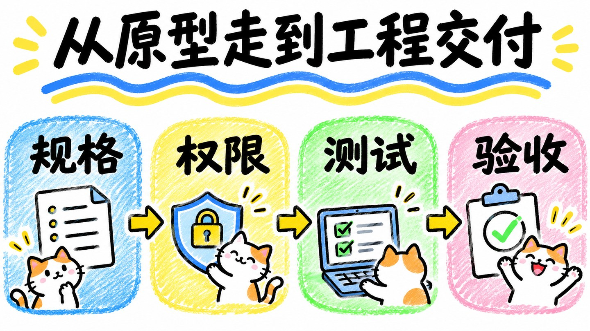

> **生成工具**：Codex\
> **生成模型**：gpt-6.2-sol

## 先用大白话理解

一座纸桥能摆在桌上，说明桥的形状想通了。要让人走过去，还要知道它能承受多大重量、哪一块坏了怎样换。工程交付就是给程序补上这样的可检验条件。Agentic Engineering 里，助手可以写代码、跑测试、反复修改，人要说明什么算通过和哪些动作需要授权。

上一轮退款页已经能生成报告。回到工位再检查，`NA` 的常见情况解决了，但「错行怎么提示」「取消归档后会怎样」还没落实。把这些条件写出来，接手的人就能用同一份样本验收。 [原型记录](dev-01-vibe-coding-prototype.md) · [Agentic Engineering Patterns](https://simonwillison.net/guides/agentic-engineering-patterns/)

## 1. 把一句需求展开成可检查的规格

| 部分 | 可验证规则 |
| --- | --- |
| 输入 | 首行是 `refund`。每行一个非负金额，最多两位小数。最多 4096 字符，非法行报告行号 |
| 数字 | 真零保留，空行和 `NA` 跳过。 `4, NA, 6` 显示两条、均值 5.00 |
| 空结果 | 条数是 0，均值为空，归档预览不可用 |
| 草稿版本 | 输入有改动或重新生成时，上一个审批不能再用 |
| 归档 | 预览不写入，取消不写入。确认当前版本后，只为这份草稿发一张本地回执 |

用「提交前后回执数」来观察结果，比验证点了一下按钮更精确。版本是草稿生成时取得的编号，让批准对象可以明确定位。实验把应用范围限在合成单列表格和本地页面。正式业务的身份认证、持久化和并发写入需要服务端另行验收。 [实验规格与复跑](../../experiments/report-delivery/README.md)

## 2. 让页面负责显示，让规则负责决定

原型在单个 HTML（网页标记文件）内用几行代码既算数据又改界面。工程版分成三块：页面结构、负责连接按钮和状态的代码、可脱离浏览器测试的业务规则。比如金额先记成整数分：`0.01` 元是 1 分，`0.02` 元是 2 分，平均 1.5 分，按本例的四舍五入规则显示 0.02 元。用整数运算可以把「恰好半分」写成确定的比较。

```text
读取文本 → 校验格式 → 生成第 N 版草稿
         → 预览第 N 版 → 人工确认 → 生成一次回执
                     ↘ 取消或改输入 → 旧批准作废
```

浏览器把当前版本展示在确认框里。业务函数同时检查这次批准的版本与当前草稿是否吻合。这样即使页面状态出错，规则层仍有自己的拒绝条件。两个版本各自有编号，旧批准失败后仍可使用没有出错的新预览。 [规则实现](../../experiments/report-delivery/engineered/report-core.js) · [页面实现](../../experiments/report-delivery/engineered/report-ui.js)

## 3. 用两组证据证明它能工作

八项 Node.js 内建测试覆盖缺失与真零、全空、坏行与坏表头、金额舍入、输入上限、显式审批与重复提交、批准过期、取消和异常后恢复。浏览器再测人实际会遇到的路径。非法第 2 行要显示可理解的错误，修完可恢复到「2 条、5.00」，打开预览时归档数必须仍是 0。

| 比较项 | 第二轮原型 | 工程版验收 |
| --- | --- | --- |
| 可重复覆盖 | 浏览器抽查默认输入、空表和归档按钮 | 8 项规则测试与界面状态检查 |
| 错误恢复 | 可能产生无效均值，缺少具体行提示 | 显示行号、禁止提交，修正后能重试 |
| 修改范围 | 小范围快照，所有逻辑挤在单页 | 统计、交互与测试分离，方便逐项复核 |
| 归档保护 | 点击即显示已归档 | 当前草稿审批、取消、重复提交均受约束 |

代码复核时，先看旧版中一点击便改变状态的入口，再走新规则里的生成、预览和提交。避免把显示层的按钮禁用当成唯一保护。回退代价也要问清。这个演示没有外部写入，退回版本只涉及代码；真实业务已经写入的归档要靠独立数据处理流程。 [规则测试](../../experiments/report-delivery/engineered/report-core.test.cjs) · [浏览器结果](../../experiments/report-delivery/results/browser-results.json)

## 4. 把证据交给下一位接手者

长任务里，Harness（围绕 Agent 的任务框架）可以把工作分成小段，每段保存验收条件、已通过的证据和剩余缺陷。换会话后，先读这些产物，再挑一个条件验证和修改。也可把实现和评估分别看待，用同一套规格评价候选，避免因为实现者熟悉自己的路径而漏掉异常情况。 [Anthropic 长任务 Harness](https://www.anthropic.com/research/effective-harnesses-for-long-running-agents) · [生成与评估分工案例](https://www.anthropic.com/research/harness-design-long-running-apps)

下一篇继续看同一页面，比较只记点击坐标和按按钮的可访问名称定位，两种策略在布局变化后怎样恢复。 [DEV-03 浏览器操作](dev-03-computer-use.md)
