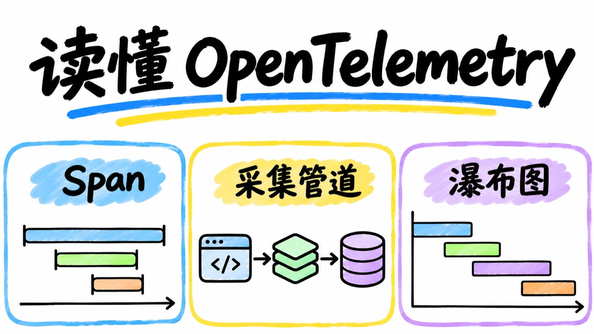
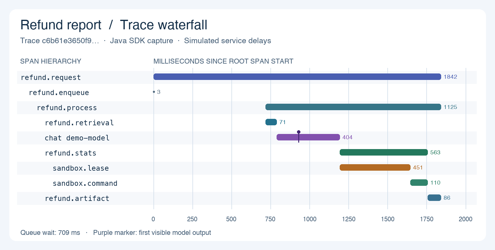

> **生成工具**：Codex\
> **生成模型**：gpt-6.2-sol

## 从一句“报告怎么还没好”开始

你去食堂点餐，取餐时只知道自己等了快两分钟。要知道慢在哪里，得有几张带时间的单据。前台几点接单，后厨几点拿到单，什么时候开始做，什么时候端上来。单据都带同一个订单编号，拼起来才是一张完整的时间线。

OpenTelemetry，简称 OTel，是一套采集、传递和导出运行数据的标准与工具。用在程序里，一张有开始、结束和结果的工作单叫 **Span**。一次操作相关的 Span 集合叫 **Trace**，中文常说调用链或链路追踪。退款报告任务可以有入队、消费、调用模型、租用沙箱、生成报告等 Span。看到报告慢时，先找这次操作的 Trace，再打开其中的 Span 看时间花在哪里。 [OpenTelemetry Trace 概念](https://opentelemetry.io/docs/concepts/signals/traces/)

全文用一份逗号分隔值文件（CSV）演示。这份文件只有一列 `refund_amount`，三行数据是 `8.00`、`2.00` 和缺失值 `NA`。有效记录有两条，平均金额是 `(8.00 + 2.00) ÷ 2 = 5.00` 元。示例把均值存为整数 500 分。模型、检索和沙箱等待由程序模拟，退款统计自己算，追踪数据则由真实的 Java SDK 生成。

## Span 里面到底装了什么

以 `chat demo-model` 为例。它在模型调用开始时创建，在请求结束时关闭。期间可以记下供应商、模型名、输入输出 Token 数，以及“第一段文本出现”的时刻。Token 是模型处理文本的计量单位，示例中的用量来自模拟响应。Span 的持续时间是结束时间减开始时间，首段响应的耗时是该事件时间减此 Span 开始时间。两者共用起点，终点不同。

| 字段 | 大白话 | 本例放什么 |
| --- | --- | --- |
| `traceId` | 整个订单的编号 | 所有属于这次退款任务的 Span 共用 |
| `spanId` | 这一段工作的编号 | `chat demo-model` 自己的编号 |
| `parentSpanId` | 哪段工作发起了它 | 指向消费端的 `refund.process` |
| `name`、`kind` | 工作叫什么，在交互里扮演什么角色 | 模型 Span 是 `CLIENT`，表示向外发起调用；队列两端是 `PRODUCER`、`CONSUMER` |
| 开始、结束时间 | 什么时候开工，什么时候结束 | OTLP 用 Unix 纪元纳秒，界面通常换算为毫秒 |
| `attributes` | 整段工作的属性 | 例如 `gen_ai.usage.input_tokens=620`、`gen_ai.usage.output_tokens=80` |
| `events` | 工作中发生的带时间点的小事 | 首段可见文本到达，记一个 `app.model.first_visible_delta` |
| `status` | 这段工作对调用方的结果 | 正常演练是 `UNSET`，工具抛错时相关 Span 显式标记 `ERROR` |
| `links` | 与其他 Span 的关联 | 一个批处理同时消费多条消息时，可用 Link 指向多个来源 |

一个 Span 最多有一个父 Span，根 Span 没有父。在批处理、重投或独立异步链路中，父子树无法同时表达所有来源，这时可用 Link 补上关系。属性适合记“这一单用了 620 个 Token”，事件适合记“第 140 毫秒冒出第一段文本”。工具 Span 里若还要分别看租约和命令的耗时，就建两个子 Span，因为它们各有开始和结束。 `UNSET` 是默认状态，不能从它单独推断整条任务成功。任务结果仍应对照业务状态和报告。 [Tracing API 规范](https://opentelemetry.io/docs/specs/otel/trace/api/)

## 架构图里有两条路，别把它们画成一条

```text
业务请求与上下文
应用接单 ──消息及 traceparent──> 队列 ──消息及 traceparent──> 工作进程
   │                                                          │
   │ Span 结束后导出                                           │ Span 结束后导出
   └─────────────────────── OTLP ─────────────────────────────┘
                             │
                             ▼
                   Collector（可选的收集器）
              Receiver → Processor(s) → Exporter
                             │
                             ▼
                     追踪后端存储和查询
                             │
                             ▼
                     界面按 Trace ID 画瀑布
```

上面一条是业务流。应用把待处理的消息送入队列，工作进程后来把它取出来。消息携带 `traceparent`，作用是让两边约定“这是同一个订单，工作进程的上一步是入队”。

下面一条是观测流。应用里的埋点通过 API（应用程序接口）建 Span，SDK（软件开发工具包）管理采样和处理，导出器把 Span 送出去。生产常用 OTLP（OpenTelemetry Protocol）传输，可走 HTTP（超文本传输协议）或 gRPC（一种远程调用框架）。配置 Collector 时，Receiver 收数据，Processor 做批处理、字段处理或采样，Exporter 发往一个或多个目标。Collector 可以部署在应用附近作代理，也可作为共享网关集中接收。简单部署若后端支持，应用也可直接发送。保存、索引、搜索和画瀑布图一般由追踪后端及其界面提供，例如 Jaeger。 [Collector 架构](https://opentelemetry.io/docs/collector/architecture/) · [OTLP 规范](https://opentelemetry.io/docs/specs/otlp/) · [Jaeger 架构](https://www.jaegertracing.io/docs/latest/architecture/)

回到食堂排队的问题，OpenTelemetry 的三类常见信号各回答一个问题。**Trace（追踪）**告诉你某一单在哪一步等了多久。**Metrics（指标）**把许多订单聚合起来，例如过去五分钟排队时间的分布。**Logs（日志）**记录某个时刻发生的具体事情，例如租约申请超时。日志若附带 Trace ID 和 Span ID，就能从瀑布图回到对应错误。本文的 Java 演练只采集追踪。

应用的导出器和 Collector 的导出器处在不同位置。前者把应用产生的 Span 发给接收端，后者把 Collector 已经收到并处理过的数据再发给后端。生产里的应用 SDK 通常用批处理降低开销，短命任务还要给最后一批数据留出刷新时间。Collector 里定义了组件后，还得在 `service.pipelines.traces` 把它们连上，组件才会进入这条管道。学习时可以用 `otlp` 接收器接收 Java 应用数据，再用 `debug` 导出器打印，先确认 Span 到了收集端，再配置真正的追踪后端。 [Collector 配置](https://opentelemetry.io/docs/collector/configuration/)

同一 Trace 的 Span 可以来自多台机器，也可能分批抵达。根 Span 未送达时，后端仍可能先收到几个子 Span。业务流程继续前进与观测数据送达是两个结果。页面上暂时只有半条链路，既可能是上下文没传好，也可能是采样或导出问题。

## 跟一遍队列两端的 Java 代码

以下是基于[可运行的 Maven 项目](../../experiments/production-refund/java-otel/README.md)的伪代码。两段分别发生在接入线程和消费线程，省略了 SDK 装配、数据转换与异常处理。入队时把**当前的生产者 Span**编码进消息头，消费时用这个头恢复上一步。

```java
// 接入端已有 refund.request Span，入队操作创建一个子 Span。
Span producer = tracer.spanBuilder("refund.enqueue")
        .setSpanKind(SpanKind.PRODUCER)
        .startSpan();
try (Scope scope = producer.makeCurrent()) {
    propagator.inject(Context.current(), headers, Map::put);
    queue.add(new Job(Map.copyOf(headers), System.nanoTime(), csv));
} finally {
    producer.end();
}

// 工作端从消息头恢复远端上下文，建立消费 Span。
Context parent = propagator.extract(Context.root(), job.headers(), HEADER_GETTER);
Span consumer = tracer.spanBuilder("refund.process")
        .setSpanKind(SpanKind.CONSUMER)
        .setParent(parent)
        .startSpan();
try (Scope scope = consumer.makeCurrent()) {
    generateReport(job.csv());
} finally {
    consumer.end();
}
```

`traceparent` 由 W3C（万维网联盟）的 Trace Context 规范定义，通常形如 `版本-Trace ID-发送方 Span ID-追踪标记`。在本例中“发送方”就是 `refund.enqueue`。ID 是十六进制编码，Trace ID 有 32 个字符，Span ID 有 16 个字符。接收方沿用前者，自己生成新的 Span ID，并把后者保存为父节点。头里传的是关联所需的字段，Span 的事件、错误、用量在结束后由导出器走观测流。 `Context.root()` 是空的初始上下文。如果队列头丢了，消费端就会另建一条 Trace，退款数据本身仍可正常处理。 [W3C Trace Context](https://www.w3.org/TR/trace-context/) · [Java SDK 示例](ops-06-opentelemetry-trace.md)

## 那它发送出去是什么数据结构

OTLP 的追踪负载按三个层次组织。**Resource** 说明数据来自哪个服务或进程，例子是 `service.name=refund-demo`。**Instrumentation Scope** 说明哪一段埋点代码输出了数据，例子是名为 `refund-demo` 的 Tracer。两个名字这里恰好相同，生产中一个服务可以有许多不同埋点库。最后的 **Span** 才是这次具体的模型调用、沙箱命令等记录。

```json
{
    "resourceSpans": [
        {
            "resource": {
                "attributes": [
                    {
                        "key": "service.name",
                        "value": {
                            "stringValue": "refund-demo"
                        }
                    }
                ]
            },
            "scopeSpans": [
                {
                    "scope": {
                        "name": "refund-demo"
                    },
                    "spans": [
                        {
                            "traceId": "c6b61e3650f99aa9eb0eaa7568638120",
                            "spanId": "eaafc497dec34bbb",
                            "parentSpanId": "829e214d1ba0c791",
                            "name": "chat demo-model",
                            "kind": 3,
                            "startTimeUnixNano": "1795421635935364000",
                            "endTimeUnixNano": "1795421636339088292",
                            "attributes": [
                                {
                                    "key": "gen_ai.usage.input_tokens",
                                    "value": {
                                        "intValue": "620"
                                    }
                                },
                                {
                                    "key": "gen_ai.usage.output_tokens",
                                    "value": {
                                        "intValue": "80"
                                    }
                                }
                            ],
                            "events": [
                                {
                                    "timeUnixNano": "1795421636077533750",
                                    "name": "app.model.first_visible_delta"
                                }
                            ]
                        }
                    ]
                }
            ]
        }
    ]
}
```

这是把一条 Java 运行记录整理成的精简 OTLP JSON（JavaScript Object Notation，一种文本数据格式），只保留和模型调用有关的字段。运行时的内存导出器输出 `SpanData`，实际网络传输由 OTLP 导出器完成。父 ID 对应同一条 Trace 的 `refund.process`，这个父 Span 可以在同一批或后续批次抵达。OTLP JSON 用十六进制表示 Trace ID 和 Span ID，JSON 里的 `kind=3` 对应客户端调用，时间戳的十进制字符串单位为纳秒。整段耗时用 `(结束纳秒 − 开始纳秒) ÷ 1,000,000` 换成毫秒。 [OTLP 的 JSON 编码规则](https://opentelemetry.io/docs/specs/otlp/) · [追踪数据结构定义](https://github.com/open-telemetry/opentelemetry-proto/blob/v1.8.0/opentelemetry/proto/trace/v1/trace.proto)

## 从数据到瀑布图，读出三件事



这次运行的总耗时约 **1842 毫秒**，队列等待 **709 毫秒**。模型 Span 约 **404 毫秒**，紫色刻度标出首段文本，它比模型开始晚约 **142 毫秒**。工作进程中，沙箱租约约 **451 毫秒**，命令执行约 **110 毫秒**。这张图取自 Java SDK 记录，等待由演练注入。

- **横条位置看什么时候开始**。每个 Span 的开始时间减去根 Span 的开始时间，都落在同一条横轴。在当前比例下宽度不足 4 像素的入队操作画成点，横轴起点仍是它的真实位置。
- **横条长度看它用了多久**。根 Span 包住整个任务。工作进程约在 700 毫秒后才开始，消费横条左侧的空白提示先看排队。精确的排队数从消费 Span 属性 `app.queue.wait_ms` 读，横条间的像素距离只用来判断大致范围。
- **缩进看父子关系**。这次消费 Span 的父节点是入队 Span，但入队早就结束了。父子关系表示上下文来源，跨队列时不要求时间上的包含。统计工具的持续时间则已覆盖本例的租约和命令，把这三段再相加会重复计算。两个并行 Span 若在横轴上重叠，端到端延迟取决于挡住报告完成的路径，不能把每条横条的长度简单相加。

正式界面通常先按服务、时间范围和操作筛选，再打开某条 Trace，搜索最可疑的 Span。打开详情后找属性、事件和状态。以退款任务来说，先查消费端的队列等待，再看统计工具下的沙箱租约。采样后的单条慢例适合解释“这次为什么慢”，要回答“最近一小时有多少比例的请求慢”，应查询全量或有明确统计口径的指标，例如排队时间直方图。

## 跑一遍，看数据断在哪

仓库根目录运行以下命令。Java 使用本地队列和内存导出器，首次运行 Maven 会解析构建依赖。 `--timestamps` 额外打印每行 Span 的 `start_unix_ns` 和 `end_unix_ns`，用它们能独立还原本页的画法。

```bash
mvn -q -f experiments/production-refund/java-otel/pom.xml compile exec:java -Dexec.args=--timestamps
mvn -q -f experiments/production-refund/java-otel/pom.xml compile exec:java -Dexec.args=--drop-traceparent
```

第一次看两个完整 ID。 `refund.enqueue.spanId` 应等于 `refund.process.parentSpanId`，它们的 Trace ID 也应相同，报告输出 `rows=2 mean_cents=500`。第二次人为移除传播头，报告仍是 500 分，工作进程 Span 的父 ID 却变为全零，Trace ID 也改变了。可以用同一业务任务号去找两段追踪。这验证的是业务做完了、关联失败了。若 ID 一致但后端还是缺行，顺序查 Span 是否结束、采样是否记录、导出器是否送达、Collector 管道是否转发，最后核对追踪后端的时间范围和服务过滤条件。

生产上先收集服务名、操作名、阶段耗时、有限枚举和错误类型。示例中的金额只在本地报告演练，埋点无需复制原始 CSV、模型提示词或授权头。接下来若要把代码接进已有 Spring Boot 服务，用 Java Agent 自动采集框架调用，再为排队、沙箱租约和产物补业务 Span。 [用 Java 实际接入与排障](ops-06-opentelemetry-trace.md)
