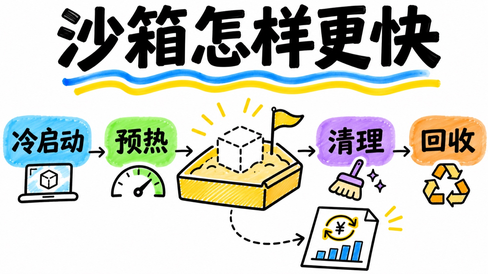

> **生成工具**：Codex\
> **生成模型**：gpt-6.2-sol

## 先用大白话理解

做实验要一张干净的桌子。有人排队等桌子，有人等工具箱运来，有人等仪器通电，然后才轮到自己按下第一个按钮。沙箱（Sandbox）是给程序单独划出的执行空间。用户只说“打开报告怎么这么慢”，工程师得把这四段分开计时，才能知道该买更多桌子、把工具箱提前放好，还是把仪器设置保存起来。

本例上传逗号分隔值文件（CSV），金额是 8.00、2.00 元及一个缺失值，统计进程跑完后得到 2 条记录、均值 5.00 元。我们关注从请求一个执行租约到统计程序首次成功完成的这段准备及首命令时间。若产品的启动指标取“可以接收命令”，应另外记录可就绪时刻。

## 给四段分别按一次表

| 阶段 | 起止点 | 慢时先核对 |
| --- | --- | --- |
| 排队 | 提交租约请求 → 调度分配到执行位置 | 队列深度、各池容量、租户配额 |
| 镜像准备 | 分配后开始解析镜像 → 所需层可挂载 | 节点、镜像摘要、拉取字节、解压时间 |
| 运行时 | 根文件系统可用 → 执行端报告就绪 | 容器或虚拟机初始化、挂载、网络及身份注入 |
| 首命令 | 发起统计命令 → 收到首命令成功结果 | 命令派发、解释器冷启、输入加载 |

表格用首命令成功收尾，能抓住探针已就绪但任务仍迟迟打不开的情况。真实系统可能并行准备镜像和网络，把每步起止记下来，按关键路径算端到端。记录时间时让同一进程用单调时钟，跨服务关联用追踪与校准。不同机器的墙上时间直接相减，可能数出负排队时间。

## 四条路分别复用了什么

冷启动要准备镜像层、初始化运行时和任务环境。容器镜像可以按摘要引用，一台节点有了同样的基础层，后续启动就能复用。OCI 是 Open Container Initiative（开放容器倡议），它的镜像清单列出镜像配置和层，便于按内容身份管理。固定摘要可避免同一个标签改指其他内容。 [OCI 镜像清单](https://github.com/opencontainers/image-spec/blob/main/manifest.md)

预热池提前维持已经就绪的执行实例，任务到来时分配一个干净实例，再装入数据与身份。它省去一部分现场等待，也长期占用资源。洁净快照则保存还没有租户数据与密钥的初始化状态，任务来时恢复，然后生成新身份、补齐实例级配置。快照版本要跟镜像和策略绑定，恢复后不能继承旧连接、临时文件和授权。共享只读基础层和每任务可写层有不同生命周期。预热池空了就按冷路径准备，指标要单记池命中率，避免只报告命中样本。 [此前的沙箱实测方法](../10-sandbox-runtime/sbx-05-benchmark-response.md)

## 为什么要看 P95

P95 是第 95 百分位，这里用最近秩法。20 个耗时从小到大排，向上取整 `20 × 0.95` 得第 19 个值。例子里最慢一组冷路径耗时 `15 + 185 + 60 + 20 = 280` 毫秒，20 个样本里有四个达到 280，因此第 19 个也是 280。清洁快照对同组输入为 `15 + 0 + 35 + 20 = 70` 毫秒。现场不能把四段的 P95 加起来当总 P95，先对每个请求做一份合计，再排序取值。

| 路径 | 每路径样本 | 请求到首命令完成的 P95 |
| --- | ---: | ---: |
| 冷启动 | 20 | 280 毫秒 |
| 镜像层已缓存 | 20 | 125 毫秒 |
| 有预热实例 | 20 | 50 毫秒 |
| 从洁净快照恢复 | 20 | 70 毫秒 |

数字来自[确定性演练](../../experiments/production-refund/README.md)中的虚拟时钟。它说明统计口径，无法预测真实运行时谁更快。现场要按节点冷暖、镜像版本、地域、负载、命中状态分组，保留样本数和错误数。还要量空闲池成本。每天多留 3 个实例，每个空闲 10 小时，就多 30 实例小时；把这笔成本与少排队的任务数放在同一张表。

## 租约过期后怎么知道真的释放了

租约是对一份资源在限定时段的使用记录。演练的 `s-old` 到虚拟时刻 80 过期，79 时仍存活，80 时先撤销访问、停止执行、丢弃本任务可写层，再记为 `released`，81 时重复回收没有新增操作。生产应把每一步持久化，超时后能重试，清理失败先隔离该实例。租约代次用于阻止旧持有者迟到后继续写入，新租用者使用新代次与新身份。

核销时对照控制端租约和实际进程、挂载、网络、凭据，分别检查正常完成、超时、用户取消和回收进程重启。Kubernetes 的已完成作业清理机制可以删除已完成的 Job 及其依赖对象，应用自己的外部文件、许可证和凭据仍应另有回收和核对。下一步把执行端变成独立的异步工作池，用队列深度和租约供给一起决定扩容。 [Kubernetes Job TTL 清理](https://kubernetes.io/docs/concepts/workloads/controllers/ttlafterfinished/) · [生产化专题目录](../../llm-agent-learning-roadmap.md)
