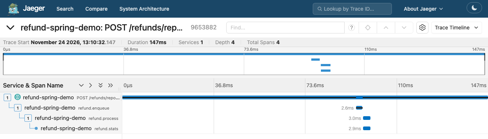

> **生成工具**：Codex\
> **生成模型**：gpt-6.2-sol

## 先用大白话理解

用户点了“生成报告”，页面等了 1,850 毫秒。只看一个总时间，好比你知道快递晚了，却不知道是在仓库排队、在路上，还是卡在门卫登记。OpenTelemetry（简称 OTel）是一套生成和传递软件运行观测数据的工具与规范，可以给每段工作记开始、结束和上下游关系。

样例是同一份 CSV（逗号分隔值文件），退款是 8.00 元、2.00 元和缺失值，统计产物必须给出 2 条有效记录、均值 5.00 元。用户随后单独确认归档。这里测到报告可见为止，把人的确认时间留在另一段交互。下面每个时刻都是虚拟毫秒，从同一个请求进入的时刻计起。

## 给每段工作一个可关联的编号

Trace（一次调用链的追踪）用 Trace ID 关联一组工作。Span（工作片段）是某一步具体的计时记录，有自己的 Span ID，可引用父 Span ID。请求进来建根 Span。向队列写消息时，在消息元数据注入当前追踪上下文，工作进程从消息恢复。W3C Trace Context 是万维网联盟定义的跨进程追踪上下文格式，常见字段 `traceparent` 携带追踪 ID、父片段 ID 和追踪标记。

同步一对一调用通常能自然形成父子。队列重投或一批消息共同触发一个批处理时，消费端可使用 Span Link（关联到其他片段）保留多个来源，任务号继续用作业务对账。传播上下文解决相关性，授权仍用真实服务身份。进程内耗时用单调时钟记录，跨机器对照校准时间，也可用发送和接收的边界拆出一段更容易核实的等待。 [OpenTelemetry 上下文传递](https://opentelemetry.io/docs/concepts/context-propagation/) · [Trace 定义](https://opentelemetry.io/docs/concepts/signals/traces/)

## 读一遍时间线

| 片段 | 从何时到何时 | 耗时 | 上级 |
| --- | --- | ---: | --- |
| 请求 | 0～1850 | 1,850 毫秒 | 根 |
| 排队 | 15～715 | 700 毫秒 | 请求 |
| 检索 | 715～785 | 70 毫秒 | 请求 |
| 模型 | 785～1185 | 400 毫秒 | 请求 |
| 工具 | 1185～1765 | 580 毫秒 | 请求 |
| 沙箱租约 | 1195～1645 | 450 毫秒 | 工具 |
| 沙箱命令 | 1645～1745 | 100 毫秒 | 工具 |
| 发布报告产物 | 1765～1850 | 85 毫秒 | 请求 |

接入处理的 15 毫秒加上串行主路径的 `700 + 70 + 400 + 580 + 85`，得到 1,850 毫秒。沙箱两段已经包含在工具中，再加会重复算。两条并行路径要找挡住用户交付的那条，并观察重叠区间。此例先查 700 毫秒排队，再钻到工具内部看 450 毫秒租约。命令只占 100 毫秒，先优化统计脚本能节省的时间有限。

模型从 785 开始，模拟在 925 给出第一段用户可见文本。从模型 Span 开始计首段是 140 毫秒，从请求进入计则是 925 毫秒。两者都可以叫首段延迟，仪表盘必须标注计时起点。`Token` 是模型的文本计量单位，流式网络分块与 Token 边界可以不同，工具参数或空事件也可能先到。此例明确以第一段可见文本作为终点。

## 选一版字段，先记少量证据

本例固定 OpenTelemetry Semantic Conventions（语义约定）v1.39.0 来阅读字段。这一版本的生成式 AI 字段仍处于开发状态，升级埋点时要一起核对仪表盘。示例模型响应报告输入 620、输出 80 Token，分别放到 `gen_ai.usage.input_tokens`、`gen_ai.usage.output_tokens`。保留 `gen_ai.request.model` 和调用类型 `gen_ai.operation.name`，输出失败时附短错误类型，供应商未返回用量就留空并记明来源。步骤顺序可以用应用自己的序号，如 `app.agent.step`。定义过的字段和应用自定义字段沿不同命名空间记录。统计工具和沙箱的自定义字段由应用统一约定。 [v1.39.0 的 GenAI Span 约定](https://github.com/open-telemetry/semantic-conventions/blob/v1.39.0/docs/gen-ai/gen-ai-spans.md)

正常 span 只留部署版、耗时、结果类别、输入长度或数量，原始提示词、工具参数、报告与凭据默认不采集。排查时优先用合成样本重放。确需记录内容则限制环境和可见范围、做脱敏并规定保留时间。统计指标持续收全量口径，详细 Trace 可以采样。头部采样在开始时决定保存哪些链路，尾部采样等到看到错误和耗时后再选，后者更容易保留慢例与错误，也需要聚拢同一 Trace 的片段、容量和等待窗口。 [OpenTelemetry 采样](https://opentelemetry.io/docs/concepts/sampling/)

## 动手做一个 Java 项目

先跑一个包含真实 OpenTelemetry SDK（软件开发工具包）的最小 Maven 项目。主线程把一份退款 CSV 放进队列，工作线程取出，依次走检索、模拟模型调用、统计工具和产物步骤。金额仍是 8.00 元、2.00 元和 `NA`，最后应输出两条有效记录、均值 500 分。排队和外部服务的延迟用 `Thread.sleep` 注入，统计实际用 `BigDecimal` 计算。项目不需要启动模型、消息中间件或观测后端。 [Java 演练项目](../../experiments/production-refund/java-otel/README.md)

```bash
mvn -q -f experiments/production-refund/java-otel/pom.xml compile exec:java
```

### 第一步，让 Span 能被看到

在 Maven 中把 `opentelemetry-sdk` 和 `opentelemetry-sdk-testing` 固定到同一版本 `1.68.0`。这与上文固定的语义约定 v1.39.0 是两条独立的版本线。前者是 Java 库，后者决定观测字段如何命名。示例的 `Tracer` 负责创建 Span，`SimpleSpanProcessor` 在 Span 结束时移交给导出器，`InMemorySpanExporter` 把结果暂存在进程内，主程序读出并打印。 [完整 Maven 配置](../../experiments/production-refund/java-otel/pom.xml) · [OpenTelemetry Java SDK](https://opentelemetry.io/docs/languages/java/sdk/)

```java
InMemorySpanExporter exporter = InMemorySpanExporter.create();
SdkTracerProvider provider = SdkTracerProvider.builder()
        .addSpanProcessor(SimpleSpanProcessor.create(exporter))
        .build();
try (OpenTelemetrySdk sdk = OpenTelemetrySdk.builder()
        .setTracerProvider(provider)
        .setPropagators(ContextPropagators.create(W3CTraceContextPropagator.getInstance()))
        .build()) {
    Tracer tracer = sdk.getTracer("refund-demo");
    TextMapPropagator propagator = sdk.getPropagators().getTextMapPropagator();
    // 把 tracer 和 propagator 交给接入端和工作线程。
}
```

### 第二步，把追踪编号写进队列消息

`startSpan()` 创建一个工作片段，`makeCurrent()` 把它放进当前线程的上下文。入队时必须把**生产者 Span** 设为当前，再调用 `inject`，否则发出去的可能是更外层请求的编号。SDK 把当前 Trace ID 和 Span ID 编码进 `traceparent`。队列只需保存普通字符串。消费者在另一条线程调用 `extract`，读出远端父上下文。

下面省去调度和错误处理，演示接入的两端。完整项目在统一的 `inSpan` 方法里负责恢复 Scope 和结束 Span。 [完整 Java 源码](../../experiments/production-refund/java-otel/src/main/java/example/refund/RefundTraceDemo.java)

```java
// 接入线程，当前上下文里已有 refund.request。
Span producer = tracer.spanBuilder("refund.enqueue")
        .setSpanKind(SpanKind.PRODUCER)
        .startSpan();
Map<String, String> headers = new HashMap<>();
try (Scope scope = producer.makeCurrent()) {
    propagator.inject(Context.current(), headers, Map::put);
    queue.add(new Job(Map.copyOf(headers), System.nanoTime(), csv));
} finally {
    producer.end();
}

// 工作线程，从消息恢复父上下文。
Context parent = propagator.extract(Context.root(), job.headers(), HEADER_GETTER);
long waitMs = TimeUnit.NANOSECONDS.toMillis(System.nanoTime() - job.enqueuedNanos());
Span consumer = tracer.spanBuilder("refund.process")
        .setSpanKind(SpanKind.CONSUMER)
        .setParent(parent)
        .setAttribute("app.queue.wait_ms", waitMs)
        .startSpan();
try (Scope scope = consumer.makeCurrent()) {
    // 在这个 Scope 中创建检索、模型、统计工具和产物的子 Span。
} finally {
    consumer.end();
}
```

`Scope.close()` 恢复当前线程原来的上下文。线程池会复用线程，遗漏这一步可能把下一个任务挂到上一个任务下面。`span.end()` 记下结束时刻，少了它，导出器可能一直收不到这个 Span。完整示例捕获异常后设为 `ERROR`，记录异常类型并继续抛出，避免把含用户输入的异常详情送到观测系统。

`app.queue.wait_ms` 从任务放入队列前算到消费者收到任务，包含本例注入的约 700 毫秒。消费者 Span 从取到任务才开始，不能直接拿它的持续时间当排队时间。这里两条线程共享同一个 JVM，能比较 `System.nanoTime()`。换成跨机器的 Kafka 或 RabbitMQ 后，两台机器的 `nanoTime()` 没有共同原点。用 broker（消息代理）的入队时间、消费端接收时间和同步时钟做估算，按平台定义区分首次入队、重新投递与每次处理等待。一个消息对应一个消费者时可按示例选父子关系。批量处理或追踪已自带上下文的场景，要按消息规范考虑 Span Link。 [消息 Span 约定](https://opentelemetry.io/docs/specs/semconv/messaging/messaging-spans/)

### 第三步，先用父子关系找链路，再按耗时查瓶颈

一次运行得到 `report rows=2 mean_cents=500`。下面把控制台输出整理成表，下表中的 ID 只展示前 8 位，自动化校验用完整 ID。本次所有行的 Trace ID 都以 `13b5d0ae` 开头，序号和毫秒数每次运行会略有变化。

| Span | Span ID 前 8 位 | Parent Span ID 前 8 位 | 耗时（毫秒） |
| --- | --- | --- | ---: |
| `refund.request` | `3b267c50` | `00000000` | 1832 |
| `refund.enqueue` | `0b2974ce` | `3b267c50` | 1 |
| `refund.process` | `ba7d4954` | `0b2974ce` | 1122 |
| `refund.retrieval` | `dcc01907` | `ba7d4954` | 71 |
| `chat demo-model` | `448ed01b` | `ba7d4954` | 404 |
| `refund.stats` | `e4267c28` | `ba7d4954` | 559 |
| `sandbox.lease` | `8b6405fb` | `e4267c28` | 450 |
| `sandbox.command` | `7f6e3a69` | `e4267c28` | 108 |
| `refund.artifact` | `bdf43e90` | `ba7d4954` | 86 |

另外，消费 Span 打印了 `queue_wait_ms=704`，模型 Span 打印了 `input_tokens=620 output_tokens=80` 和首段事件 `offset_ms=142`。Token 数是模拟供应商回包的值。

读输出时，先核对 `refund.process` 的 `trace` 和 `refund.enqueue` 相同，再核对其 `parent` 等于入队 Span 的 `span`。诊断时读 `queue_wait_ms`，它表示开始工作前已等了多久。然后打开 `refund.stats`，对照其子 Span `sandbox.lease` 和 `sandbox.command`。前者约 450 毫秒，后者约 100 毫秒。这个样本首先该查队列为什么等了 700 毫秒，其次查租约分配。模型 Span 的首段事件偏移约 140 毫秒，整个模型 Span 仍约 400 毫秒。这两种耗时都来自真实采集的 Span，所测等待由程序注入。

再故意制造两种故障，观察链路会怎样变化。

```bash
mvn -q -f experiments/production-refund/java-otel/pom.xml compile exec:java -Dexec.args=--drop-traceparent
mvn -q -f experiments/production-refund/java-otel/pom.xml compile exec:java -Dexec.args=--fail-tool
```

- 丢掉 `traceparent` 后，统计仍返回 500 分，但 `refund.process` 的 Trace ID 改变，父 Span ID 变为全零。线上遇到两段 Trace，沿消息发送和接收的边界核对是否保留了传播字段。
- 工具失败时，`sandbox.command`、`refund.stats`、`refund.process` 和演练的请求 Span 都能看到 `ERROR`，并且没有 `refund.artifact`。这代表本次请求确实失败。真实异步接口如果早已返回 `202 Accepted`，入口 HTTP Span 可以是成功，最终失败要到消费 Span 与任务记录里找。

### 第四步，搬进已有的 Spring Boot 项目

已有 Spring Boot 应用可以让 OpenTelemetry Java Agent 承担框架埋点和 SDK 初始化。应用依赖 `io.opentelemetry:opentelemetry-api`，在业务类用 `GlobalOpenTelemetry.getOrNoop().getTracer("refund-service")` 取 Tracer，只为沙箱租约、报表产物等应用步骤增加手工 Span。若 Agent 已经为使用的消息客户端传播上下文，先观察真实入队和消费 Span，再决定是否补自己的传播逻辑。进程内示例的 SDK 装配只用于本地演练。 [Java Agent 手工扩展](https://opentelemetry.io/docs/zero-code/java/agent/api/)

假设团队已有接收 OTLP 的 Collector。OTLP 是 OpenTelemetry Protocol，也就是应用把观测数据发给后端的协议。Collector 负责接收、处理并转发。对于配置了 HTTP 接收端口 4318 的 Collector，可用下面的环境变量启动应用。示例地址和 JAR 路径需要替换成部署环境的实际值。

```bash
export OTEL_SERVICE_NAME=refund-service
export OTEL_TRACES_EXPORTER=otlp
export OTEL_METRICS_EXPORTER=none
export OTEL_LOGS_EXPORTER=none
export OTEL_EXPORTER_OTLP_PROTOCOL=http/protobuf
export OTEL_EXPORTER_OTLP_ENDPOINT=https://otel.example.com:4318
java -javaagent:/opt/otel/opentelemetry-javaagent.jar -jar refund-service.jar
```

这里配置的是 OTLP 通用端点，HTTP Trace 请求会走 `/v1/traces`。如果改用 `OTEL_EXPORTER_OTLP_TRACES_ENDPOINT`，填写包含该路径的完整地址。启动后可在预发布提交一条合成退款请求，按 `service.name` 找入口，再顺着 Trace 打开模型和工具。入口只有 202 时，另外核对任务创建到报告可用的指标，因为短 HTTP Span 并不覆盖后台等待。前面的内存示例验证 Java SDK 能生成并关联 Span，下面再把它们送进真实的查询后端。 [SDK 配置与 OTLP 端点](https://opentelemetry.io/docs/languages/java/configuration/)

## Spring Boot 接入实战

把同一份 `8.00, 2.00, NA` 交给 Spring Boot。HTTP 接口将任务交给工作线程，等统计完再回给调用方。有效 2 笔，均值 500 分。我们要证明的是报告生成之后，HTTP 入口和三个业务 Span 能从 Jaeger 查回来，并连成一条线。

### 先区分业务传递与遥测传递

```text
业务   HTTP 请求 → Spring Boot → 消息头和工作线程 → 退款报告
遥测   Java Agent → Collector → Jaeger 存储 → 查询和瀑布图
```

`traceparent` 随业务消息传递，告诉工作线程该关联到哪条链路。OTLP（OpenTelemetry Protocol）让已完成的 Span 走另一条路，在本例中是两个真实的 HTTP 跳转。Java Agent 发给 Collector，Collector 将同一批 Span 打到调试日志，并转发给 Jaeger，Jaeger 把它们存起来供查询。 [Collector 配置](https://opentelemetry.io/docs/collector/configuration/) · [Jaeger 查询 API](https://www.jaegertracing.io/docs/2.23/architecture/apis/)

| 位置 | 配置中的观察点 |
| --- | --- |
| Spring Boot，端口 18087 | `POST /refunds/report` 返回笔数、均值，以及演练用的入口和工作线程 Trace ID |
| Collector，端口 14318 | `/v1/traces` 收到 Span，`debug` 导出器打印 Trace ID 和 Span ID |
| Jaeger 接收端，端口 14319 | 收到 Collector 发送的 Span，把它们写入内存存储 |
| Jaeger 查询端，端口 17686 | 按 Trace ID 打开瀑布图，也能读取相同链路的 JSON |

### 应用代码只管业务工作片段

Java Agent 自动记录 HTTP 入口，业务代码通过 `GlobalOpenTelemetry` 取 Agent 装配的 Tracer。发送者在 `refund.enqueue` 为当前 Span 时注入消息头。工作线程从头里提取上下文后显式指定父节点，这样演练可以单独验证消息是否携带了传播字段。核心操作如下，结束 Span 和处理异常的代码见完整项目。 [Java Agent 的手动埋点说明](https://opentelemetry.io/docs/zero-code/java/agent/api/) · [完整控制器](../../experiments/production-refund/spring-otel/src/main/java/example/refund/RefundController.java)

```java
// 发送端。在 refund.enqueue 的作用域内把上下文写到消息头。
propagator.inject(Context.current(), headers, Map::put);

// 消费端。以消息头恢复父节点，然后记录消费 Span。
Context parent = propagator.extract(Context.root(), headers, HEADER_GETTER);
Span consumer = tracer.spanBuilder("refund.process")
        .setParent(parent)
        .setSpanKind(SpanKind.CONSUMER)
        .startSpan();
```

按项目 README 启动 Java Agent、Collector 和 Jaeger 后，发两次请求。第一条保留上下文，第二条模拟队列漏传 `traceparent`。 [启动与查询命令](../../experiments/production-refund/spring-otel/README.md)

```bash
curl -fsS -X POST http://127.0.0.1:18087/refunds/report
curl -fsS -X POST 'http://127.0.0.1:18087/refunds/report?dropTraceparent=true'
```

### 对照三个结果，先判断哪一段断了

| 情形 | 业务结果 | Collector 和 Jaeger 能查到什么 |
| --- | --- | --- |
| 正常 | 2 笔，500 分，两个 Trace ID 相同 | HTTP 入口 → `refund.enqueue` → `refund.process` → `refund.stats` |
| 丢掉消息头 | 2 笔，500 分，两个 Trace ID 不同 | 请求 Trace 里有入口和入队，另一条 Trace 有消费与统计 |
| 把应用的导出路径改错 | 2 笔，500 分，两个 Trace ID 仍相同 | 应用导出器收到 HTTP 404，Collector 没收到这次 Span，Jaeger 查不到本次 Trace |



图中是一次正常请求。左侧缩进表示父子关系。消费 Span 是入队 Span 的子节点，两段工作在时轴上可以先后发生。这一条的 HTTP 入口约 147 毫秒，点开 `refund.process` 可以查到 `app.queue.wait_ms=2`。等待的起点在提交工作之前，终点在消费函数开始后，包含进程内的调度时间。这个数字用于理解单次记录，不代表真实消息队列的性能。

用 Jaeger 查询接口也能核对这次传播。该次运行的 `refund.enqueue.spanId` 为 `046649f70f175ba4`，恰好是 `refund.process.parentSpanId`。断链请求里，入口与入队仍一起导出，消费 Span 在另一条 Trace 里且没有父 ID。直接比较这两个字段，比观察横条是否相邻更可靠。

最后改坏导出路径复跑。通用端点会构造 `/v1/traces`，Trace 专用端点覆盖通用端点并使用它自己的路径。出错后先找应用导出器的 HTTP 状态，再用 Trace ID 找 Collector 的 `debug` 日志。如果 Collector 已打印同一个 Trace ID，下一步查它向 Jaeger 转发的出口和 Jaeger 查询条件。业务成功、上下文关联和遥测送达可以分别检查。 [Java Agent 配置](https://opentelemetry.io/docs/zero-code/java/agent/configuration/) · [OTLP SDK 配置](https://opentelemetry.io/docs/languages/java/configuration/)

## 从一条慢请求回到生产排障

[Python 时间线演练](../../experiments/production-refund/README.md)保留了开头可手算的固定样本，可以对照 Java 版实际采集的 Span。遇到同类告警，先在同版本、同流量档看排队的分布和积压，再核对沙箱池命中率。如果有空闲执行位但任务仍等 700 毫秒，检查调度与租约分配；如果执行位全占满，结合工作池供给和请求速率看容量。修复后按 [OPS-05 的灰度口径](ops-05-progressive-delivery.md)复测正确率与端到端延迟，并保留两个版本对应的样本。 [生产化专题目录](../../llm-agent-learning-roadmap.md)

## 用三条断言判断埋点接入成功

先用正常请求检查业务结果是有效 2 条、均值 500 分。再核对生产者的 Span ID 等于消费者的父 ID，而且两边属于同一 Trace。最后用相同输入故意断开传播，对业务结果再验一次，同时确认工作进程出现新的 Trace ID。如果业务数值正确但链路断开，优先检查队列头在生产、传输、消费三个位置是否一致。瀑布图的字段读法可参照 [OpenTelemetry 入门](opentelemetry-tracing-primer.md)。

## 实战排障与回归

工单说「退款报告等了快两秒，还写着 3 笔」。把它想成两张检查单。第一张查为什么等得久，第二张查是谁把账算错了。下列演练用同一份合成 CSV 分别查两件事。

```csv
refund_amount
8.00
2.00
NA
```

`NA` 表示缺失，不计入笔数或均值。手算是 2 笔，均值 `(8.00 + 2.00) ÷ 2 = 5.00` 元，等于 500 分。先把这两个值记作验收结果，后面逐段核对。

### 1. 沿一条 Trace 找到等待的位置

在仓库根目录运行以下命令。保留同一个临时目录，后面的命令会把故障回放结果也写进去。

```bash
triage_dir=$(mktemp -d)
otel_demo=experiments/production-refund/java-otel/pom.xml
mvn -q -f "$otel_demo" compile exec:java -Dexec.args=--timestamps > "$triage_dir/baseline.log"
grep -E '^report|^refund\.(request|process|stats)|queue_wait_ms' "$triage_dir/baseline.log"
```

本次运行从任务开始到结果生成约 **1,834 毫秒**。`refund.process` 是消费端 Span（工作片段），持续约 1,124 毫秒。它带的 `queue_wait_ms=703` 记录工作开始前的等待，约占整次任务的 38%。`refund.stats` 持续约 561 毫秒，已经包含它的两个子步骤 `sandbox.lease` 和 `sandbox.command`。先从排队查起，同时保留沙箱租约这一条线索。耗时来自模拟等待和实际线程调度，每次运行会略有波动。

如果同一次工单的消费端找不到，先对照 `refund.enqueue` 的 Span ID 和 `refund.process` 的父 ID。两者应相同，Trace ID 也应一致。可用本篇的 `--drop-traceparent` 复现传播断开，区分「工作没执行」和「工作在另一条 Trace 里」。

### 2. 一份 3 笔的报告，查第一处出错的结果

两次只改一个阶段。第一个开关让统计工具把 `NA` 当成 0，实际参与计算的是 `8.00, 2.00, 0.00`。第二个开关让工具正常算，再在组装报告时把笔数加 1。

```bash
mvn -q -f "$otel_demo" compile exec:java -Dexec.args=--wrong-tool-value > "$triage_dir/tool.log"
mvn -q -f "$otel_demo" compile exec:java -Dexec.args=--wrong-artifact-value > "$triage_dir/artifact.log"
grep -E '^(tool|report) rows=' "$triage_dir/tool.log" "$triage_dir/artifact.log"
```

| 回放 | 工具交出的值 | 报告交出的值 | 第一处偏差 |
| --- | --- | --- | --- |
| `--wrong-tool-value` | 3 笔，333 分 | 3 笔，333 分 | 统计工具。分母从 2 变成了 3 |
| `--wrong-artifact-value` | 2 笔，500 分 | 3 笔，500 分 | 报告组装。工具交接正确 |

两次的 `refund.stats` 和 `refund.artifact` 都结束为 `UNSET`，也都生成了报告。这个状态表示演练没有把这些 Span 标为成功或失败。它无法验证统计口径。用 Trace 找阶段，再核对工具和报告交接处的结果，才能判断该修哪段。这里的两份金额仅在本地合成样例的标准输出中出现。生产排障可以用业务任务号回查受控产物。

### 3. 把预期结果变成回归断言

在构建或发布前跑正常路径，并对报告结果做精确匹配。下面第一句应返回 0，后两句应返回 1。先检查测试本身能拦住错误，再用同一份输入复查修复版。

```bash
grep -Fx 'report rows=2 mean_cents=500' "$triage_dir/baseline.log"
grep -Fx 'report rows=2 mean_cents=500' "$triage_dir/tool.log"
grep -Fx 'report rows=2 mean_cents=500' "$triage_dir/artifact.log"
```

再用独立的评测演练检查「首个错误阶段」和「真实产物与回执」。它用 `4, NA, 6` 做等价的缺失值测试，均值同样是 5 元。Java 演练检查追踪及两段结果，Python 演练额外检查 SQLite 归档与文件，两份输出由各自的进程生成。

```bash
python3 experiments/agent-eval/eval_lab.py > "$triage_dir/eval.json"
```

在 `eval.json` 中，`correct.passed=true` 和 `fixtures.all_missing.passed=true` 是正常和全缺失输入的两个通过样本。`attribution.wrong_tool_value.first_failure` 为 `tool_output`，`attribution.wrong_summary.first_failure` 为 `artifact`，两者的 `passed` 都为 `false`。队列等待是否改善，应另用同口径多请求比较，检查尾延迟、未完成任务和重复收据。上面这一次 703 毫秒只用于定位。 [AE-07 失败归因](../07-agent-eval/ae-07-failure-attribution.md) · [OPS-05 灰度与回退](ops-05-progressive-delivery.md)
