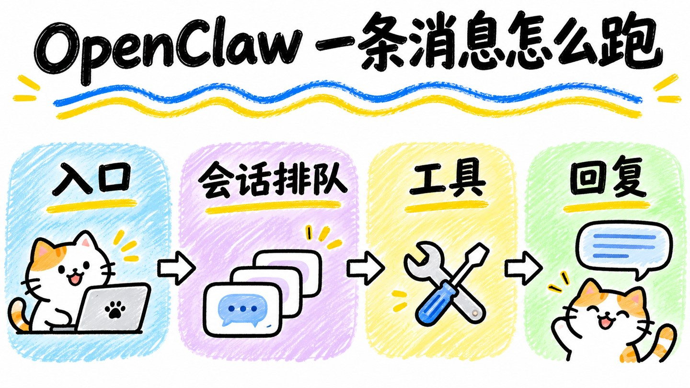

> **生成工具**：Codex\
> **生成模型**：gpt-6.2-sol

## 先用大白话理解

你去办事大厅交一张退款表。前台先确认是哪个窗口、要不要接着上一份工单。窗口里的人再查规则、拿计算器、把报告交回前台。OpenClaw 也分着做这些事。Gateway 是前台，Session 是工单夹，Agent Loop 是窗口里「问模型 → 按需要调用工具 → 把结果交回模型」的工作流程。

三行退款是 `4, NA, 6`。这次确认 `NA` 表示缺失，报告应该给有效条数 2、均值 5。为了看清错误究竟从哪来，固定回包接口在缺少纠正规则时让报告填零，输出三条、均值约 3.33。每轮都要由真实框架读取 CSV，固定接口只有收到工具结果才给最终答复。

## 1. Gateway 先找工单，工具半步之后才会发生

源码固定版本 `v2026.11.7`。Channel（渠道）是消息进来的地方，例如聊天应用或网页会话。Gateway 检查请求，再用路由规则选择 Agent 和会话键 `sessionKey`。可把它理解为一个逻辑地址。实际存储记录还有 `sessionId`。运行标识 `runId` 则标记这一次执行。如果你只拿到 `runId` 和已接收时间，表示前台收单，报告仍可能正在计算。

| 想查什么 | 源码入口和阅读问题 |
| --- | --- |
| 消息归到哪位 Agent | 从 `src/routing/resolve-route.ts` 的 `resolveAgentRoute` 看渠道、账户和对话等信息怎样形成会话键 |
| 谁接单、谁等待结果 | 从 `src/gateway/server-methods/agent.ts` 看 agent 与 agent.wait 的入口及可见性检查 |
| 谁执行一次任务 | 从标签内 `docs/concepts/agent-loop.md` 的 Run sequence 看 `agentCommand`、`runEmbeddedAgent` 和事件订阅的关系 |
| 工作区怎样进上下文 | 从 `src/agents/bootstrap-files.ts` 找 `resolveBootstrapFilesForRun`，再看 Agent 工作区、可注入文件与上下文预算 |

[路由源码](https://github.com/openclaw/openclaw/blob/v2026.11.7/src/routing/resolve-route.ts) · [Gateway 入口](https://github.com/openclaw/openclaw/blob/v2026.11.7/src/gateway/server-methods/agent.ts) · [固定版 Agent Loop](https://github.com/openclaw/openclaw/blob/v2026.11.7/docs/concepts/agent-loop.md) · [上下文装配](https://github.com/openclaw/openclaw/blob/v2026.11.7/src/agents/bootstrap-files.ts)

同一物理会话的写入先按会话串行，再受全局容量限制。两条不同会话无需等彼此的上一轮，仍可能共享全局容量、某个 Agent 的工作区或工具账户。排队顺序与数据隔离是两件事。多租户部署应分别核对身份范围、会话访问、工作目录和工具凭证。

## 2. 第一轮请求和第二轮请求装了什么

准备阶段会解析工作区、注入适用的上下文文件和技能快照。Skill 是一份给 Agent 用的操作说明，包含何时适用、该走哪些步骤。快照记录该次运行可发现的技能信息。是否把全文加载给模型，取决于具体加载路径。工具定义则描述可以请求的操作和参数，实际执行仍由运行时检查。

```text
用户请求 → 选择会话 → 组装上下文与工具定义
    → 固定接口请求 read → 内嵌运行器读取 CSV
    → 把 CSV 放回下一次请求 → 收到最终答案 → 结束本轮
```

这次用 `agent --local` 走真实内嵌循环，渠道接收、Gateway 事件转发和远端交付从源码对照。第一轮模型接口请求 `read`，第二轮看到 `refund\n4\nNA\n6` 才给报告。原生 `toolSummary` 记录一条成功读取。原始 Gateway 时序里，还能分别观察助手增量、工具事件和运行终止状态，接受任务或显示文本都不足以推断外部发送已经完成。

## 3. 用两个新会话分辨历史与工作区记忆

先在原会话纠正口径，紧接着用同一会话重问。然后开新会话，看看旧纠正是否仍出现。实验在临时工作区用外部夹具写入获准的 `MEMORY.md`；模型侧只请求读工具。再开新会话，检查规则是否进系统上下文。最后移除文件，用另一会话复查。这样能区分「模型在这次看到什么」和「谁修改了长期记录」。

同一会话重问时，接口请求里保留上一轮的用户纠正，报告仍是 2 条、均值 5。发布笔记前，另一个会话又得到 3 条、均值约 3.33。发布后的新会话没有原历史，但接口实际看到系统上下文中的口径，结果改为 2 条、均值 5。移除笔记后，再开的新会话中规则消失。这个顺序由固定端点记录，留档时只保留来源标识和结果。

实测配置的上下文窗口首次设得太小，框架在发出首个请求前就报告超出预算。扩大固定端点声明的窗口后，才进入真正的工具回合。这个现象值得保留：工具列表、引导文件和注入内容在短历史前就会占用上下文。排查时可先看系统上下文统计，再判断是不是历史太长。

实验只使用独立的临时状态目录，未连接聊天渠道或真实模型。对照入口见 [CASE-03](case-03-openclaw-hermes-comparison.md)。 [可复跑代码](experiments/framework-replay/replay.py) · [回包夹具](experiments/framework-replay/fixture_api.py) · [实际结果](experiments/framework-replay/openclaw-results.json)
