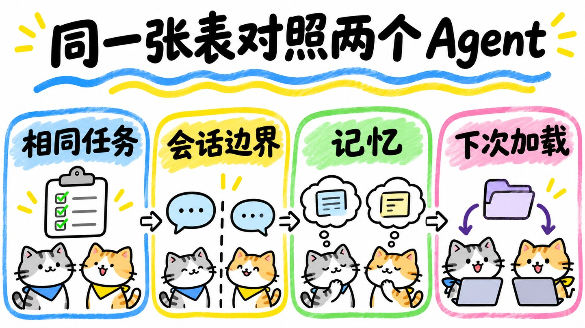

> **生成工具**：Codex\
> **生成模型**：gpt-6.2-sol

## 先用大白话理解

给两个办公室发同一张退款表。两边都得读表，都先收到一条临时纠正。过一会儿再来，你要问四件事：原工单能不能接着做，新工单会不会串上一个工单的内容，哪份小抄会被带进新工单，小抄是谁批准写上去的？

这次把「算对」和「为什么算对」都记下来。同一个固定端点只在看到纠正或批准的口径后，才按两条有效退款给出均值 5。当前任务仍由框架自己的读工具读取 CSV。这样即使两边最终数字一样，也能看到一边到底走过了哪个工具，规则是来自当前对话，还是来自系统上下文。

## 1. 公平对照先固定哪些条件

| 条件 | 怎样固定 |
| --- | --- |
| 输入 | 同一份合成 CSV，表头 refund，三行 `4, NA, 6` |
| 接口与回包 | 同一段回环 Chat Completions 夹具，同一模型标识 `refund-fixture` |
| 已执行的业务工具 | 只有读这份表。OpenClaw 调用 `read`，Hermes 调用 `read_file` |
| 状态目录 | OpenClaw 使用临时工作区和状态目录，Hermes 使用独立的临时 profile |
| 记录范围 | 记工具名、结果和两种口径来源布尔值，不保存原始系统提示与真实令牌 |

回环指进程通过本机地址与固定端点通信。夹具核对工具结果确实含表头及三条数据，再按纠正来源返回报告。模型接口名称相同，框架的辅助工具与系统提示仍各有区别。这里比较相同的业务读动作与状态变化，不把它解释为两套完整权限策略等价，也不测现实模型生成质量。

## 2. 六步回放怎样读

先跑旧规则，再在原会话提供纠正，接着用同一会话再问一遍，但不在当前消息重复纠正。然后依次测一条没有发布长期经验的新会话、一条获准写入后的新会话、另一条撤回经验后的新会话。

| 会话步骤 | 两边有效条数 | 两边均值 | 收到规则的位置 |
| --- | ---: | ---: | --- |
| 原会话首次计算 | 3 | 约 3.33 | 无 |
| 原会话当场纠正 | 2 | 5 | 当次用户内容 |
| 原会话下次提问 | 2 | 5 | 前一轮用户纠正 |
| 发布前的新会话 | 3 | 约 3.33 | 无 |
| 发布后的新会话 | 2 | 5 | 系统上下文中的已存笔记 |
| 移除笔记后的新会话 | 3 | 约 3.33 | 无 |

后两步很重要。发布后，新会话的历史不含纠正，但系统上下文有。移除后另开会话又看不到它，验证的是下一会话的读取路径。旧聊天记录里仍可能有这条纠正。清理共享笔记和清理旧聊天历史要分别审查。

## 3. 相同结果下面是怎样的入口

| 关注点 | OpenClaw `v2026.11.7` | Hermes `v0.23.3` |
| --- | --- | --- |
| 外部入口 | 源码有渠道、Gateway 与会话路由，本次实测内嵌 CLI | 源码有 CLI 与 Gateway，本次实测 `AIAgent` 执行循环 |
| 会话 | 支持明确会话标识，运行、会话与工作区的边界不同 | 会话记录按 profile 管，回放从原生会话库取历史再提交一轮 |
| 持久笔记 | 特定上下文可把工作区 `MEMORY.md` 纳入本轮 | 新会话装配 profile 的内置短记忆 |
| Skill | 源码可沿运行时准备找到技能快照和发现方式 | 实测技能创建待审、获准后可读、后续编辑被拒 |
| 写入批准 | 本实验用明确的外部确认步骤写入和删除工作区笔记 | 实验启用框架内置待审开关，调用同版命令处理审批 |

OpenClaw 这次的比较用了外部批准步骤，不据此推断产品在所有场景有或没有同类内置门槛。Hermes 的试验只覆盖受管入口，直接编辑文件与其他写入方式有各自的授权边界。要部署在多租户环境，先确认身份和任务的范围，再测会话分离、工具授权、导入技能、手工写入和撤回的不同路径。

## 4. 排查「它明明学过，怎么又算错」

先回看原生会话是否真的恢复。如果是新会话，接着从记录确认笔记是否已批准、是否落盘、是否在当前作用域被加载。最后看工具结果有没有回到模型接口。只看最后一句回复容易把这几层混在一起。

可以把本实验的输出当作调试模板。一次记录运行入口、同一次调用的工具和结果、规则是在历史还是系统上下文、该动作的批准来自哪里。对于真实服务，还应区分模型返回文本、框架完成状态和外部消息交付回执。本组以固定规则完成确定性对照，没有测渠道并发、真实模型推理效果或跨租户安全隔离。 [复跑与范围](experiments/framework-replay/README.md) · [OpenClaw 结果](experiments/framework-replay/openclaw-results.json) · [Hermes 结果](experiments/framework-replay/hermes-results.json)
