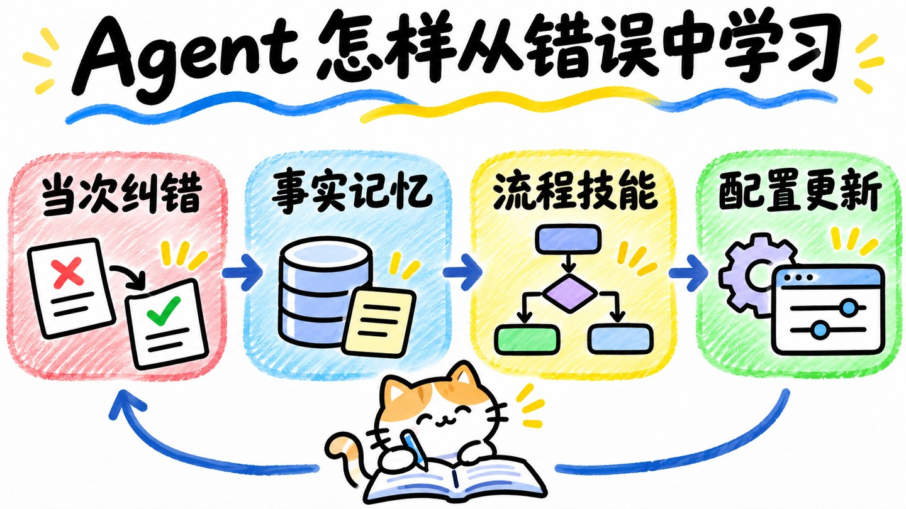

> **生成工具**：Codex\
> **生成模型**：gpt-6.2-sol

## 先用大白话理解

小李算错了一张报表。主管走过来，说「空着的行别算进去」。小李把这张表重新算对了。这算学会了吗？要再给他一张新表，看他能不能把办法用上。要判断他应该记什么，还得再问一句：这条规定属于眼前这张表、本部门某种格式，还是所有报表？

Agent（能围绕任务多步执行的助手）的「自进化」也有这个区别。它可以把错误原因写在当前任务纸上，把某条业务事实记到下次，把成熟流程编成技能，或把已审核的程序设置换成新版本。前面这些例子都可以在底层模型固定时实现。

## 1. 把出错过程摊开

财务上传的 CSV（逗号分隔值文件）金额依次是 `4, NA, 6`。这里的 `NA` 表示金额缺失，真实的 `0` 则是一笔金额为零的记录。助手把缺失条目补成 0 后得出三条有效记录，均值约 `(4 + 0 + 6) / 3 = 3.33`。用户确认规则后重算，有效条目是 4 和 6，均值 `(4 + 6) / 2 = 5`。

| 实验情形 | 有效条数 | 均值 | 这次改变了什么 |
| --- | ---: | ---: | --- |
| 旧版首次执行 | 3 | 约 3.33 | 使用旧默认规则 |
| 同会话按用户指示重试 | 2 | 5 | 当前执行携带临时覆盖规则 |
| 换会话，仍使用旧版 | 3 | 约 3.33 | 上次的覆盖没有跨会话加载 |
| 换会话，加载已审阅的新版 | 2 | 5 | 应用按部门和文件模式选中新版规则 |

这组结果来自纯 Python 的确定性回放。上一轮轨迹可帮执行器找出重试原因，但一次重试成功只说明当前输入得到正确结果。跨会话是否改变，取决于有没有写入、激活和再次加载的链路。 [实验结果](experiments/agent-evolution/feedback-results.json)

## 2. 四种改进写到不同的地方

| 做法 | 记录什么 | 什么时候读取 | 如何验证 |
| --- | --- | --- | --- |
| 当次纠错与轨迹反思 | 当前任务失败阶段、观察结果、下一次重试计划 | 同一执行循环，或框架明确安排的反思回合 | 重试先前失败步骤并比对报告 |
| 事实记忆 | 财务 `refund-v2` 格式里的 `NA` 是未登记金额，附来源及版本 | 以后识别到同一租户和相同文件模式 | 新会话是否正确召回，换组织是否不召回 |
| 流程知识或 Skill | 先找数据字典，再区分缺失和真零，再检查报告条数与均值 | Agent 处理同类任务时加载说明与检查步骤 | 检查缺值、全空、真零等新样本 |
| 应用配置调整 | 哪类输入要路由到新版统计器，提示词、配置和发布版本 | 任务在入口按租户和格式匹配时 | 同一留出集做旧版与候选版对照，并保留回滚版本 |

Skill 可以理解成可复用的操作手册。Prompt 是给模型的任务说明。只改其中一个时也要写清实验变量，否则下一次出现回归，会分不清是记忆变了、提示变了还是程序变了。Reflexion 论文讨论了通过语言反馈与情节记忆改善后续回合的方式。Hermes 的项目文档给出了持久记忆与技能各自的产品入口。这里的回放用配置演示整个过程。 [Reflexion 原论文](https://arxiv.org/abs/2303.11366) · [Hermes Memory](https://hermes-agent.nousresearch.com/docs/user-guide/features/memory) · [Hermes Skills](https://hermes-agent.nousresearch.com/docs/user-guide/features/skills)

## 3. 事实的适用范围要随事实一起保存

财务新版的记录应写成「某团队、某文件格式、某版本、某来源」，而不是一句「NA 永远不算」。实验里，旧格式明确规定要把缺失标记计为零，另一租户也采用它自己的规则。把新版记忆加载到那里，会把两份原本正确的报告改错。再设一个真实金额 0 的样本，即使采用跳过缺失规则，也必须保留这条记录。

可以把反思、记忆和技能依次问成三个问题。现在为什么算错？下次遇到同一格式要记住什么？以后换到一个新团队时，该怎样查到它自己的规则？这三个问题会产出不同的结果，也各有不同的失效方式。

递归自我改进（Recursive Self-Improvement，RSI）的「递归」指改进进入下一轮，而且下一轮再用这个变动过的系统产生反馈。本次演示只激活预先给定的规则版本。训练参数的反馈如何进入下一轮，见 [EVO-03](evo-03-model-feedback-training.md)。如何审阅和发布经验，见 [EVO-02](evo-02-auditable-experience.md)。

## 4. 下次怎样找到这条经验

设下一次请求的可信元数据是 `finance/refund-v2`。先匹配租户和文件模式，再从匹配结果里选当前获准版本，最后把经验的规则或说明交给处理器。若租户是 `support`，即使文件列名一样，也得先查该组织的数据字典。审批者还可以停用旧经验。检索命中不表示应该永远使用，仍要核对版本、生效日期和来源。

有时两条事实都匹配，但内容冲突。例如技术说明说「新版跳过空值」，财务公告说「这次补录请按零处理」。对一次性的例外，可以记在当前会话的任务状态里，并明确是哪一批报表。规则记录本身保留长期通用的范围。这样可以兼容业务例外，又不会让临时要求变成下一次的默认口径。

复盘时给每次改动留一个标识。只移除会话反思文本再重跑，能比较反思是否有帮助。保持同一模型与任务，只换活跃配置，才能解释两次报告的差异。最后再用此前没见过的同类输入测迁移效果。 [本篇回放代码](experiments/agent-evolution/feedback_lab.py)
