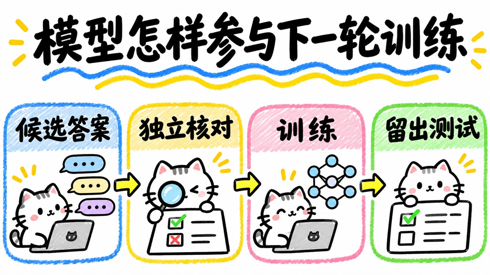

> **生成工具**：Codex\
> **生成模型**：gpt-6.2-sol

## 先用大白话理解

学生做了一批题，再把有用的解法放进下周练习册。改练习册和下周重新学习，是两件事。模型也可以参与编练习册，例如写多份解法、给答案打分，然后把筛选后的材料送进训练。只给它一句更好的指令，变化发生在本次输入。训练则会调整模型权重，也就是模型内部的大量数值参数。

先抓住两条线。一条是数据怎么来：谁生成候选、怎么确定能否用。另一条是系统哪里变：写了一个提示、换了一个配置，还是实际更新了权重。下面两篇论文都涉及权重训练，但提供训练信号的方式不同。

## 1. STaR 用已知答案筛选解释

STaR 是 Self-Taught Reasoner（自教推理器）。给一批已有正确答案、缺少解题过程的问题，让模型先尝试生成解释和答案。答案能匹配标准的解释可进入训练材料。答错的问题可把正确答案作为提示，再请模型写一份解释。将最后获得并筛过的解释用于微调，再用更新的模型重复。这种根据正确答案补写解释的路径会帮助收集数据，同时要求注意解释本身是否可靠。最终答案对上，只验证了答案这一项。 [STaR 原论文](https://arxiv.org/abs/2203.14465)

拿退款题手算一轮。三行 `4, NA, 6`，要求计有效条数与平均值。候选 A 把缺失填成 0，交 `(3, 10/3)`。候选 B 按定义排除缺失，交 `(2, 5)`。独立标准答案是 `(2, 5)`。应该同时核对两个字段，因为遇到 `0, NA, 0`，错误做法也可能得到均值 0，只是条数错了。解释还应保留为什么真零与缺失不同这一条理由。

## 2. Self-Rewarding 用语言模型评价候选

Self-Rewarding Language Models 的训练流程用语言模型按评分提示评判候选回答，得到偏好数据，然后迭代做 DPO（Direct Preference Optimization，直接偏好优化）。读者可以把偏好数据理解为对同一问题写下「这一答复优于另一答复」，训练再让模型更偏向获选回答。随后下一版模型参与新的回答与评价。文章还评估了模型判断质量的变化。 [Self-Rewarding Language Models 原论文](https://arxiv.org/abs/2401.10020)

这种反馈可能随轮次放大。假如裁判偏爱长答案，写得很完整但均值算错的候选就可能战胜短而正确的答案。实验用简单的词数代理模拟这种偏差，规则选了 12 词的错误候选，独立算术标准选了 4 词的正确候选。真实裁判可以用盲评、答案顺序互换、人工标注和任务可执行测试来检查这类偏差。 [裁判校准](le-03-llm-judge-calibration.md) · [合成训练数据](trn-12-synthetic-training-data.md)

## 3. 两轮教学实验看收益能不能延续

固定四道留出题，两道含缺失但有有效金额，一道全空，一道全部是数字。训练用的例子和留出题的具体行不同。实验只用一张按类别计数的规则票表：当候选通过算术标准时，给该类规则记一票。下一轮按已记的规则选择。它用来演示训练数据、更新状态和独立评测的关系，没有训练语言模型。

| 状态 | 留出正确数 | 新学到的行为 |
| --- | ---: | --- |
| 初始 | 1/4 | 全数字题原本就正确 |
| 一轮后 | 3/4 | 学会含缺失的混合表，仍不处理全空 |
| 两轮后 | 4/4 | 全空表返回条数 0、均值为空 |

如果只看训练里的那一题，第一轮时已看起来成功。固定留出集能看到新题仍有失败，原本正确的数字题也要继续测。真正训练还应记录版本、数据来源、样本是否重复、训练计算量和既有能力分数。训练器改变权重的更多背景见 [PPO 与 GRPO](trn-08-ppo-grpo.md)。运行 `python3 experiments/agent-evolution/iteration_lab.py` 查看这组输出。 [实测记录](experiments/agent-evolution/iteration-results.json)

## 4. 给每一轮记两张成绩单

第一张记录「材料有没有变好」。例如这一轮生成了多少候选、多少被独立判分验收、多少候选过度重复。如果两条候选只是句式不同、推理过程完全一样，重复计数会夸大数据变化。还要按题型看留存率，避免筛选后只剩最容易的问题。

第二张记录「训练结果有没有变好」。先固定同一份留出集，用原版和新版分别计算正确率，再检查旧的数字题、跨范围任务和拒答能力是否回归。最终决定时保留错误样本和裁判分歧。对于自动裁判挑出的新答案，可以抽样人工盲审，同时把可用的算术验证、单元测试和业务规则设为独立门槛。

这组实验的「轮」由新增训练样本和更新后的计数表定义。第一轮只加入混合表，再执行下一轮时才加入全空表。因此得到 1/4、3/4、4/4，说明这批例子的覆盖如何扩展。结果不能推出轮次一直增加便会一直变好。后续训练有训练成本，数据和裁判都有可能漂移；停训条件应该与外部验收一同设定。
